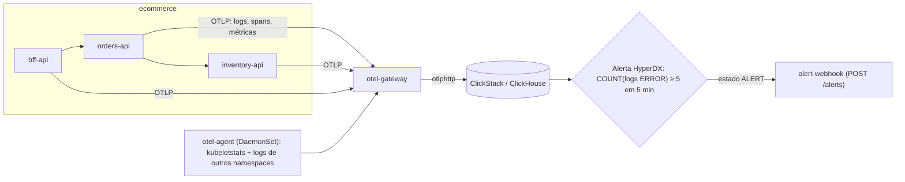
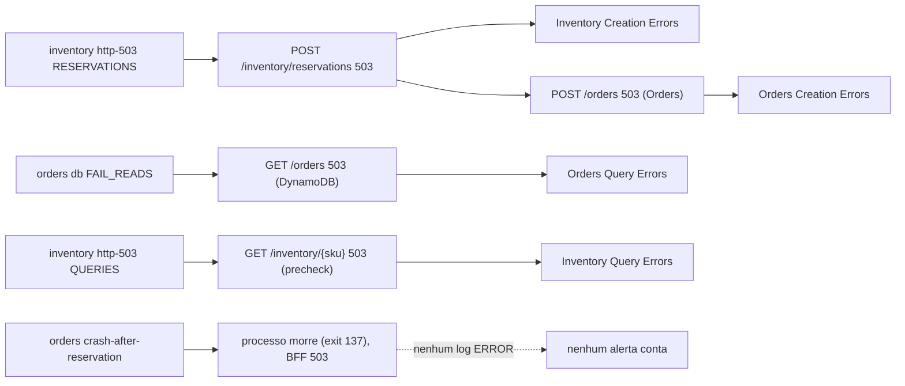
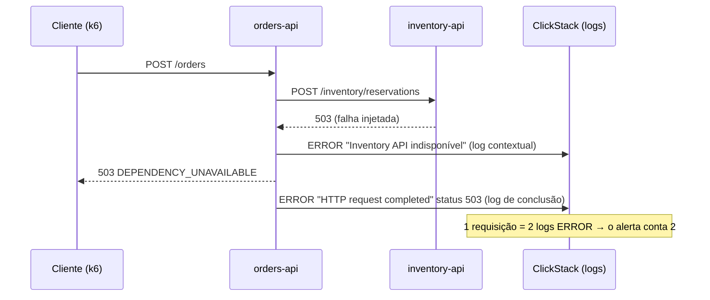
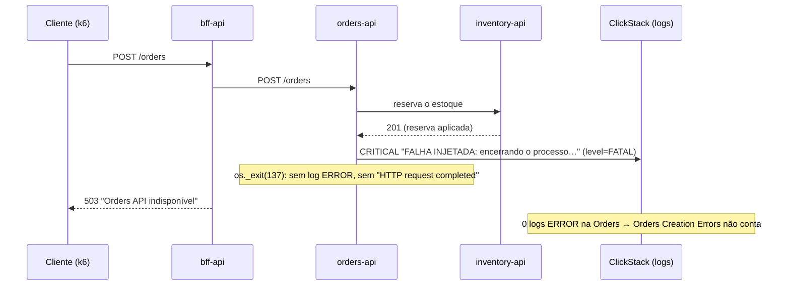

# LAB X1 — ClickStack Alerting (anti-pattern intencional)

> **Break it → Observe it → Understand it → Fix it → Validate it**
>
> Duração estimada: 40 min

---

## 1. Cenário

O time precisa ser avisado quando pedidos ou consultas de estoque falham. A solução mais rápida foi criar, no
HyperDX, **quatro alertas que contam logs `ERROR`** por serviço e rota. Eles disparam — mas o número que mostram
**não é** o número de requisições com erro, e há falhas que eles simplesmente não enxergam.

Caminho de um log até a notificação:



O alerta só enxerga o que chega como **linha de log com `level=ERROR`**: tudo o que muda a quantidade de linhas muda o
alerta, mesmo sem mudar o impacto no cliente.

## 2. Hipótese

1. Os quatro alertas disparam quando provocamos falhas (≥ 5 logs ERROR em 5 min).
2. `COUNT(logs ERROR)` **superestima** as falhas quando uma requisição gera mais de um log ERROR (log contextual +
   log de conclusão) e **subestima** quando a falha não gera log ERROR (ex.: crash do processo).
3. Spans HTTP SERVER e métricas HTTP não amostradas, por rota e status, medem as falhas corretamente.

## 3. Pré-requisitos

- LAB 01 concluído; `scripts/reset.sh` executado.
- Alertas criados pelo `scripts/setup.sh` (`observability/alerts/create_alerts.py`). Para recriar/atualizar:

```bash
source scripts/lib/common.sh && source scripts/lib/hyperdx-port-forward.sh && start_hyperdx_port_forward
python3 observability/alerts/create_alerts.py --app-url http://localhost:3000 --api-url http://localhost:8000 \
  --creds .workshop/hyperdx-credentials.json \
  --webhook-url http://alert-webhook.observability.svc.cluster.local:8080/alerts
stop_hyperdx_port_forward
```

- HyperDX: `kubectl -n observability port-forward svc/clickstack-app 3000:3000` → <http://localhost:3000>
  (usuário/senha em `.workshop/hyperdx-credentials.json`).

## 4. Estado inicial

```bash
scripts/fault.sh inventory status        # NONE
scripts/fault.sh orders status           # db_fault_mode NONE
kubectl -n observability get deploy alert-webhook
kubectl -n observability exec deploy/alert-webhook -- python -c "import urllib.request;print(urllib.request.urlopen('http://127.0.0.1:8080/alerts').read().decode())"
```

Na UI do HyperDX → **Alerts**: os quatro alertas existem, estado `OK` (ou sem dados).

| Alert | Service | Route | Threshold |
|---|---|---|---|
| Orders Creation Errors | orders-api | `POST /orders` | ≥ 5 ERROR logs / 5 min |
| Orders Query Errors | orders-api | `GET /orders` e `GET /orders/{order_id}` | ≥ 5 ERROR logs / 5 min |
| Inventory Creation Errors | inventory-api | `POST /inventory/reservations` | ≥ 5 ERROR logs / 5 min |
| Inventory Query Errors | inventory-api | `GET /inventory/{sku}` | ≥ 5 ERROR logs / 5 min |

Filtros (Lucene, source **Logs**) — veja `observability/alerts/create_alerts.py`:

```text
Orders Creation Errors:
ServiceName:"orders-api" LogAttributes.http.route:"/orders" LogAttributes.http.request.method:"POST" LogAttributes.level:"ERROR" LogAttributes.http.response.status_code:>499

Orders Query Errors:
ServiceName:"orders-api" (LogAttributes.http.route:"/orders" OR LogAttributes.http.route:"/orders/{order_id}") LogAttributes.http.request.method:"GET" LogAttributes.level:"ERROR" LogAttributes.http.response.status_code:>499

Inventory Creation Errors:
ServiceName:"inventory-api" LogAttributes.http.route:"/inventory/reservations" LogAttributes.http.request.method:"POST" LogAttributes.level:"ERROR" LogAttributes.http.response.status_code:>499

Inventory Query Errors:
ServiceName:"inventory-api" LogAttributes.http.route:"/inventory/{sku}" LogAttributes.http.request.method:"GET" LogAttributes.level:"ERROR" LogAttributes.http.response.status_code:>499
```

> `LogAttributes.level` é emitido pelas APIs. O ClickStack normaliza `SeverityText` para minúsculas (`error`), por isso
> o filtro usa o atributo próprio. O timestamp é aplicado pela janela do alerta (5 min).

Cada definição de alerta no código carrega o comentário obrigatório:

```text
# ============================================================
# ERRO DE IMPLEMENTAÇÃO INTENCIONAL — OBSERVABILITY ANTI-PATTERN
#
# Este alerta utiliza COUNT(logs) para contabilizar falhas HTTP.
#
# Essa abordagem é conceitualmente incorreta como medida exata
# de requisições com erro, pois uma única requisição pode gerar
# múltiplos logs, enquanto outra pode falhar sem registrar ERROR.
#
# IMPLEMENTAÇÃO RECOMENDADA:
# Utilizar métricas HTTP não amostradas ou agregações adequadas
# de spans HTTP SERVER por rota e status.
#
# Este anti-pattern é intencional e será corrigido na fase 2.
# ============================================================
```

## 5. Comandos executáveis

Qual falha alimenta qual alerta:



| Passo | Cenário | Ação | Comportamento esperado | Como verificar |
|---|---|---|---|---|
| 5.1 | Reserva de estoque falha | `fault.sh inventory http-503 RESERVATIONS` + k6 3 min | precheck `GET` ok; `POST /inventory/reservations` → 503; `POST /orders` → 503 | alertas *Inventory Creation Errors* e *Orders Creation Errors* em `ALERT` (5.4) |
| 5.2 | Leituras do DynamoDB falham | `fault.sh orders db FAIL_READS` + k6 com `EXPECT_ERRORS=false` | `GET /orders` → 503; o k6 **falha** o threshold (esperado) | alerta *Orders Query Errors* em `ALERT` |
| 5.3 | Precheck de estoque falha | `fault.sh inventory http-503 QUERIES` + k6 3 min | `GET /inventory/{sku}` → 503; a Orders recusa o pedido antes de reservar | alerta *Inventory Query Errors* em `ALERT` |
| 5.4 | Notificação | aguardar 1–2 min após o tráfego | alertas avaliados a cada ~1 min sobre janelas de 5 min; o webhook recebe o payload | `logs deploy/alert-webhook \| grep "ALERTA RECEBIDO"`; UI → **Alerts** |
| 5.5 | Medir o anti-pattern | `compare-counts.sh 15` | (a) `COUNT(logs ERROR)` ≈ **2 ×** (b) requisições distintas = (c) spans 5xx | saída do script, por serviço/rota |
| 5.6 | Falha sem log ERROR | `fault.sh orders crash-after-reservation` + k6 sem retry | réplicas reiniciam (exit 137); BFF responde 503; *Orders Creation Errors* **não** conta | `RESTARTS > 0`, `exit=137`; consulta (e) do `compare-counts.sh` > 0 |

### 5.1 Disparar os alertas de criação (Orders + Inventory)

```bash
scripts/fault.sh inventory http-503 RESERVATIONS     # precheck GET ok, reserva sempre 503
scripts/k6.sh inventory-errors.js RATE=4 DURATION=3m
```

Gera: `POST /inventory/reservations` 503 (Inventory Creation Errors) e `POST /orders` 503 (Orders Creation Errors).

> **💡 O que você deveria ter notado (5.1)**
>
> - **Uma** falha (reserva `503` na Inventory) acendeu **dois** alertas: *Inventory Creation Errors* e *Orders Creation
>   Errors* — o mesmo problema contado em dois serviços.
> - O precheck `GET /inventory/{sku}` continuou ok: só a rota de criação falhou.
>
> **Lição:** um alerta por serviço/rota multiplica o mesmo incidente; quem recebe precisa correlacionar sozinho.

### 5.2 Disparar o alerta de consulta da Orders

```bash
scripts/fault.sh inventory reset
scripts/fault.sh orders db FAIL_READS                 # GetItem/Query falham => GET /orders 503
scripts/k6.sh inventory-errors.js RATE=4 DURATION=3m EXPECT_ERRORS=false
```

O `inventory-errors.js` também chama `GET /orders?customer_id=…` a cada iteração. Com `EXPECT_ERRORS=false` o
threshold do k6 exige `http_req_failed < 5%` e vai **falhar** — é esperado: o objetivo aqui é gerar erros de
consulta. (Alternativamente use `scripts/k6.sh get-orders.js` **antes** de injetar a falha: o `setup` cria pedidos.)

> **💡 O que você deveria ter notado (5.2)**
>
> - Com `FAIL_READS`, o `GET /orders` passou a responder `503` e o alerta *Orders Query Errors* entrou em `ALERT`.
> - O k6 terminou com o threshold `http_req_failed < 5%` **violado**: esperado, o objetivo era gerar erros.
>
> **Lição:** o alerta enxerga a falha de leitura, mas só como contagem de linhas de log — sem taxa nem denominador.

### 5.3 Disparar o alerta de consulta da Inventory

```bash
scripts/fault.sh orders reset
scripts/fault.sh inventory http-503 QUERIES          # falha o precheck GET /inventory/{sku} da Orders
scripts/k6.sh inventory-errors.js RATE=4 DURATION=3m
```

> **💡 O que você deveria ter notado (5.3)**
>
> - O precheck `GET /inventory/{sku}` falhando acendeu *Inventory Query Errors*.
> - Como o precheck falha **antes** da reserva, os pedidos também voltaram `503` — mas o alerta é de **consulta**:
>   o nome do alerta não diz qual fluxo de negócio parou.
>
> **Lição:** alertas por rota técnica não descrevem o impacto no usuário (pedidos não criados).

### 5.4 Verificar os alertas e o webhook

Os alertas são avaliados a cada ~1 minuto sobre janelas de 5 minutos. Aguarde 1–2 min após o tráfego.

```bash
kubectl -n observability logs deploy/alert-webhook --since=15m | grep "ALERTA RECEBIDO"
kubectl -n observability exec deploy/alert-webhook -- python -c "import urllib.request;print(urllib.request.urlopen('http://127.0.0.1:8080/alerts').read().decode())"
```

Payload recebido (campos definidos em `WEBHOOK_BODY`): `alert`, `state` (`ALERT`/`OK`), `status` (`firing`/`resolved`),
`value` (contagem de logs na janela), `threshold`, `startTime`, `endTime`, `link` (search no HyperDX), `body` (amostra
das linhas), `alertId`.

Na UI: **Alerts** → estado `ALERT`; clique no alerta → saved search com as linhas que foram contadas.

> **💡 O que você deveria ter notado (5.4)**
>
> - Os quatro alertas em `ALERT` na UI e as notificações no `alert-webhook` (`ALERTA RECEBIDO` nos logs).
> - No payload, `value` é a **contagem de logs na janela** (5 min), comparada ao `threshold` (≥ 5).
> - O alerta só reage depois da avaliação (~1 min) sobre uma janela de 5 min: há atraso entre a falha e a notificação.
>
> **Lição:** o número que chega no alerta é "linhas de log", não "requisições com erro".

### 5.5 Medir o anti-pattern

```bash
scripts/fault.sh all reset
labs/.extras/lab-x1/compare-counts.sh 15
```

O script consulta o ClickHouse do ClickStack e mostra, por serviço/rota, na janela de 15 min:

- **(a)** `COUNT(logs ERROR)` — o que os alertas usam;
- **(b)** `uniqExact(request_id)` dos logs ERROR — requisições distintas;
- **(c)** spans `SpanKind='Server'` com `http.response.status_code >= 500`;
- **(d)** métrica `http.server.request.duration` (contagem de 5xx por método/rota/status);
- **(e)** requisições 5xx na BFF sem nenhum log ERROR na Orders API.

Por que (a) sai maior que (b) e (c) — uma requisição, duas linhas contadas:



Evidência da validação local do workshop:

```text
== (a) COUNT(logs ERROR)                 orders-api  POST  /orders   678
== (b) requisições distintas             orders-api  POST  /orders   339
== (c) spans HTTP SERVER 5xx             orders-api  POST /orders    339
```

> **💡 O que você deveria ter notado (5.5)**
>
> - **(a)** `COUNT(logs ERROR)` = **678**, mas **(b)** requisições distintas = **339** e **(c)** spans 5xx = **339**:
>   (a) ≈ 2 × (b) = (c).
> - Cada requisição que falha gera 2 logs ERROR (contextual + `HTTP request completed`): o alerta conta o **dobro**.
> - (b), (c) e (d) concordam entre si: eles medem requisições, não linhas.
>
> **Lição:** `COUNT(logs)` **superestima** — e o fator muda quando alguém adiciona ou remove um `log.error`.

### 5.6 Falha SEM log ERROR

O caso oposto — uma falha real que o alerta não vê:



```bash
scripts/fault.sh orders crash-after-reservation       # vale para TODAS as réplicas em execução
scripts/k6.sh create-orders.js RATE=2 DURATION=1m RETRY_ON_ERROR=false
kubectl -n ecommerce get pods -l app.kubernetes.io/name=orders-api    # RESTARTS > 0
kubectl -n ecommerce get pod -l app.kubernetes.io/name=orders-api \
  -o jsonpath='{range .items[*]}{.metadata.name}{" exit="}{.status.containerStatuses[0].lastState.terminated.exitCode}{"\n"}{end}'
labs/.extras/lab-x1/compare-counts.sh 10
```

Cada réplica morre (`os._exit(137)`) na primeira requisição após reservar o estoque e reinicia com as falhas
desligadas. O único log é `FALHA INJETADA: encerrando o processo…` com nível **CRITICAL** (atributo
`level=FATAL`) — **não** há log `HTTP request completed` nem log `ERROR`. A BFF responde `503`
(`Orders API indisponível`), o alerta *Orders Creation Errors* **não conta** essa falha, e a consulta **(e)** fica > 0.
Se o cliente repetir com a mesma `Idempotency-Key`, recebe `409 ORDER_IN_PROGRESS` até o lease (10 s) expirar e
depois o pedido é recuperado (`orders.idempotency.recovery`), sem duplicar a reserva (aqui o k6 roda com
`RETRY_ON_ERROR=false`, então esses registros ficam `IN_PROGRESS` — recuperáveis, conforme o contrato).

> **💡 O que você deveria ter notado (5.6)**
>
> - `RESTARTS > 0` e `exit=137` nas réplicas da Orders: o processo morreu depois de reservar o estoque.
> - Nenhum log `ERROR` nem `HTTP request completed` da Orders para essas requisições — só um `CRITICAL`
>   (`level=FATAL`) "FALHA INJETADA: encerrando o processo…".
> - A BFF respondeu `503` ("Orders API indisponível"), mas *Orders Creation Errors* **não contou**; a consulta
>   **(e)** do `compare-counts.sh` ficou **> 0**.
>
> **Lição:** `COUNT(logs)` também **subestima**: a falha mais grave (crash) é justamente a que não deixa log ERROR.

## 6. Falha provocada

| Alerta | Falha | Comando |
|---|---|---|
| Orders Creation Errors | reserva falha → Orders 503 | `fault.sh inventory http-503 RESERVATIONS` |
| Inventory Creation Errors | reserva 503 na Inventory | `fault.sh inventory http-503 RESERVATIONS` |
| Orders Query Errors | leituras DynamoDB falham | `fault.sh orders db FAIL_READS` |
| Inventory Query Errors | `GET /inventory/{sku}` 503 (precheck) | `fault.sh inventory http-503 QUERIES` |
| *(falha invisível)* | crash do processo | `fault.sh orders crash-after-reservation` |

## 7. Observações

**Logs** — uma requisição que falha gera, na mesma `request_id`, **dois** logs ERROR:

| Serviço | Log contextual (ERROR, `http.response.status_code=503`) | Log de conclusão |
|---|---|---|
| orders-api `POST /orders` | `Inventory API indisponível` | `HTTP request completed` |
| orders-api `GET /orders` | `DynamoDB indisponível ao listar pedidos` | `HTTP request completed` |
| inventory-api | `Falha injetada: respondendo HTTP 503` | `HTTP request completed` |

Já o limite de concorrência da Inventory (`TOO_MANY_CONCURRENT_REQUESTS`) gera só **um** — a razão logs/requisições
varia conforme o **caminho do código**, não conforme o impacto no usuário.

Busque no HyperDX (source Logs) e abra o trace a partir de um log:

```text
ServiceName:"orders-api" LogAttributes.level:"ERROR" LogAttributes.http.route:"/orders"
```

**Correlação com o negócio** — os logs carregam `request_id`, `trace_id`, `span_id`, `idempotency.key`, `order.id`,
`idempotency.status`, `idempotency.attempts`, `reservation.state`, `dependency.reason`. Todas as tentativas de um mesmo
pedido podem ser agrupadas por `idempotency.key`:

```text
ServiceName:"orders-api" LogAttributes.idempotency.key:"<chave>"
```

**Métricas de negócio** (source Metrics): `orders.failed` por `reason` (`inventory_http_503`, `inventory_circuit_open`,
`dynamodb_unavailable`, …), `orders.created`, `inventory.reservations.failed` por `reason`, `inventory.faults.injected`
por `fault.type`.

## 8. Explicação técnica

`COUNT(logs)` mede **quantas linhas** o código escreveu, não **quantas requisições** falharam:

- **Superestimação** — log contextual + log de conclusão + eventual stack trace = N logs por requisição.
  O fator muda quando alguém adiciona/remove um `log.error`, sem nenhuma mudança no impacto ao cliente.
- **Subestimação** — falhas sem log ERROR: crash/OOMKilled do processo, timeout no cliente (BFF 504) enquanto a Orders
  conclui com 201, perda de logs no pipeline (fila do exporter cheia), nível errado (`CRITICAL`/`WARN`).
- **Sem denominador** — "≥ 5 logs" não diz se isso é 5 de 10 ou 5 de 100 000 requisições. Alertas devem olhar
  **taxa de erro** (e, idealmente, consumo de error budget — fase 2).
- **Custo/cardinalidade** — logs são amostrados, filtrados ou descartados em produção; métricas HTTP não.

**Implementação recomendada (fase 2, não implementada no MVP):**

- Métrica `http.server.request.duration` (histograma OTel, não amostrada) agregada por `service.name`,
  `http.request.method`, `http.route`, `http.response.status_code`: `rate(5xx) / rate(total)`.
- Ou spans `SpanKind=Server` agregados por rota/status — **desde que** o sampling seja 100% ou a amostragem seja
  compensada (o MVP usa 100%).
- Alertar em **taxa** (ex.: > 5% em 5 min com mínimo de tráfego) em vez de contagem absoluta.

## 9. Correção

No MVP a correção é **demonstrada**, não implementada: execute `labs/.extras/lab-x1/compare-counts.sh` e mostre que (c) e (d)
batem com o número real de requisições com erro (k6 `http_req_failed`), enquanto (a) não. A troca dos alertas para
métricas/spans HTTP é escopo da **fase 2**.

```bash
scripts/fault.sh all reset
```

## 10. Validação

| Verificação | Comportamento esperado | Como verificar |
|---|---|---|
| Os quatro alertas dispararam | o webhook registrou `Inventory Creation Errors`, `Inventory Query Errors`, `Orders Creation Errors` e `Orders Query Errors` | comando Python abaixo (lista os nomes recebidos) |
| Superestimação medida | (a) ≈ 2 × (b) nas rotas com log contextual; (b) = (c) | `compare-counts.sh 30` |
| Subestimação medida | consulta (e) > 0 após a 5.6 | `compare-counts.sh 30` |
| Falhas removidas | alertas voltam a `OK` quando a janela de 5 min deixa de ter ≥ 5 logs | UI → **Alerts**; webhook recebe `resolved`, se habilitado |

```bash
kubectl -n observability exec deploy/alert-webhook -- python -c "
import json, urllib.request
d = json.load(urllib.request.urlopen('http://127.0.0.1:8080/alerts'))
print(sorted({a['payload'].get('alert', '').replace('🚨 ', '') for a in d['alerts']}))"
# ['Inventory Creation Errors', 'Inventory Query Errors', 'Orders Creation Errors', 'Orders Query Errors']
labs/.extras/lab-x1/compare-counts.sh 30
```

Após remover as falhas, os alertas voltam a `OK` na UI quando a janela de 5 min deixa de ter ≥ 5 logs
(o webhook recebe notificações `resolved`, se habilitadas para o alerta).

## 11. Challenge

1. Explique por que `uniqExact(request_id)` (b) bate com os spans (c), mas também não é a métrica ideal para alertar.
2. Provoque `504` na BFF com sucesso na Orders: `scripts/fault.sh bff timeout 200` + `scripts/fault.sh orders cpu-work 400`.
   Quais alertas disparam? O cliente percebeu falha? O pedido foi criado? (Dica: retry com a mesma chave → replay.)
3. Escreva (sem aplicar) a query SQL de **taxa** de erro 5xx de `POST /orders` a partir de `otel_metrics_histogram`.
4. Qual seria o efeito de um sampling de traces de 10% sobre a consulta (c)?

## 12. Critérios de sucesso

- [ ] Os quatro alertas entraram em `ALERT` e o webhook registrou as quatro notificações.
- [ ] `compare-counts.sh` mostrou (a) ≈ 2 × (b) = (c) para as rotas com log contextual.
- [ ] Falha por crash demonstrada sem log ERROR correspondente (consulta (e) > 0).
- [ ] Um erro foi correlacionado de ponta a ponta (log → `trace_id` → trace → `idempotency.key` → `order.id`).
- [ ] O aluno explica o anti-pattern e a correção da fase 2.

## 13. Reset

```bash
scripts/fault.sh all reset
scripts/reset.sh
```

Os alertas e o webhook permanecem configurados (fazem parte da infraestrutura do workshop). O receptor guarda os
últimos 200 payloads em memória; para zerá-lo: `kubectl -n observability rollout restart deploy/alert-webhook`.
