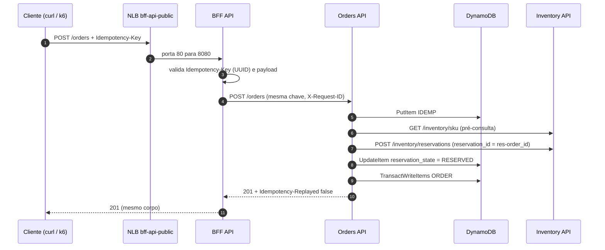
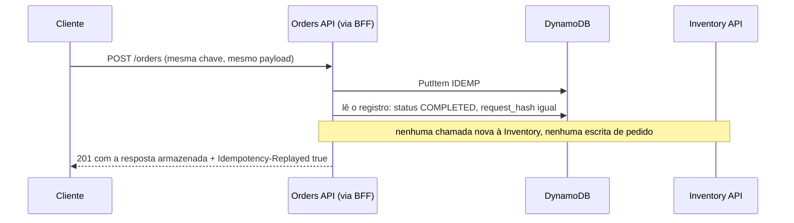
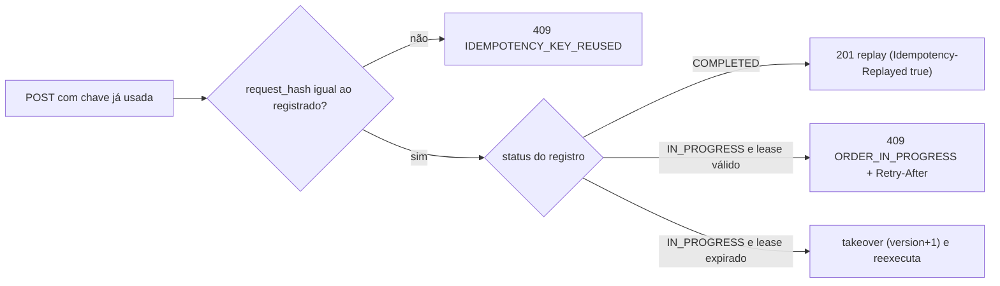
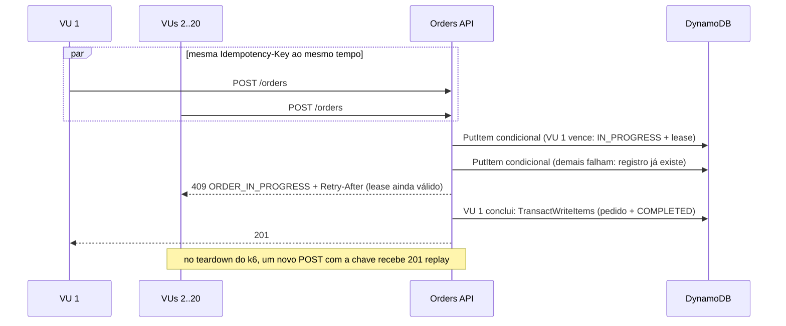
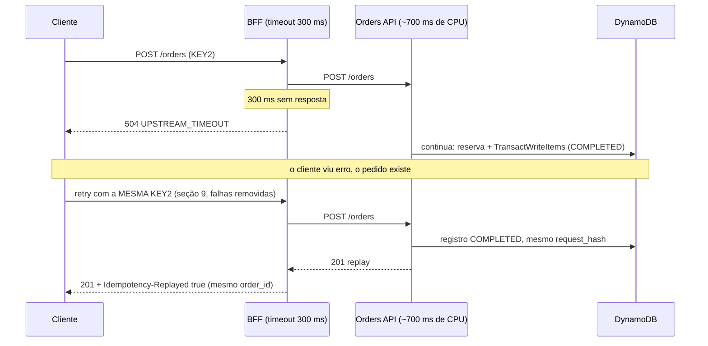

# LAB 01 — First Successful Order

> **Break it → Observe it → Understand it → Fix it → Validate it**
>
> Duração estimada: ~35 min até a 5.10 (roteiro do lab) + 15–25 min opcionais (seções 6–12). Não inclui os ~25 min de `setup.sh`, que o instrutor pode executar antes.

---

## 1. Cenário

A loja vai abrir. Antes de qualquer teste de caos, precisamos provar que o **caminho feliz** funciona de ponta a ponta:

```text
cliente ──► BFF API ──► Orders API ──► Inventory API (reserva de estoque)
                            │
                            └──► DynamoDB (pedido + registro de idempotência)
```

Fluxo completo de um `POST /orders` (o que este lab exercita passo a passo):



E precisamos provar que ele funciona **mesmo quando o cliente repete a requisição** — porque, em produção, clientes, gateways e SDKs repetem requisições o tempo todo (timeouts, reconexões, usuários impacientes clicando duas vezes).

## 2. Hipótese

> "Se o cliente enviar a mesma requisição de criação de pedido várias vezes — sequencialmente, concorrentemente ou após um timeout — o sistema cria **exatamente um** pedido, faz **exatamente uma** reserva de estoque e devolve **sempre a mesma resposta**. Somente a Orders API consegue acessar o DynamoDB."

## 3. Pré-requisitos

| Ferramenta | Uso |
|---|---|
| AWS CLI v2 configurado (`aws sts get-caller-identity` funciona) | EKS, DynamoDB, IAM, ECR |
| `kubectl`, `eksctl`, `helm`, `docker` (com `buildx`), `python3`, `perl` | Scripts do workshop |
| `uuidgen`, `curl`, `jq` | Comandos deste lab |

Variáveis do seu ambiente (os demais nomes derivam do `CLUSTER_ID` — ver `scripts/lib/common.sh`):

```bash
export AWS_REGION=us-east-1
export STUDENT_ID=clusterXXXX                 # use o seu ID
export CLUSTER_NAME=rw-$STUDENT_ID
export TABLE_NAME=rw-$STUDENT_ID-orders
```

## 4. Estado inicial

Provisione e implante o ambiente (pule se o instrutor já o fez):

```bash
scripts/setup.sh      # EKS 1.36 + add-ons + DynamoDB + Pod Identity + Cluster Autoscaler + ClickStack + OTel + alertas
scripts/deploy.sh     # build/push das 3 imagens no ECR e deploy no namespace ecommerce
scripts/validate.sh   # critérios de aceitação "baseline" -> .workshop/validation-report.md
```

Confirme o estado:

```bash
kubectl -n ecommerce get deploy,pods,svc,hpa
kubectl -n ecommerce get pods -o custom-columns=POD:.metadata.name,SA:.spec.serviceAccountName,PRIORITY:.spec.priorityClassName,QOS:.status.qosClass
```

Esperado: `bff-api` (2/2), `orders-api` (2/2, HPA min 2), `inventory-api` (1/1, Burstable, `critical-services`). Cada API usa sua própria ServiceAccount (`bff-api-sa`, `orders-api-sa`, `inventory-api-sa`).

A BFF é exposta pelo NLB público `bff-api-public` (porta 80). Guarde a URL dele:

```bash
export BFF=http://$(kubectl -n ecommerce get svc bff-api-public -o jsonpath='{.status.loadBalancer.ingress[0].hostname}')
echo "$BFF/docs"                                             # Swagger da BFF no navegador
curl -s -o /dev/null -w '%{http_code}\n' $BFF/health/ready   # 200
```

> Logo após o deploy, o DNS do NLB leva ~2–3 min para responder. Só a BFF é pública: a NetworkPolicy
> `bff-api-ingress` aceita tráfego da internet (via NLB) e dos namespaces `loadtest`/`ecommerce`, enquanto Orders e
> Inventory só aceitam a BFF (`loadtest → BFF → Orders → Inventory`).

## 5. Comandos executáveis

Resumo dos cenários desta seção:

| Passo | Cenário | Ação | Comportamento esperado | Como verificar |
|---|---|---|---|---|
| 5.1 | Primeiro pedido | `POST /orders` com chave nova | `201`, `Idempotency-Replayed: false`, `status: CONFIRMED`, `Location: /orders/ord-…` | saída do `curl -i` |
| 5.2 | Retry com a mesma chave | repetir o mesmo `POST` | `201`, `Idempotency-Replayed: true`, mesmo `order_id`/`created_at`/corpo | `grep` nos headers e `order_id` |
| 5.3 | Mesma chave, payload diferente | `quantity` 2 → 5 | `409 IDEMPOTENCY_KEY_REUSED` | corpo da resposta |
| 5.4 | Chave inválida ou ausente | `Idempotency-Key: abc` / sem header | `400 INVALID_IDEMPOTENCY_KEY` (a BFF rejeita, a Orders nem é chamada) | corpo da resposta |
| 5.5 | Consultas | `GET /orders/{id}` e `GET /orders?customer_id=` | o pedido aparece; listagem via `Query` no `GSI1` com `next_token` | `jq` |
| 5.6 | Persistência | `get-item` no DynamoDB | `ORDER#…` e `IDEMP#…` (`COMPLETED`, `version=1`, `attempts=1`, `response_status=201`, `expires_at` ≈ +86400 s) | `aws dynamodb get-item` |
| 5.7 | Reserva única | estado da Inventory | os retries não criaram reservas extras | `scripts/fault.sh inventory state` |
| 5.8 | Isolamento IAM | `validate-iam.sh` | só a `orders-api-sa` acessa o DynamoDB, e só o necessário | 0 FAIL no script |
| 5.9 | Trace distribuído | busca no HyperDX | mesmo `TraceId` em BFF → Orders → Inventory + DynamoDB | árvore do trace |
| 5.10 | Concorrência | 20 VUs com a **mesma** chave | 1 pedido; os concorrentes recebem `409 ORDER_IN_PROGRESS` | resumo do k6 |

### 5.1 Primeiro pedido

```bash
export CUSTOMER=customer-lab01-$RANDOM
export KEY=$(uuidgen | tr 'A-Z' 'a-z')
cat > /tmp/order.json <<EOF
{"customer_id": "$CUSTOMER",
 "items": [{"sku": "product-001", "quantity": 2, "unit_price": "49.90"}]}
EOF

curl -s -i -X POST $BFF/orders \
  -H "Content-Type: application/json" -H "Idempotency-Key: $KEY" \
  --data @/tmp/order.json
```

Esperado: `HTTP/1.1 201`, headers `Idempotency-Replayed: false`, `X-Request-ID: …`, `Location: /orders/ord-…` e corpo:

```json
{"order_id":"ord-…","customer_id":"customer-lab01-…","items":[{"sku":"product-001","quantity":2,"unit_price":"49.90"}],
 "total_amount":"99.80","currency":"BRL","status":"CONFIRMED","created_at":"…Z"}
```

Guarde o `order_id`:

```bash
export ORDER_ID=$(curl -s -X POST $BFF/orders -H "Content-Type: application/json" \
  -H "Idempotency-Key: $KEY" --data @/tmp/order.json | jq -r .order_id)
echo $ORDER_ID
```

> Esse segundo `curl` já é um **retry** com a mesma chave — ele devolve o mesmo pedido (veja 5.2).

### 5.2 Retry com a mesma chave → replay

```bash
curl -s -i -X POST $BFF/orders -H "Content-Type: application/json" \
  -H "Idempotency-Key: $KEY" --data @/tmp/order.json | grep -iE "^HTTP|idempotency-replayed|order_id"
```

Esperado: `201`, `Idempotency-Replayed: true` e o **mesmo** `order_id`, `created_at` e corpo da primeira resposta.



### 5.3 Mesma chave, payload diferente → 409

```bash
sed 's/"quantity": 2/"quantity": 5/' /tmp/order.json > /tmp/order-diff.json
curl -s -i -X POST $BFF/orders -H "Content-Type: application/json" \
  -H "Idempotency-Key: $KEY" --data @/tmp/order-diff.json
```

Esperado: `409` com `{"error":"IDEMPOTENCY_KEY_REUSED",…}`.



> A comparação do hash vem **antes** do replay: mesmo com o pedido já `COMPLETED`, um payload diferente com a mesma chave recebe `409`.

> A comparação usa o **hash SHA-256 do payload canônico** (itens ordenados por SKU, preços normalizados para 2 casas, `currency` default `BRL`). Teste: inverter a ordem dos itens ou enviar `"unit_price": 49.9` (número) **não** gera conflito — é a mesma intenção.

### 5.4 Idempotency-Key inválida → 400

```bash
curl -s -X POST $BFF/orders -H "Content-Type: application/json" -H "Idempotency-Key: abc" --data @/tmp/order.json; echo
curl -s -X POST $BFF/orders -H "Content-Type: application/json" --data @/tmp/order.json; echo
```

Esperado: `400` `INVALID_IDEMPOTENCY_KEY` nos dois casos (a chave é obrigatória e deve ser um UUID).

### 5.5 Consultar pedidos

```bash
curl -s $BFF/orders/$ORDER_ID | jq
curl -s "$BFF/orders?customer_id=$CUSTOMER&limit=10" | jq '{count, next_token, ids: [.orders[].order_id]}'
```

`GET /orders` usa `Query` no índice `GSI1` (`GSI1PK = CUSTOMER#<customer_id>`), nunca `Scan`; a paginação usa `next_token`.

### 5.6 Inspecionar o DynamoDB

Pedido:

```bash
aws dynamodb get-item --region $AWS_REGION --table-name $TABLE_NAME \
  --key "{\"PK\":{\"S\":\"ORDER#$ORDER_ID\"},\"SK\":{\"S\":\"META\"}}" \
  --query 'Item.{status:status.S,total:total_amount.S,customer:customer_id.S,reservation:reservation_id.S,gsi1pk:GSI1PK.S}'
```

Registro de idempotência (mesma tabela, prefixo `IDEMP#`):

```bash
aws dynamodb get-item --region $AWS_REGION --table-name $TABLE_NAME --consistent-read \
  --key "{\"PK\":{\"S\":\"IDEMP#$CUSTOMER#$KEY\"},\"SK\":{\"S\":\"META\"}}" \
  --query 'Item.{status:status.S,version:version.N,attempts:attempts.N,order_id:order_id.S,reservation_state:reservation_state.S,response_status:response_status.N,request_hash:request_hash.S,lease_expires_at:lease_expires_at.N,expires_at:expires_at.N}'

aws dynamodb describe-time-to-live --region $AWS_REGION --table-name $TABLE_NAME
```

Esperado: `status=COMPLETED`, `version=1`, `attempts=1`, `reservation_state=CONFIRMED`, `response_status=201`, `expires_at` ≈ agora + 86400 s e TTL `ENABLED` no atributo `expires_at`.

Converta o `expires_at`:

```bash
date -r <expires_at>        # macOS   (Linux: date -d @<expires_at>)
```

### 5.7 Verificar a reserva de estoque

```bash
scripts/fault.sh inventory state
```

A saída (`<pod>: {...}`) mostra `reservations_total`, `reservations_by_status` (`RESERVED`/`RELEASED`) e, por SKU, `available`/`reserved`. Os retries das seções 5.1–5.2 **não** aumentaram o número de reservas: a reserva é identificada por `reservation_id = res-<order_id>` e `Idempotency-Key = reserve-<order_id>`.

### 5.8 EKS Pod Identity e isolamento IAM

```bash
scripts/validate-iam.sh
```

O script executa:

| Teste | Esperado |
|---|---|
| `sts get-caller-identity` dentro da Orders API | `assumed-role/rw-<id>-orders-api/…` |
| `GetItem` e `Query` (GSI1) pela Orders API | permitidos |
| `Scan`, `DescribeTable`, `DeleteItem`, `ListTables` pela Orders API | `AccessDenied` (least privilege) |
| Pod com `bff-api-sa` / `inventory-api-sa` | `Unable to locate credentials` e `IMDS_BLOCKED` |
| Pod avulso com `orders-api-sa` | negado pela ValidatingAdmissionPolicy `restrict-orders-api-sa` |
| `kubectl debug` em Pod da Orders API | negado |

Confira a associação e a policy:

```bash
infrastructure/pod-identity.sh status
cat infrastructure/orders-dynamodb-policy.json
```

### 5.9 Trace distribuído no HyperDX

```bash
kubectl -n observability port-forward svc/clickstack-app 3000:3000
cat .workshop/hyperdx-credentials.json      # e-mail/senha do usuário instrutor
```

Abra http://localhost:3000 e faça login.

1. **Search → source `Logs`**, consulta (lucene):
   ```text
   ServiceName:"orders-api" LogAttributes.idempotency.key:"<valor de $KEY>"
   ```
   Você verá os logs `Idempotency record criado (IN_PROGRESS)`, `Pedido CONFIRMED`, `Replay de resposta idempotente` e o `HTTP request completed` de cada tentativa — cada um com `TraceId`, `SpanId` e `LogAttributes.request_id`.
2. Clique em um log e abra o **trace** associado (ou pesquise na source `Traces` por `SpanAttributes.idempotency.key:"<KEY>"`). A árvore esperada:
   ```text
   POST /orders                          bff-api
    └── POST                             (HTTP client)
         └── POST /orders                orders-api
              ├── Idempotency Claim
              │    └── DynamoDB.PutItem
              ├── Validate Order
              ├── Check Inventory → Inventory get_stock → GET /inventory/{sku}   inventory-api
              ├── Reserve Inventory → Inventory reserve → POST /inventory/reservations → Reserve Stock
              ├── DynamoDB.UpdateItem                  (reservation_state=RESERVED)
              └── Complete Order
                   └── DynamoDB.TransactWriteItems     (pedido + COMPLETED, atômico)
   ```
3. Correlacione por `request_id`: `LogAttributes.request_id:"<X-Request-ID retornado>"` mostra os logs da BFF e da Orders com o **mesmo** `TraceId` (W3C Trace Context propagado).

### 5.10 Idempotência sob concorrência (k6 no cluster)

```bash
scripts/k6.sh idempotency-concurrency.js
```

20 VUs enviam simultaneamente a **mesma** chave. Esperado: checks 100%, `idempotency_violations: 0`, `idempotency_in_progress` ≈ 19, e no teardown `pedidos persistidos=1` + replay final `201` com `Idempotency-Replayed=true`.



| Métrica do k6 | Esperado | Significado |
|---|---|---|
| `checks` | 100% | toda resposta foi `201` ou `409 ORDER_IN_PROGRESS` |
| `idempotency_violations` | 0 | nenhum pedido duplicado (threshold `count==0`) |
| `idempotency_in_progress` | ≈ 19 | concorrentes barrados pelo lease |
| `pedidos persistidos` (log do teardown) | 1 | um único pedido para a chave |

---

> ### ✋ Fim do roteiro do LAB 01
>
> **Não é necessário seguir as seções 6 a 12.** Elas aprofundam o mesmo tema (timeout da BFF depois que a Orders já
> criou o pedido, e a recuperação pelo retry com a mesma chave) e ficam como **material opcional**, para quem terminar
> antes ou quiser estudar depois.
>
> Se parar aqui, faça apenas a **[13. Reset](#13-reset)** antes do próximo lab.

---

## 6. Falha provocada

**Timeout na BFF depois que a Orders API já concluiu o pedido** — o cenário clássico de duplicidade: o cliente recebe erro, mas o efeito aconteceu.

```bash
scripts/fault.sh bff timeout 300        # BFF desiste da Orders API após 300 ms
scripts/fault.sh orders cpu-work 700    # Orders gasta ~700 ms de CPU em cada POST/GET (todas as réplicas)

export KEY2=$(uuidgen | tr 'A-Z' 'a-z')
curl -s -i -X POST $BFF/orders -H "Content-Type: application/json" \
  -H "Idempotency-Key: $KEY2" --data @/tmp/order.json | grep -E "^HTTP|error"
```

Esperado: `HTTP/1.1 504` com `{"error":"UPSTREAM_TIMEOUT","message":"Orders API não respondeu a tempo. Repita com a MESMA Idempotency-Key.",…}`.



## 7. Observações

Logo após o 504, **antes** de repetir:

```bash
sleep 2
aws dynamodb get-item --region $AWS_REGION --table-name $TABLE_NAME --consistent-read \
  --key "{\"PK\":{\"S\":\"IDEMP#$CUSTOMER#$KEY2\"},\"SK\":{\"S\":\"META\"}}" \
  --query 'Item.{status:status.S,order_id:order_id.S,version:version.N}'
```

- O registro está `COMPLETED`: a Orders API terminou o trabalho mesmo sem ninguém esperando a resposta.
- No HyperDX, `ServiceName:"bff-api" LogAttributes.level:"ERROR"` mostra `Timeout chamando a Orders API` e a conclusão `504`; na Orders API, o mesmo `TraceId` termina em `201`. **O cliente viu erro; o sistema registrou sucesso.**

## 8. Explicação técnica

- **Por que o retry é perigoso:** sem idempotência, o cliente que recebeu 504 repetiria o POST e criaria um segundo pedido e uma segunda reserva.
- **Contrato idempotente:** a Orders API cria um registro `IDEMP#<customer>#<key>` com `PutItem` + `ConditionExpression=attribute_not_exists(PK)` — exclusão mútua sem GetItem-then-PutItem. Só um executor "ganha" (`IN_PROGRESS`, com `lease_expires_at` e `version`/fencing token); os concorrentes recebem `409 ORDER_IN_PROGRESS` + `Retry-After`.
- **Atomicidade:** o pedido (`ORDER#…`) e a finalização (`COMPLETED`, `response_body`) são gravados juntos em `TransactWriteItems`, condicionados a `owner_token`/`version`/`IN_PROGRESS`. O `ClientRequestToken` só protege retries do SDK (~10 min), não substitui a idempotência de 24 h.
- **Replay:** em retries, a resposta armazenada (status 201 e corpo originais) é devolvida com `Idempotency-Replayed: true`.
- **Reserva idempotente:** `reservation_id` é derivado do `order_id` estável; a Inventory API reconhece a reserva repetida e não decrementa o estoque de novo.
- **Retenção:** 24 h lógicas (`expires_at`) + DynamoDB TTL. O TTL é **assíncrono** (pode levar dias); por isso a aplicação também verifica `expires_at`. Reusar a chave após a expiração cria uma nova operação.
- **Três camadas de identidade (5.8), que não se confundem:**
  1. **Identidade Kubernetes** — a ServiceAccount do Pod (`orders-api-sa`), validada pelo API server. A ValidatingAdmissionPolicy restringe *quem* pode criar Pods com ela.
  2. **Autenticação AWS** — o EKS Pod Identity Agent troca o token projetado da SA por credenciais temporárias da role `rw-<id>-orders-api` (session tags `kubernetes-namespace`, `kubernetes-service-account`, `eks-cluster-name`).
  3. **Autorização entre aplicações** — *qual serviço pode chamar qual* (NetworkPolicies BFF→Orders→Inventory). Isso não é IAM: a BFF não tem permissão para o DynamoDB, mas pode chamar a Orders API. Identidade do usuário final (`customer_id`) é **simulada** no workshop; em produção ela viria de um token autenticado, nunca do body.

## 9. Correção

O sistema já está correto — a "correção" aqui é o **comportamento do cliente**: repetir com a **mesma** `Idempotency-Key`.

```bash
scripts/fault.sh orders reset
scripts/fault.sh bff reset

curl -s -i -X POST $BFF/orders -H "Content-Type: application/json" \
  -H "Idempotency-Key: $KEY2" --data @/tmp/order.json | grep -iE "^HTTP|idempotency-replayed|order_id"
```

Esperado: `201`, `Idempotency-Replayed: true` e o `order_id` que já estava no DynamoDB.

## 10. Validação

```bash
# Exatamente 1 pedido para KEY2 e para KEY (o cliente fez vários POSTs):
curl -s "$BFF/orders?customer_id=$CUSTOMER&limit=50" | jq '.count'     # 2 (um por chave)

# Reservas: uma por pedido
scripts/fault.sh inventory state

# Relatório completo do ambiente:
scripts/validate.sh
cat .workshop/validation-report.md
```

Esperado: `count = 2` e `validate.sh` sem ❌.

| Cenário | Ação | Comportamento esperado | Como verificar |
|---|---|---|---|
| Um pedido por chave | listar pedidos do `$CUSTOMER` | `count = 2` (um para `KEY`, um para `KEY2`), apesar dos vários POSTs | `curl … \| jq '.count'` |
| Uma reserva por pedido | estado da Inventory | nenhuma reserva duplicada pelos retries | `scripts/fault.sh inventory state` |
| Retry após o 504 | `POST` com `KEY2` sem as falhas | `201` + `Idempotency-Replayed: true` com o `order_id` já gravado | seção 9 |
| Ambiente íntegro | `validate.sh` | nenhum ❌ no relatório | `.workshop/validation-report.md` |

## 11. Challenge

1. Envie o mesmo pedido com os itens em ordem diferente e `unit_price` como número (`49.9`). Há conflito? Por quê (veja `canonical()` em `apps/orders-api/app/models.py`)?
2. Rode `scripts/k6.sh idempotency-concurrency.js CONCURRENCY=50`. Quantas respostas `409 ORDER_IN_PROGRESS` vieram com `Retry-After`? Qual seria a estratégia ideal de retry no cliente?
3. Repita a seção 6 com `scripts/fault.sh orders crash-after-reservation` (o processo morre após reservar). O que acontece com uma nova tentativa imediata? E após ~10 s (`IDEMPOTENCY_LEASE_SECONDS`)? Confira `attempts` e `version` no registro de idempotência.
4. Explique por que `customer_id` no body **não** deveria ser identidade em produção e onde ele deveria vir.

## 12. Critérios de sucesso

- [ ] Pedido `CONFIRMED` criado pela BFF, consultável por `GET /orders/{id}` e `GET /orders?customer_id=`.
- [ ] Item `ORDER#…` e registro `IDEMP#…` (`COMPLETED`, TTL `expires_at`) presentes no DynamoDB.
- [ ] Retry → `201` com `Idempotency-Replayed: true` e mesmo corpo; payload diferente → `409 IDEMPOTENCY_KEY_REUSED`; chave inválida → `400`.
- [ ] Timeout da BFF (504) seguido de retry **não** duplicou pedido nem reserva.
- [ ] `scripts/k6.sh idempotency-concurrency.js` passou (1 pedido para 20 requisições concorrentes).
- [ ] `scripts/validate-iam.sh` com 0 FAIL.
- [ ] Trace distribuído BFF → Orders → Inventory + DynamoDB visível no HyperDX.

## 13. Reset

```bash
scripts/fault.sh all reset
scripts/reset.sh
```

Encerre o port-forward do HyperDX, se estiver aberto (`Ctrl+C`). Os pedidos criados permanecem no DynamoDB, mas não interferem nos próximos labs (cada execução usa clientes e chaves novos).
