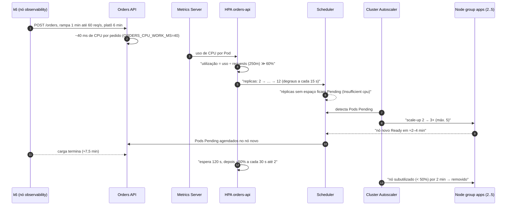
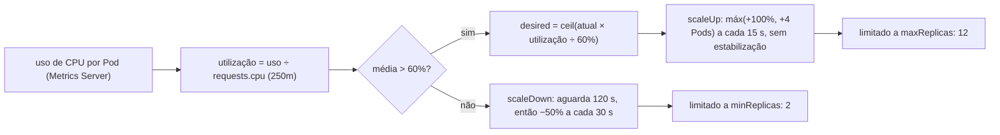
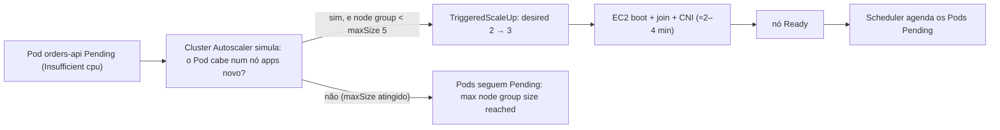
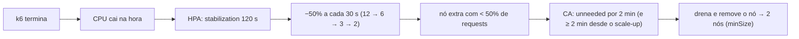

# LAB 02 — CPU Stress & Autoscaling

> **Break it → Observe it → Understand it → Fix it → Validate it**
>
> Duração estimada: 40–50 min (o scale-out de nós leva alguns minutos).

---

## 1. Cenário

Uma campanha de marketing multiplica o tráfego de criação de pedidos. Cada pedido consome CPU na Orders API (validação, cálculo, serialização). O time confia em "o Kubernetes escala sozinho".

Ele escala — mas em **duas camadas diferentes**, com **tempos diferentes** e **limites diferentes**:

```text
carga ↑ ──► CPU ↑ ──► HPA aumenta réplicas (segundos) ──► sem espaço nos nós ──► Pods Pending
                                                                     │
                                         Cluster Autoscaler adiciona nós (minutos) ◄┘
```

Fluxo completo do lab, com os tempos configurados (`hpa.yaml`, `cluster-autoscaler-values.yaml`, `stress-orders.js`):



## 2. Hipótese

> "Sob carga de CPU, o HPA aumentará as réplicas da Orders API com base em `requests.cpu`. Quando as réplicas desejadas não couberem nos nós existentes, Pods ficarão `Pending` (`FailedScheduling`) e o Cluster Autoscaler adicionará nós ao node group `apps` até acomodá-los. Quando a carga parar, ambos reduzem a capacidade — com atraso intencional."

## 3. Pré-requisitos

- LAB 01 concluído (`scripts/validate.sh` sem ❌).
- Dois terminais livres (um para o painel, outro para os comandos).
- Opcional: HyperDX aberto (`kubectl -n observability port-forward svc/clickstack-app 3000:3000`).

## 4. Estado inicial

```bash
scripts/reset.sh
kubectl -n ecommerce get hpa orders-api
kubectl get nodes -l workload=apps
kubectl top nodes
kubectl -n kube-system get deploy cluster-autoscaler-aws-cluster-autoscaler
```

Esperado: HPA `orders-api` com `MINPODS 2`, `MAXPODS 12`, alvo `cpu: <x>%/60%`; **2 nós** `apps` (m6i.large); Metrics Server respondendo; Cluster Autoscaler `1/1`.

Revise a configuração que será exercitada:

```bash
cat kubernetes/apps/orders-api/hpa.yaml
kubectl -n ecommerce get deploy orders-api -o jsonpath='{.spec.template.spec.containers[0].resources}'; echo
grep -E "scale-down|expander|new-pod" infrastructure/cluster-autoscaler-values.yaml
```

| Parâmetro | Valor |
|---|---|
| Orders API `requests.cpu` / `limits.cpu` | `250m` / `1000m` |
| HPA alvo | `averageUtilization: 60` (= 150m por Pod) |
| HPA scaleUp | `stabilizationWindowSeconds: 0`; máx(100% ou +4 Pods) a cada 15 s |
| HPA scaleDown | `stabilizationWindowSeconds: 120`; no máximo −50% a cada 30 s |
| Node group `apps` | min 2 / max 5 × `m6i.large` (2 vCPU, ~1,9 vCPU alocável) |
| Cluster Autoscaler | `scale-down-unneeded-time=2m`, `scale-down-delay-after-add=2m`, `expander=least-waste` |

No **terminal 1**, abra o painel (atualiza a cada 5 s):

```bash
labs/lab-02/watch.sh
```

## 5. Comandos executáveis

**Terminal 2.** Ative o custo de CPU por requisição na Orders API:

```bash
kubectl -n ecommerce set env deploy/orders-api ORDERS_CPU_WORK_MS=40
kubectl -n ecommerce rollout status deploy/orders-api
```

> **Por que `kubectl set env` e não `scripts/fault.sh orders cpu-work`?** A API admin altera somente os Pods **que já existem**. Os Pods criados pelo HPA nasceriam com o valor padrão (`0`) e não consumiriam CPU — o experimento se "auto-corrigiria". Com a variável no template do Deployment, **toda nova réplica herda** o comportamento, como aconteceria com um custo real de código.

Dispare a carga (Job k6 no nó de observabilidade, isolado dos nós `apps`):

```bash
scripts/k6.sh stress-orders.js RATE=60 DURATION=6m
```

O script faz rampa de 1 min até 60 req/s, platô de 6 min e descida de 30 s. Erros são esperados sob estresse e não abortam o teste.

Em paralelo (terminal 3, se possível):

```bash
kubectl -n ecommerce get hpa orders-api -w
```

O que acompanhar em cada fase do teste:

| Cenário | Ação | Comportamento esperado | Como verificar |
|---|---|---|---|
| Custo de CPU ativado | `set env ORDERS_CPU_WORK_MS=40` | rollout da Orders; novas réplicas herdam a variável | `kubectl -n ecommerce rollout status deploy/orders-api` |
| Rampa de carga (1 min) | `scripts/k6.sh stress-orders.js RATE=60 DURATION=6m` | utilização do HPA sobe muito acima de 60% | `kubectl -n ecommerce get hpa orders-api -w` (`TARGETS`) |
| HPA escala | — (automático) | `REPLICAS` sobe em degraus até `maxReplicas: 12` | eventos `SuccessfulRescale` (seção 7.1) |
| Falta capacidade nos nós | — | réplicas novas `Pending` com `Insufficient cpu` | `get pods --field-selector=status.phase=Pending` (seção 7.2) |
| CA adiciona nó | — | `TriggeredScaleUp`; nó `apps` novo `NotReady` → `Ready` em ≈2–4 min | `kubectl get nodes -l workload=apps -w` (seção 7.3) |
| Pods agendados | — | os Pending passam a `Running` no nó novo | painel `labs/lab-02/watch.sh` |
| Fim da carga | k6 termina (≈7,5 min) | após 120 s o HPA reduz até 2; depois o CA remove o nó extra | seção 7.5 |

## 6. Falha provocada

Uma demanda de CPU maior do que a capacidade de **Pods** e, em seguida, maior do que a capacidade de **nós**:

- Cada `POST /orders` gasta ~40 ms de CPU (`Validate Order`).
- Um processo Python (1 worker uvicorn, GIL) usa no máximo ~1 core ⇒ ~**25 req/s por réplica**, no limite do `limits.cpu: 1000m`.
- 60 req/s × 40 ms = **2,4 cores** de demanda. Para manter 150m por Pod (60% de 250m), o HPA calcula ≈ 2400 / 150 = **16 réplicas** ⇒ limitado a `maxReplicas: 12`.
- 12 × 250m = **3 vCPU** de requests só para a Orders API. Somando BFF (2×200m), Inventory (100m), CoreDNS, Metrics Server e DaemonSets, os 2 nós m6i.large (~3,8 vCPU alocáveis) **não comportam** ⇒ Pods `Pending`.

## 7. Observações

### 7.1 HPA (Pod Autoscaling)

```bash
kubectl -n ecommerce describe hpa orders-api | sed -n '/Metrics:/,$p'
```

- A utilização sobe muito acima de 60% (centenas de %), porque é calculada sobre `requests` (250m), não sobre `limits`.
- `desiredReplicas` salta em degraus (+100% ou +4 Pods a cada 15 s) até 12.
- Eventos `SuccessfulRescale` com `New size: N; reason: cpu resource utilization (percentage of request) above target`.

Como o HPA decide (a cada ciclo de avaliação):



### 7.2 Pods Pending e FailedScheduling

```bash
kubectl -n ecommerce get pods -l app.kubernetes.io/name=orders-api --field-selector=status.phase=Pending
kubectl get events -A --field-selector reason=FailedScheduling \
  -o custom-columns=TIME:.lastTimestamp,POD:.involvedObject.name,MSG:.message | tail
```

Mensagem típica: `0/3 nodes are available: 1 node(s) had untolerated taint {workload: observability}, 2 Insufficient cpu.` — o nó de observabilidade está protegido por taint; os nós `apps` estão cheios **de requests**, não necessariamente de uso.

### 7.3 Cluster Autoscaler (Node Autoscaling)

```bash
kubectl -n kube-system logs -l app.kubernetes.io/name=aws-cluster-autoscaler -f --tail=50 \
  | grep -E "Pod .* is unschedulable|Final scale-up plan|Scale-up|scale-up|ScaleUp|Removing|unneeded"
kubectl get events -A --field-selector reason=TriggeredScaleUp
kubectl get nodes -l workload=apps -w
```

- `Final scale-up plan: [{eks-apps-… 2->3 (max: 5)}]` e evento `TriggeredScaleUp` no Pod Pending.
- O nó novo aparece `NotReady` e depois `Ready` em **≈2–4 min** (EC2 boot + join + CNI). Durante esse tempo os Pods continuam Pending — **é a janela em que a capacidade não existe**.
- Em seguida, os Pods Pending são agendados no nó novo.



> As APIs têm `topologySpreadConstraints` (`maxSkew: 1` por nó, `DoNotSchedule`): o scheduler mantém as réplicas da
> Orders equilibradas entre os nós `apps`. Uma réplica pode ficar `Pending` mesmo com CPU livre em outro nó, se ir
> para lá deixasse a diferença maior que 1. O CA trata isso como qualquer Pod Pending: o nó novo (0 réplicas) a recebe.

### 7.4 HyperDX / ClickHouse

No HyperDX (source `Metrics`), crie gráficos com:

| O que observar | Métrica | Filtro / agrupamento |
|---|---|---|
| CPU por Pod | `k8s.pod.cpu.usage` (kubeletstats) | `ResourceAttributes.k8s.deployment.name:"orders-api"`, group by `k8s.pod.name` |
| Utilização vs requests | `k8s.pod.cpu_request_utilization` | idem |
| Pods Pending | `k8s.pod.phase` (k8s_cluster; `1` = Pending) | `ResourceAttributes.k8s.namespace.name:"ecommerce"` |
| Réplicas | `k8s.deployment.desired` × `k8s.deployment.available` | `k8s.deployment.name = orders-api` |
| Throttling (cgroup v2, emitido pela própria API) | `container.cpu.throttled_time` (s, cumulativo) | `ServiceName:"orders-api"` |
| Latência | `http.server.request.duration` (p95/p99) | `http.route = /orders`, `http.request.method = POST` |

Ou via ClickHouse (o mesmo dado usado pelo HyperDX):

```bash
source scripts/lib/common.sh; source scripts/lib/cluster-helpers.sh

# Pods Pending por minuto (k8s.pod.phase = 1)
clickhouse_query "SELECT toStartOfMinute(TimeUnix) m, uniqExact(ResourceAttributes['k8s.pod.name']) pending
FROM otel_metrics_gauge WHERE MetricName='k8s.pod.phase' AND Value=1
  AND ResourceAttributes['k8s.namespace.name']='ecommerce' AND TimeUnix > now() - INTERVAL 30 MINUTE
GROUP BY m ORDER BY m"

# Réplicas desejadas x disponíveis
clickhouse_query "SELECT toStartOfMinute(TimeUnix) m, MetricName, max(Value)
FROM otel_metrics_gauge WHERE MetricName IN ('k8s.deployment.desired','k8s.deployment.available')
  AND ResourceAttributes['k8s.deployment.name']='orders-api' AND TimeUnix > now() - INTERVAL 30 MINUTE
GROUP BY m, MetricName ORDER BY m, MetricName"

# CPU média por Pod da Orders API (cores)
clickhouse_query "SELECT toStartOfMinute(TimeUnix) m, round(avg(Value),3) cores, uniqExact(ResourceAttributes['k8s.pod.name']) pods
FROM otel_metrics_gauge WHERE MetricName='k8s.pod.cpu.usage'
  AND ResourceAttributes['k8s.deployment.name']='orders-api' AND TimeUnix > now() - INTERVAL 30 MINUTE
GROUP BY m ORDER BY m"

# Throttling acumulado por Pod (segundos)
clickhouse_query "SELECT ResourceAttributes['k8s.pod.name'] pod, round(max(Value) - min(Value),2) throttled_s
FROM otel_metrics_sum WHERE MetricName='container.cpu.throttled_time' AND ServiceName='orders-api'
  AND TimeUnix > now() - INTERVAL 30 MINUTE GROUP BY pod ORDER BY throttled_s DESC"
```

### 7.5 Fim da carga e recuperação

Após o k6 terminar (≈7,5 min), mantenha o painel aberto:

1. A CPU cai imediatamente, mas o HPA **espera 120 s** (`scaleDown.stabilizationWindowSeconds`) antes de reduzir, e então remove no máximo 50% das réplicas a cada 30 s até `minReplicas: 2`.
2. Com Pods removidos, o nó extra fica subutilizado (< 50% de requests). Após `scale-down-unneeded-time=2m` (e `scale-down-delay-after-add=2m` desde o scale-up), o CA drena e remove o nó: logs `Scale-down: removing empty node` / `node … is unneeded`.
3. O node group volta a 2 nós (`minSize: 2`).



### Achado da validação real: preemption durante o scale-out

Na primeira execução real deste lab (EKS 1.36, 2026-10-14) a Inventory API ainda **não** tinha
PriorityClass (prioridade 0). Quando o HPA levou a Orders (prioridade 1000) a 12 réplicas, o scheduler
**preemptou a Inventory** para abrir espaço — e todos os pedidos falharam até ela voltar:

```text
2026-10-14T16:10:59Z  inventory-api-ff899c866-8mrnt  Preempted by pod 0e86631a-... on node ip-192-168-87-71.ec2.internal
```

Por isso o estado base agora define `priorityClassName: critical-services` na Inventory
(`kubernetes/apps/inventory-api/deployment.yaml`). Lição: **ausência de PriorityClass é uma prioridade (0)** — a
mais baixa do cluster. Confira com:

```bash
kubectl get events -A --field-selector reason=Preempted
kubectl -n ecommerce get pods -o custom-columns=POD:.metadata.name,PRIO:.spec.priority
```

## 8. Explicação técnica

- **HPA = Pod Autoscaling.** Ajusta `spec.replicas` de um Deployment a partir de métricas (aqui, CPU do Metrics Server). Fórmula: `desired = ceil(current × utilização_atual / utilização_alvo)`, onde utilização = **uso real ÷ `requests.cpu`**. Sem `requests`, o HPA não calcula utilização; com `requests` subdimensionado, ele escala cedo demais; superdimensionado, tarde demais (e desperdiça capacidade).
- **Cluster Autoscaler = Node Autoscaling.** Não olha CPU nem latência. Ele reage a **Pods Pending por falta de recursos** (com base em `requests`) e simula se um nó do node group comportaria o Pod; também remove nós cujos Pods caberiam em outros. Ele só escala node groups descobertos pelas tags `k8s.io/cluster-autoscaler/enabled` e `k8s.io/cluster-autoscaler/<cluster>` e respeita `minSize`/`maxSize`.
- **Tempos diferentes:** HPA reage em segundos; um nó novo leva minutos. Entre os dois, há **capacidade insuficiente** — a latência e os erros (veja `http.server.request.duration` e o k6) aparecem justamente nessa janela.
- **Limits e throttling:** com `limits.cpu: 1000m`, o CFS limita o container a 1 core por período de 100 ms; o excesso vira `nr_throttled`/`throttled_usec` (`container.cpu.throttled_time`). Throttling **aumenta latência sem gerar erro** — não aparece como "falha", só como lentidão.
- **Isolamento do plano de controle do experimento:** o k6 e o Cluster Autoscaler rodam no nó `observability` (taint `workload=observability:NoSchedule`), então a pressão nos nós `apps` não derruba o gerador de carga nem a observabilidade.

## 9. Correção

O comportamento observado é o desenhado; a correção é **dimensionar coerentemente as três camadas**:

1. **Requests realistas:** medir o uso de CPU por réplica sob carga nominal (seção 7.4) e ajustar `requests.cpu` para refleti-lo; o HPA passa a refletir saturação real.
2. **`maxReplicas` coerente com `maxSize` do node group:** `maxReplicas × requests` (mais BFF, Inventory e DaemonSets) deve caber em `maxSize × alocável`. Hoje: 12 × 250m = 3 vCPU para a Orders cabem em 5 nós, mas não em 2.
3. **Absorver o tempo de provisionamento:** `minReplicas` maior em eventos previstos, ou capacidade ociosa (overprovisioning com Pods de baixa prioridade — tema do LAB 03).
4. **Remover o custo artificial de CPU:**

```bash
kubectl -n ecommerce set env deploy/orders-api ORDERS_CPU_WORK_MS-
kubectl -n ecommerce rollout status deploy/orders-api
```

## 10. Validação

```bash
labs/lab-02/verify.sh
```

O script grava `.workshop/lab-02-evidence.txt` com eventos do HPA, `FailedScheduling`, `TriggeredScaleUp`, logs de scale-up do Cluster Autoscaler e horários de criação dos nós, e indica:

- `✔ HPA escalou (SuccessfulRescale)`
- `✔ Cluster Autoscaler disparou scale-up`

Após ~5–8 min sem carga:

```bash
kubectl -n ecommerce get hpa orders-api       # REPLICAS volta a 2
kubectl get nodes -l workload=apps            # volta a 2 nós
```

| Cenário | Comportamento esperado | Como verificar |
|---|---|---|
| HPA reagiu à CPU | evento `SuccessfulRescale`, réplicas acima de 2 (até 12) | `verify.sh`: `✔ HPA escalou (SuccessfulRescale)` |
| Falta de capacidade | Pods `Pending` com `FailedScheduling: … Insufficient cpu` | `.workshop/lab-02-evidence.txt`, seção "Eventos FailedScheduling / TriggeredScaleUp" |
| CA adicionou nó | `TriggeredScaleUp` / `Final scale-up plan`; nó `apps` novo com `CREATED` durante o teste | `verify.sh`: `✔ Cluster Autoscaler disparou scale-up`; seção "Nós" do arquivo |
| Inventory não foi preemptada | nenhum evento `Preempted` para `inventory-api` | `kubectl get events -A --field-selector reason=Preempted` |
| Recuperação | réplicas voltam a 2 e o node group a 2 nós, ~5–8 min após a carga | `kubectl -n ecommerce get hpa orders-api`; `kubectl get nodes -l workload=apps` |

## 11. Challenge

1. Rode novamente com `RATE=30`. O CA é acionado? Calcule antes (réplicas desejadas × 250m) e confirme.
2. Altere temporariamente o HPA para `averageUtilization: 80` (`kubectl -n ecommerce edit hpa orders-api`). O que muda no número de réplicas e na latência p99?
3. Remova o `limits.cpu` da Orders API (QoS continua Burstable). O throttling some? Qual o risco para os vizinhos no nó?
4. Por que o HPA não escala o nó e o CA não escala Pods? Desenhe a cadeia causal de "60 req/s" até "nó novo Ready" com os tempos medidos.
5. Com `maxSize: 5`, qual a taxa máxima sustentável antes de Pods ficarem Pending indefinidamente? O que o CA registra nesse caso (`max node group size reached`)?

## 12. Critérios de sucesso

- [ ] HPA aumentou as réplicas da Orders API (evento `SuccessfulRescale`), chegando a `maxReplicas` ou próximo.
- [ ] Pods `Pending` com `FailedScheduling: Insufficient cpu` observados.
- [ ] Cluster Autoscaler registrou scale-up e um nó `apps` novo ficou `Ready`.
- [ ] Os Pods Pending foram agendados no nó novo.
- [ ] Após a carga, réplicas voltaram a 2 e o nó extra foi removido.
- [ ] Você explica a diferença entre Pod Autoscaling e Node Autoscaling e o papel de `requests.cpu`.

## 13. Reset

```bash
kubectl -n ecommerce set env deploy/orders-api ORDERS_CPU_WORK_MS-   # se ainda não removido
kubectl -n loadtest delete jobs -l app.kubernetes.io/name=k6 --ignore-not-found
scripts/reset.sh
```

Se o nó extra ainda existir, aguarde o scale-down do Cluster Autoscaler (~2–4 min) antes do LAB 03 — o LAB 03 calcula a capacidade livre de cada nó.
