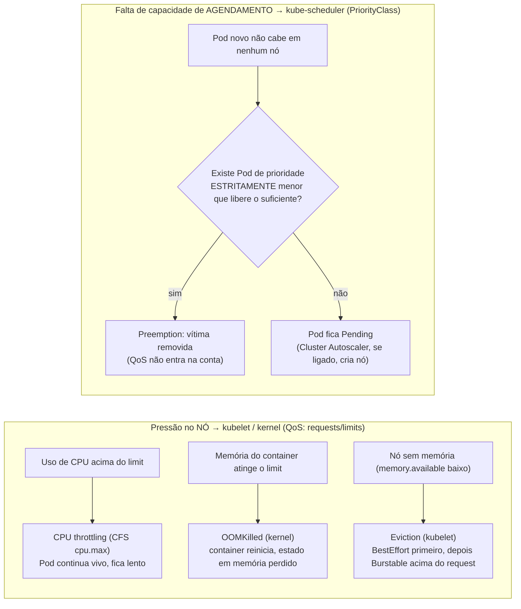
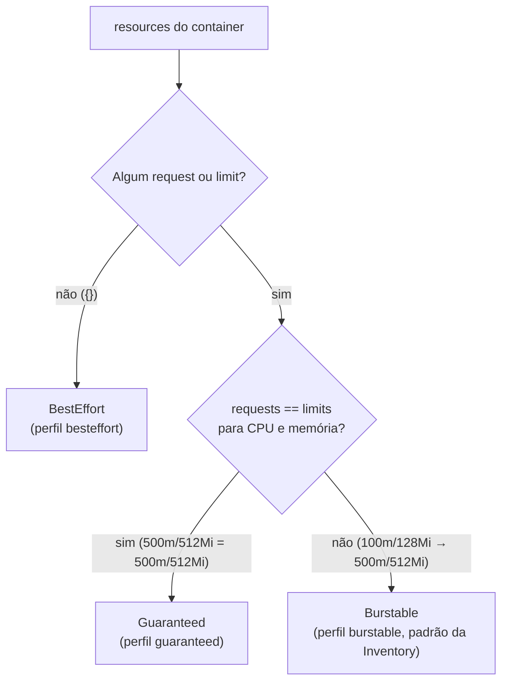
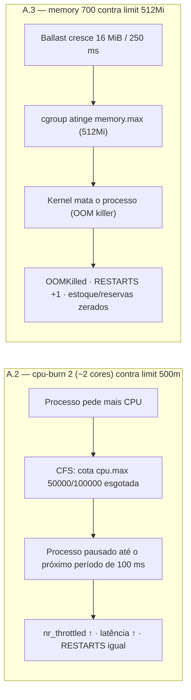
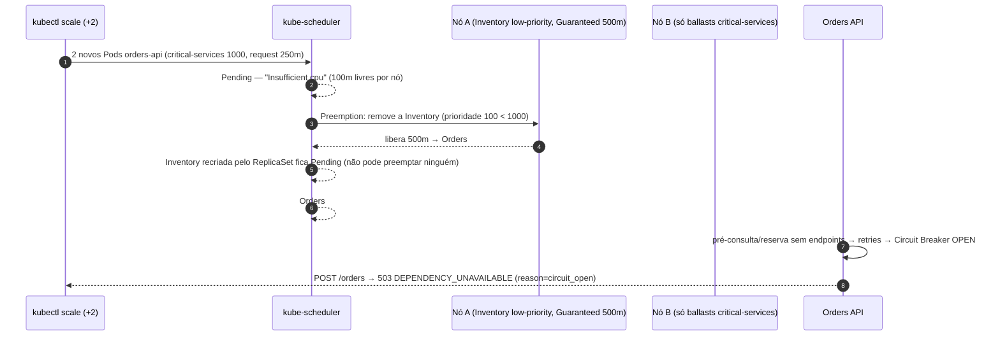
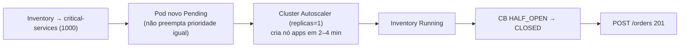

# LAB 03 — QoS & PriorityClass

> **Break it → Observe it → Understand it → Fix it → Validate it**
>
> Duração estimada: 50–60 min · Parte A (QoS) ≈ 25 min · Parte B (PriorityClass/Preemption) ≈ 25 min

---

## 1. Cenário

A Inventory API participa **de toda transação de pedido** (pré-consulta `GET /inventory/{sku}` e reserva
`POST /inventory/reservations`). No modo STRICT do MVP, um pedido só é `CONFIRMED` depois da reserva de estoque.

O time de plataforma "otimizou custos": a Inventory API ganhou requests/limits genéricos e, num cluster
apertado, foi marcada como **baixa prioridade** porque "é só um serviço de estoque". Neste laboratório você vai
ver o que acontece com essa dependência quando:

- o **nó** fica sob pressão de CPU/memória (domínio do **QoS**);
- o **scheduler** fica sem capacidade para agendar Pods críticos (domínio da **PriorityClass/preemption**).



## 2. Hipótese

1. Requests/limits determinam a `QoSClass` (`BestEffort`, `Burstable`, `Guaranteed`), e cada classe sofre de forma
   diferente: **limit de CPU causa throttling** (não mata), **limit de memória causa OOMKilled** (mata o container),
   **pressão no nó causa eviction** (kubelet remove Pods — BestEffort primeiro).
2. `Guaranteed` **não** protege contra preemption: um Pod Guaranteed de baixa prioridade é removido pelo scheduler para
   abrir espaço a um Pod de prioridade maior.
3. Como a Inventory API é dependência transacional, removê-la derruba **todos** os pedidos (503 + Circuit Breaker OPEN).
   QoS e PriorityClass resolvem problemas **diferentes**.

## 3. Pré-requisitos

- LAB 01 concluído (`scripts/validate.sh` sem falhas).
- `kubectl` apontando para o cluster do workshop; `python3` local (para `fill-capacity.py`).
- Acesso ao HyperDX: `kubectl -n observability port-forward svc/clickstack-app 3000:3000` → <http://localhost:3000>
  (credenciais em `.workshop/hyperdx-credentials.json`).
- Três terminais: **T1** comandos, **T2** observação (`watch`/scripts), **T3** carga k6.

## 4. Estado inicial

```bash
scripts/reset.sh
kubectl -n ecommerce get pods -o custom-columns=POD:.metadata.name,QOS:.status.qosClass,PRIORITY:.spec.priorityClassName,NODE:.spec.nodeName
kubectl get priorityclass critical-services low-priority-services
kubectl get nodes -l workload=apps
```

Esperado:

| Workload | QoSClass | PriorityClass |
|---|---|---|
| bff-api (2) | Burstable (200m/256Mi → 1000m/256Mi) | `critical-services` (1000) |
| orders-api (2+) | Burstable (250m/256Mi → 1000m/384Mi) | `critical-services` (1000) |
| inventory-api (1) | Burstable (100m/128Mi → 500m/512Mi) | `critical-services` (1000) — o lab troca para `low-priority-services` |

2 nós `apps` (`m6i.large`), Cluster Autoscaler com 1 réplica.

---

## 5. Comandos executáveis

### Parte A — QoS

#### A.1 Classificação QoS dos três perfis

```bash
labs/lab-03/qos.sh besteffort     # resources: {}                         -> BestEffort
labs/lab-03/qos.sh burstable      # requests 100m/128Mi, limits 500m/512Mi -> Burstable
labs/lab-03/qos.sh guaranteed     # requests == limits 500m/512Mi          -> Guaranteed
```



| Cenário | Ação | Comportamento esperado | Como verificar |
|---|---|---|---|
| Sem resources | `qos.sh besteffort` | Pod recriado (`Recreate`) como `BestEffort`; estoque em memória reiniciado | `kubectl -n ecommerce get pod -l app.kubernetes.io/name=inventory-api -o jsonpath='{.items[0].status.qosClass}'` |
| Request < limit | `qos.sh burstable` | `Burstable` (100m/128Mi → 500m/512Mi) | idem |
| Request = limit | `qos.sh guaranteed` | `Guaranteed` (500m/512Mi) | idem |

Os perfis estão em `kubernetes/labs/qos/inventory-*.patch.json` (JSON patch sobre `containers[0].resources`).
A Inventory API usa `strategy: Recreate` (réplica única com estado em memória), então cada troca de perfil
**recria o Pod** — e reinicia o estoque/reservas em memória.

Os dois experimentos seguintes batem no **limit** do container, mas o resultado é oposto porque CPU é comprimível
e memória não:



#### A.2 CPU throttling (perfil com limit de CPU)

```bash
# T1 — perfil Burstable (limit 500m) e 2 processos consumindo 1 core cada
labs/lab-03/qos.sh burstable
scripts/fault.sh inventory cpu-burn 2

# T2 — contadores do cgroup v2 a cada 5s
labs/lab-03/cpu-stat.sh
```

Saída esperada do `cpu-stat.sh`:

```text
10:41:05 cpu.max=[50000 100000] nr_periods 1200 nr_throttled 1150 throttled_usec 61234567
```

`cpu.max = 50000 100000` → 50 ms de CPU a cada período de 100 ms = **500m**. Com demanda de ~2 cores,
praticamente todo período é throttled.

Meça o efeito na latência pelo caminho real do pedido (a NetworkPolicy só permite Orders → Inventory):

```bash
# T3 — carga leve de pedidos durante o throttling
scripts/k6.sh create-orders.js RATE=5 DURATION=2m
```

Compare `http_req_duration p(95)` com e sem `cpu-burn`. No HyperDX:

- **Metrics** → `container.cpu.throttled_time` (counter, segundos) e `container.cpu.throttled_periods`,
  filtro `ServiceName = inventory-api`;
- **Metrics** → `k8s.pod.cpu_limit_utilization` (kubeletstats) próximo de 1.0;
- **Traces** → spans `POST /inventory/reservations` mais lentos.

Desligue o stress:

```bash
scripts/fault.sh inventory cpu-burn 0
```

#### A.3 OOMKilled (limit de memória)

```bash
labs/lab-03/qos.sh burstable                 # limit 512Mi (mesmo resultado com guaranteed)
scripts/fault.sh inventory memory 700        # ballast cresce 16 MiB a cada 250 ms até 700 MiB
kubectl -n ecommerce get pods -l app.kubernetes.io/name=inventory-api -w
```

Após ~10 s o contador `RESTARTS` incrementa. Confirme o motivo:

```bash
kubectl -n ecommerce get pod -l app.kubernetes.io/name=inventory-api \
  -o jsonpath='{.items[0].status.containerStatuses[0].lastState.terminated.reason}{"\n"}'
# OOMKilled
kubectl -n ecommerce describe pod -l app.kubernetes.io/name=inventory-api | grep -A5 "Last State"
```

> O container reinicia com a configuração de falhas **padrão** (ballast = 0), então não entra em loop.

**Consequência de negócio:** o estoque e as reservas vivem em memória. Após o OOMKilled:

```bash
scripts/fault.sh inventory state      # reservations_total volta a 0, estoque volta ao inicial
```

Pedidos já `CONFIRMED` no DynamoDB continuam lá, mas a Inventory "esqueceu" as reservas. Essa é a
**limitação documentada do MVP** (sem durabilidade das reservas após restart) — não um bug escondido.

#### A.4 BestEffort + vizinho barulhento (contenção)

```bash
labs/lab-03/qos.sh besteffort
kubectl apply -f kubernetes/labs/qos/noisy-neighbor.yaml        # 2x `yes` no MESMO nó da Inventory (podAffinity), auto-encerra em 10 min
kubectl -n loadtest get pod noisy-neighbor -o wide
scripts/k6.sh create-orders.js RATE=5 DURATION=2m
kubectl top pods -A --sort-by=cpu | head
```

Sem requests, a Inventory recebe o **peso mínimo de CPU** (`cpu.weight` mínimo para BestEffort) e disputa CPU
com o vizinho em desvantagem. Observe a latência p95 e os spans de `inventory-api` no HyperDX. Depois:

```bash
kubectl -n loadtest delete pod noisy-neighbor
```

**Resumo da Parte A**

| Cenário | Ação | Comportamento esperado | Como verificar |
|---|---|---|---|
| CPU acima do limit | `qos.sh burstable` + `fault.sh inventory cpu-burn 2` | Throttling em quase todo período; Pod **não** reinicia; p95 dos pedidos sobe | `labs/lab-03/cpu-stat.sh` (`nr_throttled` ≈ `nr_periods`); `container.cpu.throttled_time` no HyperDX; `RESTARTS` igual |
| Memória acima do limit | `qos.sh burstable` + `fault.sh inventory memory 700` | `OOMKilled` em ~10 s; container reinicia sem a falha; estoque e reservas voltam ao inicial | `lastState.terminated.reason` = `OOMKilled`; `RESTARTS +1`; `fault.sh inventory state` (`reservations_total` = 0) |
| BestEffort + vizinho barulhento | `qos.sh besteffort` + `noisy-neighbor.yaml` | Inventory disputa CPU com peso mínimo; latência maior, sem restart | `kubectl top pods -A --sort-by=cpu`; p95 do k6; spans `inventory-api` |

### Parte B — PriorityClass & Preemption (sequência determinística)

```bash
# B.1 — ponto de partida limpo
scripts/reset.sh

# B.2 — Inventory Guaranteed (500m). A vítima precisa liberar >= 250m (request de 1 Pod da Orders);
#        com o perfil Burstable (100m) + 100m de folga, a preempção NÃO resolveria e o scheduler não preemptaria.
labs/lab-03/qos.sh guaranteed

# B.3 — impedir que o Cluster Autoscaler adicione nós ANTES de observarmos a preempção
kubectl -n kube-system scale deploy -l app.kubernetes.io/name=aws-cluster-autoscaler --replicas=0

# B.4 — ANTI-PATTERN INTENCIONAL: dependência transacional com prioridade baixa
kubectl -n ecommerce patch deploy inventory-api --patch-file kubernetes/labs/priority/inventory-low-priority.patch.yaml
kubectl -n ecommerce rollout status deploy/inventory-api

# B.5 — ocupar a CPU livre dos nós apps com ballasts de prioridade critical-services (deixa 100m livres por nó)
python3 labs/lab-03/fill-capacity.py --slack 100
kubectl -n loadtest get pods -l app.kubernetes.io/name=capacity-ballast -o wide

# B.6 — remover o HPA (senão ele "desfaz" o scale manual) e escalar a Orders API em +2 réplicas
kubectl -n ecommerce delete hpa orders-api
CURRENT=$(kubectl -n ecommerce get deploy orders-api -o jsonpath='{.spec.replicas}')
kubectl -n ecommerce scale deploy orders-api --replicas=$((CURRENT + 2))
```

Em paralelo (T3), gere pedidos durante todo o experimento:

```bash
scripts/k6.sh create-orders.js RATE=5 DURATION=4m
```

E observe (T2):

```bash
kubectl get events -n ecommerce --sort-by=.lastTimestamp -w | grep -E "Preempted|FailedScheduling|Scheduled"
# outro terminal:
kubectl -n ecommerce get pods -o wide -w
labs/lab-04/watch-cb.sh        # estado do Circuit Breaker por réplica da Orders
```

Sequência esperada da Parte B (2 nós `apps`, CA desligado, ballasts deixando 100m livres por nó):



| Cenário | Ação | Comportamento esperado | Como verificar |
|---|---|---|---|
| Dependência com prioridade baixa | B.2 + B.4 (Guaranteed 500m + `low-priority-services`) | Inventory `Running`, `PRIORITY` 100, `QOS` Guaranteed | `kubectl -n ecommerce get pods -o custom-columns=POD:.metadata.name,QOS:.status.qosClass,PRIORITY:.spec.priorityClassName` |
| Cluster sem folga | B.3 (CA = 0) + B.5 (`fill-capacity.py --slack 100`) | Ballasts `Running` nos 2 nós `apps`; ~100m livres por nó | `kubectl -n loadtest get pods -l app.kubernetes.io/name=capacity-ballast -o wide` |
| Orders +2 réplicas | B.6 | Evento `Preempted` na Inventory; uma Orders nova agendada no nó dela | `kubectl get events -n ecommerce --field-selector reason=Preempted` |
| Vítima não reagenda | — | Inventory nova `Pending` (`Insufficient cpu`; nenhuma vítima de prioridade menor) | `kubectl -n ecommerce get pods -l app.kubernetes.io/name=inventory-api` |
| Spread impede empilhar | — | 4ª Orders `Pending`: *"didn't match pod topology spread constraints … Preemption is not helpful"* | `kubectl -n ecommerce describe pod <orders Pending>` |
| Impacto no negócio | k6 em T3 | `POST /orders` `201` → ~0%; `503 DEPENDENCY_UNAVAILABLE`; CB `OPEN` em cada réplica | saída do k6; `labs/lab-04/watch-cb.sh`; `circuit_breaker.state` = 2 no HyperDX |

## 6. Falha provocada

- **Parte A:** CPU throttling (`cpu-burn 2` contra limit 500m), OOMKilled (`memory 700` contra limit 512Mi),
  contenção de CPU (BestEffort + `noisy-neighbor`).
- **Parte B:** falta de capacidade de scheduling para Pods `critical-services` com a dependência transacional
  configurada como `low-priority-services` e o Cluster Autoscaler desligado.

## 7. Observações

**Parte A**

| Experimento | Onde observar | O que esperar |
|---|---|---|
| Throttling | `cpu-stat.sh`, métrica `container.cpu.throttled_time` | `nr_throttled` crescendo quase 1:1 com `nr_periods`; Pod **não** reinicia; latência sobe |
| OOMKilled | `lastState.terminated.reason`, evento `BackOff`/restart, `k8s.container.restarts` | Container morto pelo kernel, `RESTARTS+1`, estado em memória perdido |
| Contenção BestEffort | `kubectl top`, p95 k6, spans `inventory-api` | Latência maior; nenhuma garantia de CPU |

**Parte B** — linha do tempo típica:

1. Novos Pods `orders-api` ficam `Pending` (`FailedScheduling: Insufficient cpu`).
2. O scheduler identifica a Inventory (prioridade 100) como vítima no nó onde ela roda: evento
   `Preempted` — *"Preempted by pod … on node …"*. O Pod da Orders é agendado nesse nó (`nominatedNodeName`).
3. A Inventory é recriada pelo ReplicaSet e fica `Pending`: não há espaço e ela **não pode** preemptar ninguém
   (todos os demais são `critical-services` ou `system-*`).
4. O outro novo Pod da Orders continua `Pending`. O topology spread da Orders (`maxSkew: 1` por nó, LAB 07) exige
   que ele vá para o **outro** nó, que está cheio de ballasts `critical-services` (sem vítimas):
   *"0/3 nodes are available: 1 Insufficient cpu, 1 node(s) didn't match pod topology spread constraints … preemption:
   … Preemption is not helpful for scheduling"*.
5. Os pedidos começam a falhar: a pré-consulta/reserva da Inventory falha (sem endpoints → erro de transporte) →
   retries → **Circuit Breaker OPEN** em cada réplica → `503 DEPENDENCY_UNAVAILABLE` com `reason=circuit_open`.
   O k6 mostra `POST /orders 201` caindo para ~0%.

No HyperDX:

- **Logs** (source Logs): eventos Kubernetes coletados pelo gateway (`k8sobjects`) — busque `Preempted` e
  `FailedScheduling`;
- **Logs**: `ServiceName:"orders-api" Body:"Circuit breaker transition"` e `Body:"Inventory API indisponível"`;
- **Metrics**: `k8s.pod.phase` (Pending = 1), `circuit_breaker.state` (2 = OPEN), `orders.failed` por `reason`.

## 8. Explicação técnica

**QoSClass** é derivada automaticamente dos `resources`:

| QoS | Regra | `oom_score_adj` | Eviction por pressão do nó |
|---|---|---|---|
| BestEffort | nenhum request/limit | 1000 (primeiro a morrer) | primeiro candidato |
| Burstable | algum request, não todos iguais aos limits | 2–999 (proporcional) | quem usa acima do request primeiro |
| Guaranteed | requests == limits para CPU e memória em todos os containers | -997 | último candidato |

Três mecanismos **diferentes**:

- **CPU throttling** — o CFS aplica a cota `cpu.max` (limit). O processo é *pausado* até o próximo período;
  nada é morto. CPU é um recurso **comprimível**.
- **OOMKilled** — o uso de memória do cgroup do container atinge `memory.max` (limit) e o **kernel** mata o
  processo. Acontece mesmo com o nó folgado. Memória é **incompressível**.
- **Eviction** — o **kubelet** detecta pressão no **nó** (ex.: `memory.available` abaixo do threshold) e remove Pods
  inteiros, ordenando por uso acima do request, prioridade e QoS. Pode acontecer sem nenhum limit atingido.

**PriorityClass** age no **scheduler**: quando um Pod não cabe, o scheduler procura nós onde remover Pods de
prioridade **estritamente menor** libere recursos suficientes (preemption). QoS não entra nessa conta — por isso
um Pod `Guaranteed` de prioridade 100 foi removido. Prioridade **igual** nunca preempta (por isso os ballasts
`critical-services` e as outras réplicas da Orders ficaram intocados).

O perfil Guaranteed (500m) foi necessário para a preempção acontecer: a vítima precisa liberar recursos
suficientes para o Pod pendente (250m da Orders). Com 100m livres + 100m da Inventory Burstable = 200m < 250m,
o scheduler não teria vítima válida.

| Pergunta | Quem responde |
|---|---|
| Quem sofre primeiro quando o **nó** está sem CPU/memória? | QoS (requests/limits) |
| Quem é **agendado** primeiro / quem é **removido** quando falta capacidade de scheduling? | PriorityClass |

O anti-pattern: a prioridade deve refletir a **criticidade do fluxo de negócio**, não a "importância percebida"
do serviço. Uma dependência síncrona do caminho crítico tem, no mínimo, a mesma prioridade de quem a chama.

## 9. Correção

```bash
# 1. Dependência transacional com a mesma prioridade do caminho crítico
kubectl -n ecommerce patch deploy inventory-api --patch-file kubernetes/labs/priority/inventory-restore-priority.patch.yaml

# 2. Capacidade: reativar o Cluster Autoscaler
kubectl -n kube-system scale deploy -l app.kubernetes.io/name=aws-cluster-autoscaler --replicas=1
```

O novo Pod da Inventory (prioridade 1000) **não** consegue preemptar ninguém (todos têm prioridade igual ou
maior) — ele fica `Pending` e isso dispara o **Cluster Autoscaler**, que adiciona um nó `apps` (2–4 min).
A Inventory é agendada, o Circuit Breaker passa por `HALF_OPEN` → `CLOSED`, e os pedidos voltam a `201`.

```bash
kubectl -n kube-system logs deploy/cluster-autoscaler-aws-cluster-autoscaler --since=10m | grep -iE "scale-up|ScaleUp"
kubectl get nodes -l workload=apps -w
```

Correção de QoS (Parte A): manter a Inventory **Burstable** com requests realistas (ou Guaranteed se a latência
for crítica), limit de memória dimensionado pelo uso real + margem, e **não** depender de estado em memória em
produção (fase 2: estado compartilhado/durável).

## 10. Validação

| Cenário | Ação | Comportamento esperado | Como verificar |
|---|---|---|---|
| Prioridade corrigida | patch `inventory-restore-priority` (seção 9) | Inventory nova com prioridade 1000 fica `Pending` (não preempta prioridade igual) | `kubectl -n ecommerce get pod -l app.kubernetes.io/name=inventory-api -o wide` |
| Capacidade restaurada | CA = 1 (seção 9) | CA adiciona um nó `apps` em 2–4 min; Inventory `Running` | `kubectl get nodes -l workload=apps -w`; logs do CA (`scale-up`) |
| Recuperação do fluxo | — | CB `HALF_OPEN` → `CLOSED` em todas as réplicas; pedidos voltam a `201` | `scripts/fault.sh orders cb`; k6 com `http_req_failed < 5%` |
| Evidência da preempção | — | Evento `Preempted` da Inventory registrado | `kubectl get events -n ecommerce --field-selector reason=Preempted` |



```bash
kubectl -n ecommerce get pod -l app.kubernetes.io/name=inventory-api \
  -o custom-columns=POD:.metadata.name,STATUS:.status.phase,QOS:.status.qosClass,PRIORITY:.spec.priority
# STATUS=Running  PRIORITY=1000
kubectl get events -n ecommerce --field-selector reason=Preempted
scripts/fault.sh orders cb             # todas as réplicas: "state": "CLOSED"
scripts/k6.sh create-orders.js RATE=5 DURATION=1m   # thresholds OK (http_req_failed < 5%)
```

## 11. Challenge

1. **Eviction controlada (opcional):** com `labs/lab-03/qos.sh besteffort`, eleve a pressão de memória no nó:
   `scripts/fault.sh inventory memory 2048` (teto `INVENTORY_MEMORY_STRESS_MAX_MB=2048` — a carga é limitada por
   design). Repita junto com `kubectl apply -f kubernetes/labs/qos/noisy-neighbor.yaml`. Observe `kubectl describe node`
   (condição `MemoryPressure`) e os eventos `Evicted`. Discuta: em nós com pouca memória livre, o **OOM killer do
   kernel** pode agir antes da eviction do kubelet (que avalia a cada ~10 s); como o `oom_score_adj` do BestEffort é
   1000, ele morre primeiro de qualquer forma. Com 2048 MiB num `m6i.large` a eviction pode **não** ocorrer — explique
   por quê (allocatable × uso real × threshold `memory.available`).
2. Por que o HPA precisou ser removido na Parte B? O que aconteceria com `minReplicas` maior que a capacidade?
3. Qual seria o efeito de `preemptionPolicy: Never` na `critical-services`?
4. Proponha um `PodDisruptionBudget` para a Inventory (fase 2). Ele impediria a preempção? (Dica: PDB é
   respeitado em *best effort* pelo scheduler na preempção.)

## 12. Critérios de sucesso

- [ ] Os três perfis produziram `BestEffort`, `Burstable` e `Guaranteed` em `.status.qosClass`.
- [ ] `nr_throttled` cresceu com `cpu-burn 2` e o Pod **não** reiniciou.
- [ ] `lastState.terminated.reason = OOMKilled` com `memory 700` e o estado em memória foi perdido.
- [ ] Evento `Preempted` para a Inventory API registrado, com a Orders agendada no lugar.
- [ ] Pedidos falharam com `503 DEPENDENCY_UNAVAILABLE` e Circuit Breaker `OPEN` durante a preempção.
- [ ] Após a correção: Inventory `Running` com prioridade 1000, CB `CLOSED`, pedidos `201`.
- [ ] O aluno explica a diferença entre throttling, OOMKilled, eviction e preemption.

## 13. Reset

```bash
kubectl -n loadtest delete pod -l app.kubernetes.io/name=capacity-ballast --ignore-not-found
kubectl -n loadtest delete pod noisy-neighbor --ignore-not-found
scripts/reset.sh        # perfil Burstable, Inventory de volta a critical-services, reaplica HPA, CA=1, limpa falhas
kubectl -n ecommerce get pods -o custom-columns=POD:.metadata.name,QOS:.status.qosClass,PRIORITY:.spec.priorityClassName
```

Nós extras criados pelo Cluster Autoscaler são removidos automaticamente após ~2 min ociosos
(`scale-down-unneeded-time=2m`).
