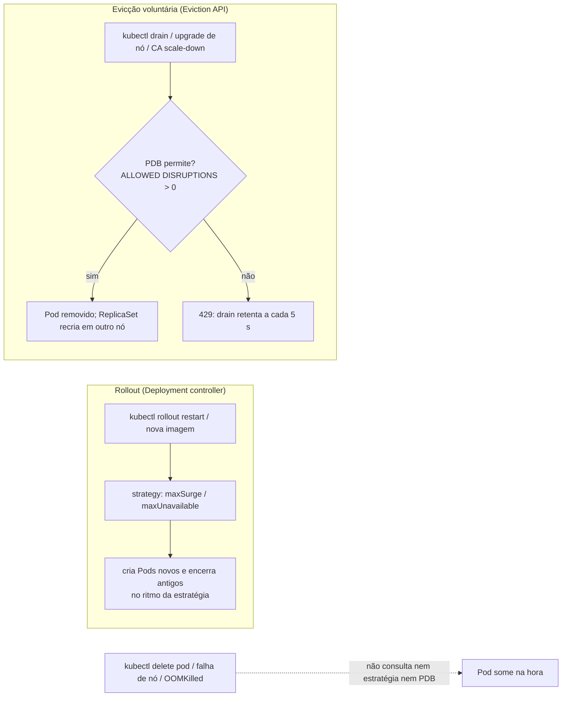
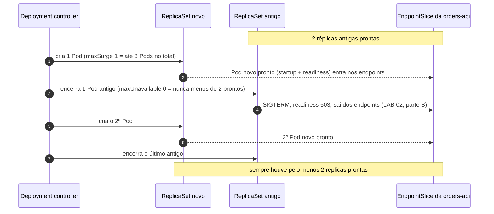
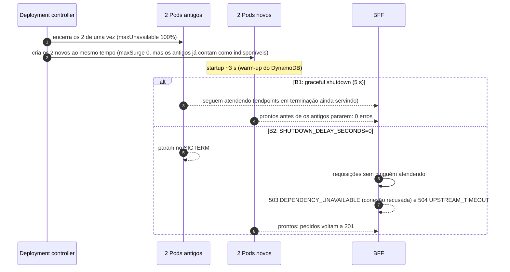
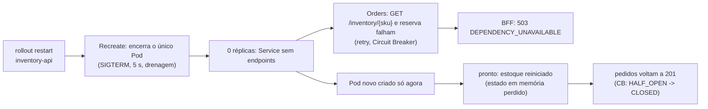
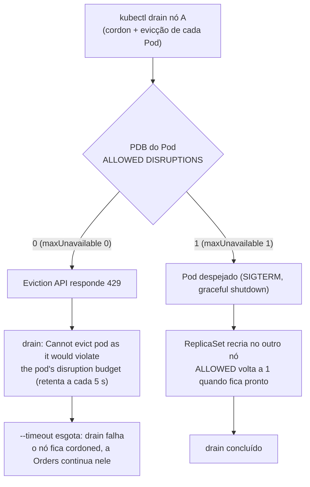
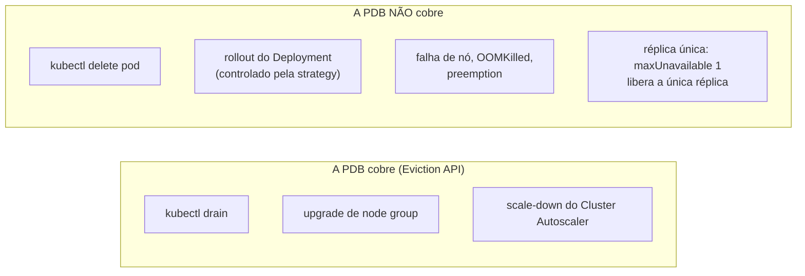

# LAB 03 — RollingUpdate & PodDisruptionBudget

> **Break it → Observe it → Understand it → Fix it → Validate it**
>
> Duração estimada: 40 min

---

## 1. Cenário

O LAB 02 mostrou que cada **réplica** sabe sair do tráfego e encerrar sem erro (readiness, `SIGTERM`, espera de
5 s). Este lab sobe um nível: **quantas réplicas podem estar fora ao mesmo tempo** quando o próprio time mexe no
cluster. Duas configurações decidem isso, cada uma para um tipo de mudança:

| Mudança | Quem decide quantas réplicas saem | Configuração no repo |
|---|---|---|
| **Rollout** (nova versão, `rollout restart`, mudança no template) | o **Deployment controller** | `strategy` — BFF e Orders: `RollingUpdate` com `maxSurge: 1, maxUnavailable: 0`; Inventory: `Recreate` |
| **Evicção voluntária** (`kubectl drain`, upgrade de nó, consolidação do Cluster Autoscaler) | a **Eviction API**, consultando a **PodDisruptionBudget** | `kubernetes/apps/*/pdb.yaml` — `maxUnavailable: 1` nas três APIs |



## 2. Hipótese

1. Com `maxSurge: 1, maxUnavailable: 0`, um rollout sob carga **não gera erros**: um Pod novo só substitui um antigo
   depois de ficar pronto.
2. Com `maxSurge: 0, maxUnavailable: 100%`, o rollout derruba **todas** as réplicas de uma vez. Se a aplicação faz
   graceful shutdown (espera 5 s, LAB 02) e sobe mais rápido do que isso, as antigas cobrem a janela e não há erro;
   **sem** graceful shutdown, abre-se uma janela sem ninguém atendendo e a BFF responde `503`/`504`.
3. `Recreate` na Inventory (réplica única) sempre tem uma janela de indisponibilidade em cada rollout.
4. Uma PDB com `maxUnavailable: 0` **bloqueia** o `kubectl drain`; com `maxUnavailable: 1`, o drain prossegue um Pod
   por vez.
5. A PDB **não** protege contra `kubectl delete pod`, contra rollouts nem contra falha de nó, e com **1 réplica** ela
   não protege nada.

## 3. Pré-requisitos

- LAB 02 concluído (probes e graceful shutdown); `scripts/reset.sh` executado.
- `export CLUSTER_ID=<seu id>` e kubectl apontando para o seu cluster.
- **3 terminais** na raiz do repositório, todos com o mesmo `CLUSTER_ID`.

## 4. Estado inicial

```bash
kubectl -n ecommerce get deploy -o custom-columns='NAME:.metadata.name,REPLICAS:.spec.replicas,STRATEGY:.spec.strategy.type,SURGE:.spec.strategy.rollingUpdate.maxSurge,UNAVAIL:.spec.strategy.rollingUpdate.maxUnavailable'
kubectl -n ecommerce get pdb
kubectl -n ecommerce get pods -o wide --sort-by=.spec.nodeName
```

Esperado:

| Deployment | Réplicas | Estratégia | maxSurge | maxUnavailable |
|---|---|---|---|---|
| bff-api | 2 | RollingUpdate | 1 | 0 |
| orders-api | 2 (HPA 2–12) | RollingUpdate | 1 | 0 |
| inventory-api | 1 | Recreate | — | — |

| PDB | MAX UNAVAILABLE | ALLOWED DISRUPTIONS |
|---|---|---|
| bff-api | 1 | 1 |
| orders-api | 1 | 1 |
| inventory-api | 1 | 1 (com 1 réplica: a única pode sair) |

## 5. Comandos executáveis

Deixe rodando durante todo o lab:

```bash
# Terminal 1 — Pods e em que nó estão
kubectl -n ecommerce get pods -w -o 'custom-columns=POD:.metadata.name,STATUS:.status.phase,READY:.status.containerStatuses[0].ready,NODE:.spec.nodeName'

# Terminal 2 — carga contínua com retry do cliente (mesma Idempotency-Key)
scripts/k6.sh create-orders.js RATE=10 DURATION=30m
```

O terminal 3 é onde você provoca as mudanças. Marque o início de cada janela para contar as respostas da BFF só
daquele trecho:

```bash
export T0=$(date -u +%FT%TZ)
# ... mudança ...
labs/lab-02/count-responses.sh "$T0"
```

| Parte | Cenário | Ação | Comportamento esperado | Como verificar |
|---|---|---|---|---|
| A | Rollout seguro (1/0) | `kubectl rollout restart deploy/orders-api` | Pod novo sobe e fica pronto antes de um antigo sair; 0 erros | terminal 1; `count-responses.sh` só com `201` |
| B1 | Rollout agressivo (0/100%) com graceful shutdown | patch `orders-aggressive-rollout` + `rollout restart` | as 2 réplicas saem juntas, mas atendem até as novas ficarem prontas: 0 erros | terminal 1; `count-responses.sh` |
| B2 | Rollout agressivo sem graceful shutdown | + `SHUTDOWN_DELAY_SECONDS=0` | janela sem ninguém atendendo: dezenas de `503`/`504` por rollout; com a estratégia segura, só alguns | `count-responses.sh` |
| C | `Recreate` na Inventory | `kubectl rollout restart deploy/inventory-api` | o Pod antigo encerra **antes** de o novo existir; `503 DEPENDENCY_UNAVAILABLE` na janela | terminal 1; `count-responses.sh`; `scripts/fault.sh orders cb` |
| D | PDB bloqueando drain | patch `orders-pdb-zero` + `kubectl drain` | drain retenta `Cannot evict pod as it would violate the pod's disruption budget` | saída do drain; `kubectl get pdb` (ALLOWED 0) |
| D | PDB liberando drain | patch `orders-pdb-restore` + drain de novo | drain conclui, um Pod da Orders por vez | saída do drain; terminal 1 |
| E | O que a PDB não cobre | `kubectl delete pod` e `rollout restart` com a PDB em 0; drain do nó da Inventory | o delete e o rollout ignoram a PDB; o drain remove a única Inventory | terminal 1; `count-responses.sh` com `503` no drain da Inventory |

## 6. Falha provocada

Execute as partes **na ordem** (A → E), no terminal 3.

### Parte A — RollingUpdate seguro (`maxSurge: 1, maxUnavailable: 0`)

```bash
export T0=$(date -u +%FT%TZ)
kubectl -n ecommerce rollout restart deploy/orders-api
kubectl -n ecommerce rollout status deploy/orders-api
sleep 15; labs/lab-02/count-responses.sh "$T0"
```



### Parte B — RollingUpdate agressivo (`maxSurge: 0, maxUnavailable: 100%`)

A estratégia não faz parte do template dos Pods: trocá-la não reinicia nada. O `rollout restart` dispara a troca.

```bash
kubectl -n ecommerce patch deploy orders-api --patch-file kubernetes/labs/rollout/orders-aggressive-rollout.patch.yaml
export T0=$(date -u +%FT%TZ)
kubectl -n ecommerce rollout restart deploy/orders-api
kubectl -n ecommerce rollout status deploy/orders-api
sleep 15; labs/lab-02/count-responses.sh "$T0"
```

**B2 — o mesmo rollout agressivo, sem graceful shutdown.** `SHUTDOWN_DELAY_SECONDS=0` faz o processo parar no
`SIGTERM` (o padrão, 5 s, vem do LAB 02). A troca da variável já dispara um rollout, mas quem encerra nele são os Pods
antigos (com 5 s): por isso o teste é o `rollout restart` seguinte.

```bash
kubectl -n ecommerce set env deploy/orders-api SHUTDOWN_DELAY_SECONDS=0
kubectl -n ecommerce rollout status deploy/orders-api
sleep 20
export T0=$(date -u +%FT%TZ)
kubectl -n ecommerce rollout restart deploy/orders-api
kubectl -n ecommerce rollout status deploy/orders-api
sleep 15; labs/lab-02/count-responses.sh "$T0"

# contraprova: estratégia segura, ainda sem graceful shutdown
kubectl -n ecommerce patch deploy orders-api --patch-file kubernetes/labs/rollout/orders-safe-rollout.patch.yaml
export T0=$(date -u +%FT%TZ)
kubectl -n ecommerce rollout restart deploy/orders-api
kubectl -n ecommerce rollout status deploy/orders-api
sleep 15; labs/lab-02/count-responses.sh "$T0"

# volta ao manifest: estratégia segura (já aplicada) e graceful shutdown de 5 s
kubectl -n ecommerce set env deploy/orders-api SHUTDOWN_DELAY_SECONDS-
kubectl -n ecommerce rollout status deploy/orders-api
```



### Parte C — `Recreate` na Inventory

```bash
export T0=$(date -u +%FT%TZ)
kubectl -n ecommerce rollout restart deploy/inventory-api
kubectl -n ecommerce rollout status deploy/inventory-api
scripts/fault.sh orders cb                # o Circuit Breaker pode ter aberto na janela
sleep 20; labs/lab-02/count-responses.sh "$T0"
scripts/fault.sh inventory reset-stock    # estoque em memória: o Pod novo começa do catálogo inicial
```



### Parte D — PDB bloqueando um drain

Desligue o Cluster Autoscaler (ele criaria um nó novo para os Pods despejados — veja o LAB 04, parte E2) e escolha
como **nó A** um nó `apps` **sem** a Inventory:

```bash
kubectl -n kube-system scale deploy -l app.kubernetes.io/name=aws-cluster-autoscaler --replicas=0
INV_NODE=$(kubectl -n ecommerce get pod -l app.kubernetes.io/name=inventory-api -o jsonpath='{.items[0].spec.nodeName}')
export NODE_A=$(kubectl get nodes -l workload=apps -o name | sed 's#node/##' | grep -v "$INV_NODE" | head -1)
echo "A=$NODE_A"
kubectl -n ecommerce get pods -l app.kubernetes.io/name=orders-api -o wide    # confirme que há uma Orders no nó A
```

Zere o orçamento da Orders e tente drenar o nó A (o `--timeout` evita que o drain fique preso para sempre):

```bash
kubectl -n ecommerce patch pdb orders-api --type merge --patch-file kubernetes/labs/rollout/orders-pdb-zero.patch.yaml
kubectl -n ecommerce get pdb orders-api                       # ALLOWED DISRUPTIONS 0
kubectl drain $NODE_A --ignore-daemonsets --delete-emptydir-data --timeout=60s
```

Restaure o orçamento e drene de novo:

```bash
kubectl -n ecommerce patch pdb orders-api --type merge --patch-file kubernetes/labs/rollout/orders-pdb-restore.patch.yaml
export T0=$(date -u +%FT%TZ)
kubectl drain $NODE_A --ignore-daemonsets --delete-emptydir-data --timeout=3m
sleep 30; labs/lab-02/count-responses.sh "$T0"
kubectl uncordon $NODE_A
kubectl -n ecommerce rollout restart deploy/orders-api deploy/bff-api    # redistribui (LAB 04, parte E3)
```



### Parte E — o que a PDB **não** protege

Com a PDB da Orders de novo em 0:

```bash
kubectl -n ecommerce patch pdb orders-api --type merge --patch-file kubernetes/labs/rollout/orders-pdb-zero.patch.yaml

# E1 — delete direto não passa pela Eviction API
POD=$(kubectl -n ecommerce get pod -l app.kubernetes.io/name=orders-api -o jsonpath='{.items[0].metadata.name}')
kubectl -n ecommerce delete pod $POD                # é apagado mesmo com ALLOWED DISRUPTIONS 0

# E2 — o rollout do Deployment não consulta a PDB
kubectl -n ecommerce rollout restart deploy/orders-api
kubectl -n ecommerce rollout status deploy/orders-api

kubectl -n ecommerce patch pdb orders-api --type merge --patch-file kubernetes/labs/rollout/orders-pdb-restore.patch.yaml
```

E3 — a PDB da Inventory com **1** réplica. Drene o nó **da** Inventory:

```bash
INV_NODE=$(kubectl -n ecommerce get pod -l app.kubernetes.io/name=inventory-api -o jsonpath='{.items[0].spec.nodeName}')
kubectl -n ecommerce get pdb inventory-api          # ALLOWED DISRUPTIONS 1: a única réplica pode sair
export T0=$(date -u +%FT%TZ)
kubectl drain $INV_NODE --ignore-daemonsets --delete-emptydir-data --timeout=3m
sleep 30; labs/lab-02/count-responses.sh "$T0"
kubectl uncordon $INV_NODE
scripts/fault.sh inventory reset-stock
kubectl -n kube-system scale deploy -l app.kubernetes.io/name=aws-cluster-autoscaler --replicas=1
```



## 7. Observações

Valores medidos no cluster `rw-cluster0001` (10 pedidos/s), na validação deste lab. Os seus tempos podem variar
alguns segundos.

### A — rollout seguro

| O que aparece | Valor medido |
|---|---|
| rollout completo da Orders (2 réplicas, um Pod novo por vez) | **7 s** |
| respostas da BFF no rollout | **252 × `201`, 0 erros** |

### B — rollout agressivo

| Estratégia | Graceful shutdown de 5 s (padrão) | Sem graceful shutdown (`SHUTDOWN_DELAY_SECONDS=0`) |
|---|---|---|
| segura (`maxSurge 1 / maxUnavailable 0`) | **0 erros** (parte A) | **2–3 erros** por rollout (2 rodadas) |
| agressiva (`maxSurge 0 / maxUnavailable 100%`) | **0 erros** (237 × `201`) | **21–27 erros** por rollout: 13–18 × `503` + 7–9 × `504` (3 rodadas) |

Linha do tempo da B1 (agressiva, com graceful shutdown):

| Instante | Evento |
|---|---|
| 03:59:33 | os **2** Pods antigos entram em terminação juntos; os 2 novos são criados no mesmo segundo |
| 03:59:36 e 03:59:38 | os novos ficam prontos (~3–5 s de startup) |
| 03:59:39 | os antigos encerram (5 s de espera + drenagem) |

Os antigos atenderam até os novos ficarem prontos: o graceful shutdown cobriu a janela. Sem ele (B2), os antigos
param no `SIGTERM` e as requisições dos ~3 s de startup falham.

### C — `Recreate`

| Instante | Evento |
|---|---|
| 04:05:52 | o Pod antigo da Inventory entra em terminação (5 s de graceful shutdown) |
| 04:05:57 | o Pod antigo encerra |
| 04:05:58 | **só então** o Pod novo é criado (`Recreate`) |
| 04:06:02 | o Pod novo fica pronto: a Inventory ficou **~5 s** fora |
| 04:05:57 → 04:06:12 | `503` na BFF por **~15 s** (**218 respostas**): o Circuit Breaker abriu (`OPEN` nas 2 réplicas da Orders) e só fecha após os 15 s de `recovery_timeout` (LAB 07) |

O Circuit Breaker protege a Inventory, mas **estende** a indisponibilidade percebida além da queda real.

### D — PDB e drain

| O que aparece | Valor medido |
|---|---|
| `kubectl get pdb orders-api` com `maxUnavailable: 0` | `ALLOWED DISRUPTIONS 0` |
| drain com a PDB em 0 | **12 tentativas** em 60 s: `error when evicting pods/"orders-api-…" … Cannot evict pod as it would violate the pod's disruption budget`, depois `global timeout reached: 1m0s` |
| estado do nó | `Ready,SchedulingDisabled`; a BFF do nó (PDB permite 1) e o CoreDNS foram despejados; a Orders continuou lá |
| drain com `maxUnavailable: 1` | **concluído em 9 s**; BFF com **415 × `201`, 0 erros** |

### E — fora da PDB

| Caso | Valor medido |
|---|---|
| E1 — `kubectl delete pod` com `ALLOWED DISRUPTIONS 0` | o Pod é apagado; o ReplicaSet recria; **0 erros** (311 × `201`, graceful shutdown) |
| E2 — `rollout restart` com a PDB em 0 | o rollout conclui normalmente; **0 erros** (250 × `201`) |
| E3 — drain do nó da Inventory (`maxUnavailable: 1`, 1 réplica) | a PDB **liberou** a única réplica; drain em 31 s; **247 × `503`** de 04:12:27 a 04:12:43 (~16 s, com o Circuit Breaker) |

No E3, diferente do `Recreate`, o ReplicaSet criou o Pod substituto **no mesmo instante** do despejo (04:12:22): a
queda foi o tempo até o novo ficar pronto, somado à recuperação do Circuit Breaker. O drain também esperou as PDBs do
`kube-system` (CoreDNS, metrics-server), que retentaram até ter réplicas suficientes.

## 8. Explicação técnica

- **`maxSurge` e `maxUnavailable` são os dois limites do rollout.** Durante a troca, o Deployment mantém no máximo
  `replicas + maxSurge` Pods e no mínimo `replicas - maxUnavailable` **prontos**. Com `1/0`, o rollout é mais lento
  e usa 1 Pod a mais de capacidade, mas nunca reduz quem atende. Com `0/100%`, não precisa de capacidade extra, mas
  derruba tudo de uma vez. A "pronto" vem das probes do LAB 02: sem readiness correta, `maxUnavailable: 0` não
  protege nada.
- **Por que a estratégia agressiva não gerou erros na B1.** Os Pods em terminação continuam atendendo durante o
  graceful shutdown (5 s), e o kube-proxy, quando um Service fica sem endpoints prontos, ainda envia tráfego aos
  endpoints em terminação que seguem servindo. Como a Orders sobe em ~3 s, as novas réplicas ficam prontas antes de as
  antigas pararem. O risco aparece quando a aplicação para no `SIGTERM` (B2) ou demora a subir: aí a janela sem
  ninguém atendendo vira erro. `1/0` não depende dessas condições — por isso é o padrão seguro.
- **O Circuit Breaker estende a indisponibilidade (parte C).** A Inventory ficou ~5 s fora, mas a BFF respondeu `503`
  por ~15 s: o Circuit Breaker da Orders abriu e só testa a dependência de novo após o `recovery_timeout` (LAB 07).
  Ele protege a dependência e corta latência, ao custo de alguns segundos de erro a mais depois da volta.
- **`Recreate` existe para quando duas versões não podem coexistir.** A Inventory guarda o estoque em memória numa
  réplica única: duas réplicas teriam estoques diferentes. O preço é a janela de indisponibilidade em **todo**
  rollout. A correção de verdade (fase 2) é tirar o estado do Pod (ex.: DynamoDB) e então usar `RollingUpdate` com
  2+ réplicas.
- **A PDB só vale para evicções voluntárias.** O `kubectl drain`, os upgrades de node group e o scale-down do Cluster
  Autoscaler usam a **Eviction API**, que recusa (`429`) uma evicção que deixaria o grupo abaixo do orçamento.
  `kubectl delete pod`, o próprio Deployment num rollout e falhas involuntárias (nó, OOM, preemption) não consultam
  a PDB.
- **`maxUnavailable` em vez de `minAvailable`.** Com HPA (Orders entre 2 e 12), `maxUnavailable: 1` é válido em
  toda a faixa. Um `minAvailable: 2` fixo, com 2 réplicas, daria `ALLOWED 0` e travaria todo drain — o mesmo efeito
  do patch da parte D, que é o erro clássico de "PDB que impede manutenção".
- **Drain × `Recreate`.** No `Recreate`, o Pod novo só é criado depois de o antigo encerrar. No drain (evicção), o
  ReplicaSet cria o substituto **no mesmo instante** em outro nó — a queda é só o tempo até ele ficar pronto.
- **PDB com 1 réplica não protege.** Com `maxUnavailable: 1` a única réplica pode sair; com `maxUnavailable: 0` ela
  nunca sai e o drain do nó trava. Não há valor certo: disponibilidade exige 2+ réplicas.
- **Drain + topology spread.** O drain usa as mesmas regras de agendamento: os Pods despejados vão para o outro nó
  (o nó drenado está cordoned e sai da conta do spread) e não voltam sozinhos depois do `uncordon` (LAB 04, parte E3).

## 9. Correção

```bash
kubectl -n ecommerce patch deploy orders-api --patch-file kubernetes/labs/rollout/orders-safe-rollout.patch.yaml    # B
kubectl -n ecommerce patch pdb orders-api --type merge --patch-file kubernetes/labs/rollout/orders-pdb-restore.patch.yaml   # D/E
kubectl uncordon -l workload=apps                                                                                    # D/E
kubectl -n ecommerce rollout restart deploy/orders-api deploy/bff-api                                                # redistribui
kubectl -n kube-system scale deploy -l app.kubernetes.io/name=aws-cluster-autoscaler --replicas=1                    # CA ligado
scripts/fault.sh inventory reset-stock && scripts/fault.sh all reset                                                 # C/E3
```

## 10. Validação

```bash
kubectl -n ecommerce get deploy orders-api -o jsonpath='{.spec.strategy.rollingUpdate}'; echo    # {"maxSurge":1,"maxUnavailable":0}
kubectl -n ecommerce get pdb                                                                         # MAX UNAVAILABLE 1 nas três
kubectl get nodes -l workload=apps                                                                   # nenhum SchedulingDisabled
kubectl -n kube-system get deploy -l app.kubernetes.io/name=aws-cluster-autoscaler                   # READY 1/1
kubectl -n ecommerce get pods -o wide --sort-by=.spec.nodeName                                       # 1 BFF e 1 Orders por nó
scripts/fault.sh orders cb                                                                           # CLOSED
```

| Cenário | Ação | Comportamento esperado | Como verificar |
|---|---|---|---|
| Rollout seguro | `rollout restart` com `1/0` | 0 erros (medido: 252 × `201`, rollout em 7 s) | `count-responses.sh` só `201` |
| Rollout agressivo | `rollout restart` com `0/100%` | com graceful shutdown: 0 erros; sem (`SHUTDOWN_DELAY_SECONDS=0`): 21–27 `503`/`504` por rollout | `count-responses.sh` |
| Recreate | `rollout restart` da Inventory | ~5 s sem Inventory, ~15 s de `503` (Circuit Breaker), estoque reiniciado | `count-responses.sh`; `fault.sh orders cb`; `fault.sh inventory state` |
| PDB bloqueia | drain com `maxUnavailable: 0` | `Cannot evict pod …` até o timeout | saída do drain |
| PDB libera | drain com `maxUnavailable: 1` | drain conclui, 0 erros | saída do drain; `count-responses.sh` |
| Fora da PDB | `delete pod`, rollout, drain da Inventory | ignoram a PDB / a única réplica sai | terminal 1; `count-responses.sh` |
| Estado final | comandos acima | estratégia e PDB do manifest, nós sem cordon, CA ligado | saída dos comandos |

## 11. Challenge

1. Calcule, para a Orders com HPA em 12 réplicas, quantos Pods existem no pico de um rollout com `1/0` e com
   `25%/25%` (o padrão do Kubernetes). Qual consome mais capacidade? Qual termina mais rápido?
2. Troque a PDB da BFF para `minAvailable: 2` (sem aplicar em produção!) e tente drenar um nó. O que acontece, e por
   que `maxUnavailable: 1` é a escolha do repo?
3. Com o Cluster Autoscaler ligado, um nó subutilizado só é removido se os Pods dele puderem ser despejados. Que PDB
   impediria o scale-down para sempre?
4. O que precisaria mudar na Inventory para trocar `Recreate` por `RollingUpdate` com 2 réplicas sem perder a
   consistência do estoque?

## 12. Critérios de sucesso

- [ ] A: rollout com `1/0` sem erros na BFF.
- [ ] B: você viu que o rollout agressivo só gera erros sem graceful shutdown (B1 × B2) e explica por quê.
- [ ] C: você explica por que a Inventory é `Recreate` e o que se perde em cada rollout.
- [ ] D: o drain travou com a PDB em 0 e concluiu com a PDB em 1.
- [ ] E: você sabe listar o que a PDB **não** protege.

## 13. Reset

```bash
kubectl -n loadtest delete jobs -l app.kubernetes.io/name=k6     # se o k6 ainda estiver rodando
scripts/reset.sh
```

O `scripts/reset.sh` reaplica o overlay (`kubectl apply -k`), que devolve a estratégia da Orders (`1/0`) e a PDB
(`maxUnavailable: 1`) aos valores do manifest, faz `uncordon` dos nós `apps` e religa o Cluster Autoscaler.
