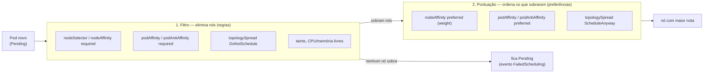
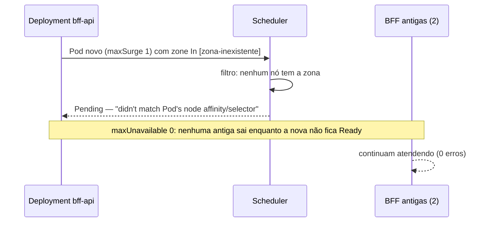
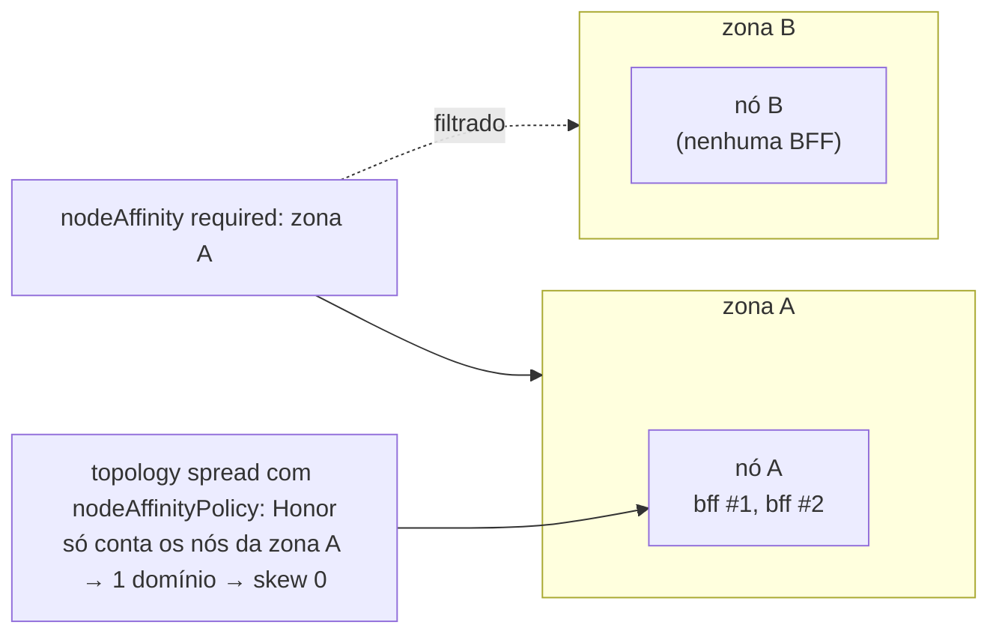
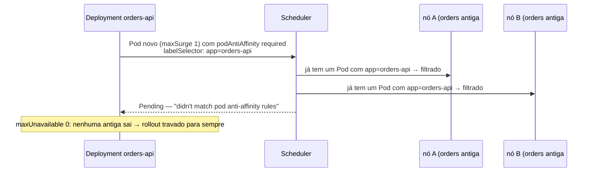
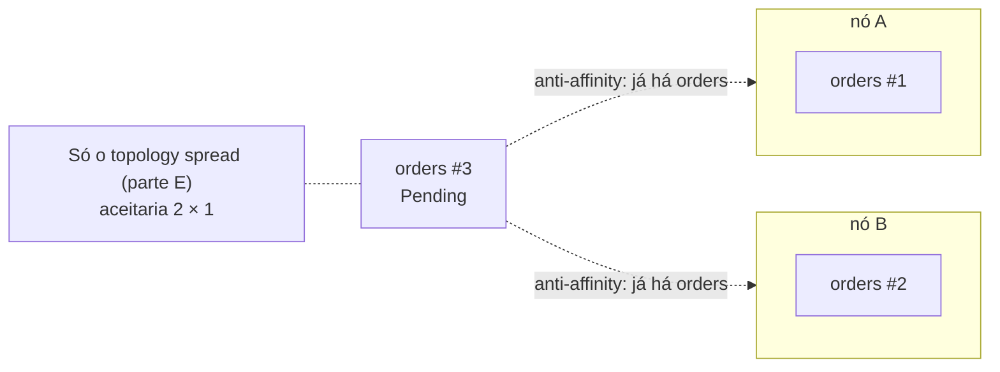
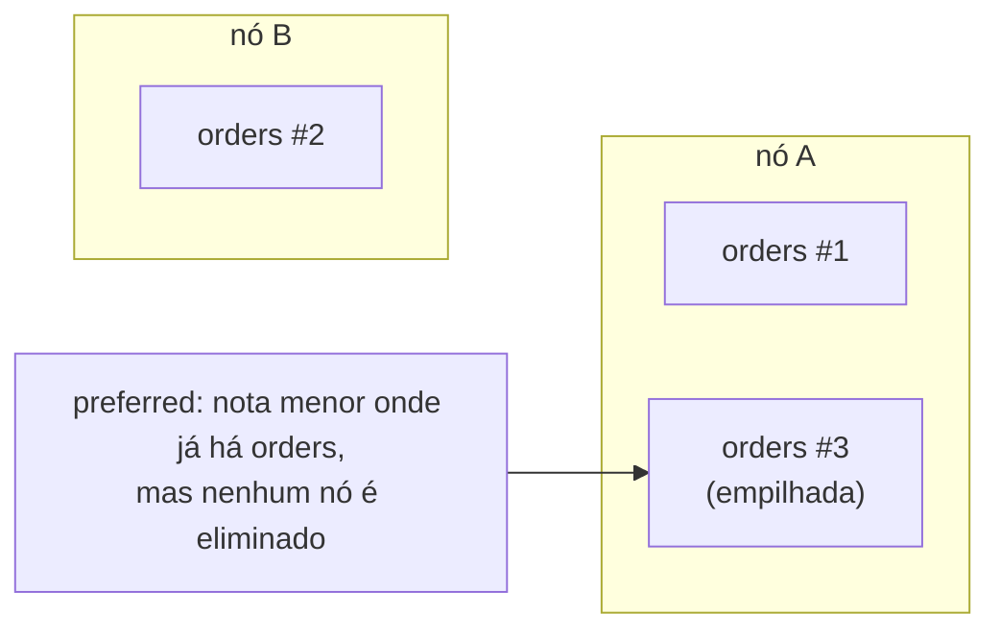
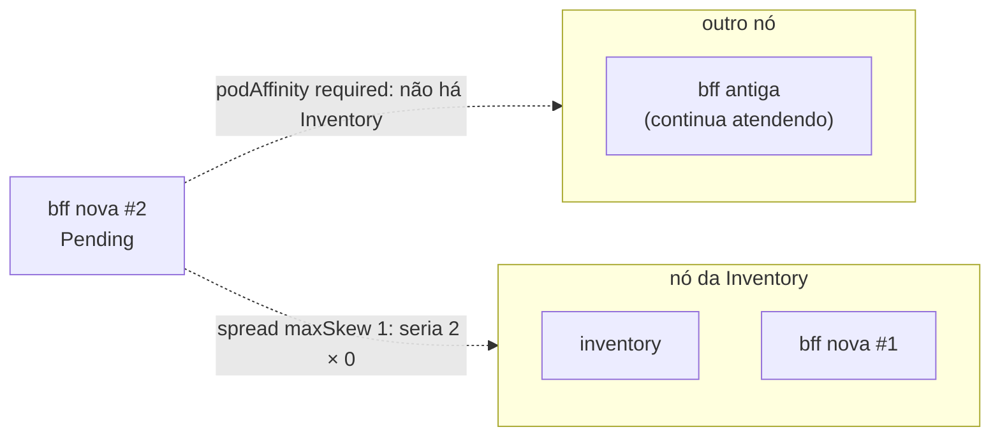
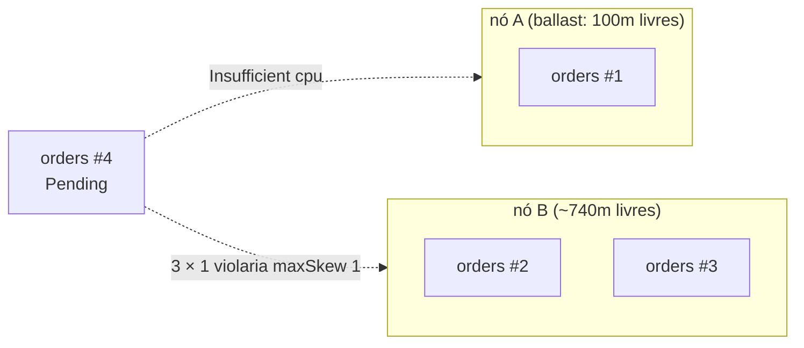
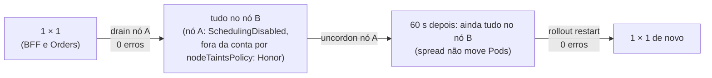

# LAB 04 — Affinity, Anti-affinity & Topology Spread

> **Break it → Observe it → Understand it → Fix it → Validate it**
>
> Duração estimada: 50 min · Partes A–D (afinidades) ≈ 30 min · Parte E (topology spread) ≈ 15 min · Parte F ≈ 5 min

---

## 1. Cenário

O scheduler decide **onde** cada Pod roda. As APIs já declaram duas regras de posicionamento
(`kubernetes/apps/*/deployment.yaml`):

| Regra | Valor | Efeito |
|---|---|---|
| `nodeSelector` | `workload: apps` | só os 2 nós `apps` (`m6i.large`); o nó `observability` tem taint e fica de fora |
| `topologySpreadConstraints` | `maxSkew: 1`, `topologyKey: kubernetes.io/hostname`, `whenUnsatisfiable: DoNotSchedule`, `matchLabelKeys: [pod-template-hash]`, `nodeTaintsPolicy: Honor` | no máximo 1 réplica de diferença entre os nós `apps` |

Neste lab você acrescenta, **uma de cada vez**, as outras ferramentas de posicionamento — `nodeAffinity`,
`podAntiAffinity` e `podAffinity`, nas versões *required* (regra) e *preferred* (preferência) — e observa quando cada
uma **bloqueia** o agendamento, quando só **pontua** e como elas se combinam com o topology spread. Os patches ficam
em `kubernetes/labs/scheduling/`.

O scheduler trabalha em duas etapas, e é isso que explica todo o lab:



Regra prática: *required* e `DoNotSchedule` são **filtros** (podem deixar o Pod `Pending`); *preferred* e
`ScheduleAnyway` são **pontuação** (nunca bloqueiam).

## 2. Hipótese

1. `nodeAffinity` *required* para uma zona sem nós deixa o Pod novo `Pending`; a mesma regra *preferred* não muda nada.
   Num rollout com `maxUnavailable: 0`, um Pod novo `Pending` **não derruba** o serviço: as réplicas antigas continuam.
2. `podAntiAffinity` *required* por nó limita a Orders a **1 réplica por nó**: com 2 nós, a 3ª fica `Pending`.
   Sem `matchLabelKeys`, a regra também conta as réplicas do ReplicaSet antigo e **trava o próprio rollout**.
3. `podAntiAffinity` *preferred* espalha quando pode e **empilha** quando não há nó livre.
4. `podAffinity` *preferred* perde para o topology spread (filtro vence pontuação); *required* somado ao spread pode
   não ter solução e deixa réplicas `Pending`.
5. Com `maxSkew: 1` rígido, uma réplica fica `Pending` em vez de ir para um nó que já tem uma a mais — **mesmo que esse
   nó tenha CPU livre**. E o spread só vale **no agendamento**: depois de um drain, nada rebalanceia sozinho.

## 3. Pré-requisitos

- LAB 02 concluído (os scripts `labs/lab-02/watch-pod.sh` e `labs/lab-02/count-responses.sh` são reutilizados aqui).
- `scripts/reset.sh` executado; `export CLUSTER_ID=<seu id>` e kubectl apontando para o seu cluster.
- **3 terminais** na raiz do repositório, todos com o mesmo `CLUSTER_ID`.

## 4. Estado inicial

```bash
kubectl get nodes -l workload=apps -L topology.kubernetes.io/zone
kubectl -n ecommerce get pods -o wide --sort-by=.spec.nodeName
for d in bff-api orders-api inventory-api; do
  echo "$d affinity=$(kubectl -n ecommerce get deploy $d -o jsonpath='{.spec.template.spec.affinity}')"
done
kubectl -n kube-system get deploy -l app.kubernetes.io/name=aws-cluster-autoscaler    # READY 1/1
```

Esperado: 2 nós `apps` (de preferência em **zonas diferentes** — a parte A3 depende disso), BFF e Orders com
**1 réplica em cada nó**, Inventory com 1 réplica, `affinity=` vazio nos três Deployments, Cluster Autoscaler ligado.

Guarde os nomes que o lab usa. O **nó A** é um nó `apps` **sem** a Inventory (réplica única: drená-la derrubaria a
dependência — veja o challenge 5):

```bash
export INV_NODE=$(kubectl -n ecommerce get pod -l app.kubernetes.io/name=inventory-api -o jsonpath='{.items[0].spec.nodeName}')
export NODE_A=$(kubectl get nodes -l workload=apps -o name | sed 's#node/##' | grep -v "$INV_NODE" | head -1)
export NODE_B=$(kubectl get nodes -l workload=apps -o name | sed 's#node/##' | grep -v "$NODE_A" | head -1)
export ZONE_A=$(kubectl get node $NODE_A -o jsonpath='{.metadata.labels.topology\.kubernetes\.io/zone}')
echo "A=$NODE_A ($ZONE_A)  B=$NODE_B  Inventory em $INV_NODE"
```

## 5. Comandos executáveis

Deixe rodando durante todo o lab:

```bash
# Terminal 1 — onde cada réplica está
kubectl -n ecommerce get pods -w -o 'custom-columns=POD:.metadata.name,STATUS:.status.phase,NODE:.spec.nodeName'

# Terminal 2 — por que um Pod não foi agendado
kubectl -n ecommerce get events -w --field-selector reason=FailedScheduling

# Terminal 3 — carga contínua: 10 pedidos/s por 45 min (com retry do cliente)
scripts/k6.sh create-orders.js RATE=10 DURATION=45m
```

Antes de cada parte, marque o início da janela para contar as respostas da BFF só daquele trecho:

```bash
export T0=$(date -u +%FT%TZ)
# ... passo ...
labs/lab-02/count-responses.sh "$T0"
```

Entre as partes, **limpe** a afinidade aplicada (o patch `clear-affinity` apaga o campo e é idempotente):

```bash
kubectl -n ecommerce patch deploy bff-api    --patch-file kubernetes/labs/scheduling/clear-affinity.patch.yaml
kubectl -n ecommerce patch deploy orders-api --patch-file kubernetes/labs/scheduling/clear-affinity.patch.yaml
kubectl -n ecommerce rollout status deploy/bff-api && kubectl -n ecommerce rollout status deploy/orders-api
```

Cada patch muda o template do Pod e dispara um **rollout** (`maxSurge: 1`, `maxUnavailable: 0`): um Pod novo sobe
**antes** de um antigo sair. Por isso um Pod novo `Pending` aparece como **rollout travado**, não como queda do serviço.

## 6. Falha provocada

Execute as partes **na ordem** (A → B → C → D → E), no terminal de comandos.

### Parte A — `nodeSelector` × `nodeAffinity` (BFF)

O `nodeSelector` já é uma regra *required* simples (igualdade de label). O `nodeAffinity` adiciona operadores
(`In`, `NotIn`, `Exists`, `Gt`, `Lt`) e a versão *preferred*. As duas convivem: o nó precisa satisfazer **ambas**.

**A1 — *required* para uma zona que não existe:**

```bash
export T0=$(date -u +%FT%TZ)
kubectl -n ecommerce patch deploy bff-api --patch-file kubernetes/labs/scheduling/bff-zone-required-missing.patch.yaml
sleep 30
kubectl -n ecommerce get pods -l app.kubernetes.io/name=bff-api -o wide
kubectl -n ecommerce rollout status deploy/bff-api --timeout=10s       # não conclui
labs/lab-02/count-responses.sh "$T0"
```



**A2 — a mesma zona, *preferred*:** limpe a parte A1 e aplique a versão de preferência.

```bash
kubectl -n ecommerce patch deploy bff-api --patch-file kubernetes/labs/scheduling/clear-affinity.patch.yaml
kubectl -n ecommerce rollout status deploy/bff-api
kubectl -n ecommerce patch deploy bff-api --patch-file kubernetes/labs/scheduling/bff-zone-preferred-missing.patch.yaml
kubectl -n ecommerce rollout status deploy/bff-api                     # conclui normalmente
kubectl -n ecommerce get pods -l app.kubernetes.io/name=bff-api -o wide
```

**A3 — *required* para a zona do nó A** (só faz sentido se `NODE_B` estiver em outra zona — confira na seção 4):

```bash
kubectl -n ecommerce patch deploy bff-api --patch-file kubernetes/labs/scheduling/clear-affinity.patch.yaml
kubectl -n ecommerce rollout status deploy/bff-api
kubectl -n ecommerce patch deploy bff-api --type strategic \
  --patch "$(sed "s/__ZONE__/$ZONE_A/" kubernetes/labs/scheduling/bff-zone-required.patch.yaml)"
kubectl -n ecommerce rollout status deploy/bff-api
kubectl -n ecommerce get pods -l app.kubernetes.io/name=bff-api -o wide  # as 2 no nó A?
```



| Cenário | Ação | Comportamento esperado | Como verificar |
|---|---|---|---|
| A1 — *required* inalcançável | `bff-zone-required-missing` | Pod novo `Pending`; rollout travado; as 2 BFF antigas atendem | terminal 2: `didn't match Pod's node affinity/selector`; `rollout status` não conclui; `count-responses.sh` sem 5xx |
| A2 — *preferred* inalcançável | `bff-zone-preferred-missing` | rollout conclui; 1 BFF por nó (o spread decide) | `rollout status` ok; `get pods -o wide` |
| A3 — *required* zona A | `bff-zone-required` com `$ZONE_A` | as 2 BFF no nó A; o spread não reclama (só 1 domínio conta) | `get pods -o wide`: mesmo `NODE` nas duas |

Ao terminar a parte A, limpe a BFF (`clear-affinity`, seção 5).

### Parte B — `podAntiAffinity` *required* (Orders)

Desligue o **Cluster Autoscaler**: com ele ligado, um Pod `Pending` por anti-affinity faz o CA criar um 3º nó (onde a
regra é satisfeita) e o bloqueio some — é o challenge 2.

```bash
kubectl -n kube-system scale deploy -l app.kubernetes.io/name=aws-cluster-autoscaler --replicas=0
kubectl -n kube-system get deploy -l app.kubernetes.io/name=aws-cluster-autoscaler   # READY 0/0 = desligado
```

**B1 — a regra ingênua (sem `matchLabelKeys`):**

```bash
export T0=$(date -u +%FT%TZ)
kubectl -n ecommerce patch deploy orders-api --patch-file kubernetes/labs/scheduling/orders-anti-required-naive.patch.yaml
sleep 30
kubectl -n ecommerce get pods -l app.kubernetes.io/name=orders-api -o wide
kubectl -n ecommerce rollout status deploy/orders-api --timeout=10s    # não conclui
labs/lab-02/count-responses.sh "$T0"
```



O `labelSelector` não distingue o ReplicaSet novo do antigo: as réplicas antigas "bloqueiam" as novas.

**B2 — a regra correta (com `matchLabelKeys: [pod-template-hash]`):** limpe e aplique.

```bash
kubectl -n ecommerce patch deploy orders-api --patch-file kubernetes/labs/scheduling/clear-affinity.patch.yaml
kubectl -n ecommerce rollout status deploy/orders-api
kubectl -n ecommerce patch deploy orders-api --patch-file kubernetes/labs/scheduling/orders-anti-required.patch.yaml
kubectl -n ecommerce rollout status deploy/orders-api                  # conclui: só o ReplicaSet novo conta
```

**B3 — 3 réplicas em 2 nós:**

```bash
export T0=$(date -u +%FT%TZ)
kubectl -n ecommerce patch hpa orders-api -p '{"spec":{"minReplicas":3}}'
sleep 40
kubectl -n ecommerce get pods -l app.kubernetes.io/name=orders-api -o wide
P=$(kubectl -n ecommerce get pods -l app.kubernetes.io/name=orders-api --field-selector=status.phase=Pending -o name | head -1)
kubectl -n ecommerce describe $P | sed -n '/Events/,$p'
labs/lab-02/count-responses.sh "$T0"
kubectl -n ecommerce patch hpa orders-api -p '{"spec":{"minReplicas":2}}'      # volta a 2
```



A regra de anti-affinity e o spread continuam **ambos** no Deployment (o scheduler aplica os dois filtros). Aqui o
anti-affinity é o mais restritivo — "no máximo 1 por nó" — enquanto o spread aceitaria 2 × 1.

| Cenário | Ação | Comportamento esperado | Como verificar |
|---|---|---|---|
| B1 — sem `matchLabelKeys` | `orders-anti-required-naive` | Pod novo `Pending`; rollout travado; Orders antigas atendem | terminal 2: `didn't match pod anti-affinity rules`; `rollout status` não conclui; sem 5xx |
| B2 — com `matchLabelKeys` | `orders-anti-required` | rollout conclui; 1 Orders por nó | `rollout status` ok |
| B3 — 3 réplicas | HPA `minReplicas: 3` | 3ª réplica `Pending`, com CPU livre nos nós | `describe pod`: `didn't match pod anti-affinity rules` |

### Parte C — `podAntiAffinity` *preferred* (Orders)

```bash
kubectl -n ecommerce patch deploy orders-api --patch-file kubernetes/labs/scheduling/clear-affinity.patch.yaml
kubectl -n ecommerce rollout status deploy/orders-api
kubectl -n ecommerce patch deploy orders-api --patch-file kubernetes/labs/scheduling/orders-anti-preferred.patch.yaml
kubectl -n ecommerce rollout status deploy/orders-api

kubectl -n ecommerce patch hpa orders-api -p '{"spec":{"minReplicas":3}}'
sleep 40; kubectl -n ecommerce get pods -l app.kubernetes.io/name=orders-api -o wide    # 2 × 1, todas Running
kubectl -n ecommerce patch hpa orders-api -p '{"spec":{"minReplicas":2}}'

# Religue o Cluster Autoscaler (desligado na parte B). READY 1/1 = ligado.
kubectl -n kube-system scale deploy -l app.kubernetes.io/name=aws-cluster-autoscaler --replicas=1
```



| Cenário | Ação | Comportamento esperado | Como verificar |
|---|---|---|---|
| C — *preferred*, 3 réplicas | `orders-anti-preferred` + `minReplicas: 3` | as 3 `Running` (2 × 1); nenhum `FailedScheduling` | terminal 1 e 2 |

### Parte D — `podAffinity` (BFF perto da Inventory)

`podAffinity` junta Pods: "rode no mesmo nó (ou zona) que tal Pod". O alvo aqui é a **Inventory**, que tem 1 réplica
e portanto está num nó só. (Com a Orders como alvo o efeito não apareceria: ela já tem uma réplica em **cada** nó, e
qualquer nó satisfaria a regra.)

**D1 — *preferred*:**

```bash
export T0=$(date -u +%FT%TZ)
kubectl -n ecommerce patch deploy bff-api --patch-file kubernetes/labs/scheduling/bff-affinity-inventory-preferred.patch.yaml
kubectl -n ecommerce rollout status deploy/bff-api
kubectl -n ecommerce get pods -l 'app.kubernetes.io/name in (bff-api,inventory-api)' -o wide --sort-by=.spec.nodeName
```

**D2 — *required*:** limpe e aplique.

```bash
kubectl -n ecommerce patch deploy bff-api --patch-file kubernetes/labs/scheduling/clear-affinity.patch.yaml
kubectl -n ecommerce rollout status deploy/bff-api
kubectl -n ecommerce patch deploy bff-api --patch-file kubernetes/labs/scheduling/bff-affinity-inventory-required.patch.yaml
sleep 40
kubectl -n ecommerce get pods -l 'app.kubernetes.io/name in (bff-api,inventory-api)' -o wide --sort-by=.spec.nodeName
kubectl -n ecommerce rollout status deploy/bff-api --timeout=10s       # não conclui
labs/lab-02/count-responses.sh "$T0"
```



| Cenário | Ação | Comportamento esperado | Como verificar |
|---|---|---|---|
| D1 — *preferred* | `bff-affinity-inventory-preferred` | rollout conclui; BFF continua 1 por nó (o spread filtra, a preferência só pontua) | `get pods -o wide` |
| D2 — *required* | `bff-affinity-inventory-required` | 1ª BFF nova no nó da Inventory; 2ª `Pending`; rollout travado com 1 nova + 1 antiga atendendo | terminal 2: `didn't match pod affinity rules` e `didn't match pod topology spread constraints`; sem 5xx |

Ao terminar, limpe a BFF (`clear-affinity`, seção 5).

### Parte E — topology spread (falha de nó)

Mantenha o k6 rodando (terminal 3). O terminal 1 já mostra **onde** cada réplica está. Use o `NODE_A` (sem a
Inventory) e o `NODE_B` definidos na seção 4.

**E1 — distribuição inicial.** Cada API com 2 réplicas tem **uma em cada nó**:

```bash
kubectl -n ecommerce get pods -l 'app.kubernetes.io/name in (bff-api,orders-api)' -o wide --sort-by=.spec.nodeName
```

**E2 — a regra é rígida.** Primeiro desligue o **Cluster Autoscaler (CA)**: o componente que adiciona nós ao node
group `apps` (2 a 5 nós) quando há Pods `Pending` por falta de espaço, e remove nós ociosos. Ligado, ele veria a
réplica pendente deste passo e criaria um 3º nó em 2–4 min — um nó com 0 réplicas, onde ela cabe sem violar o
`maxSkew` — e o bloqueio que você quer observar sumiria. "Desligar" é escalar o Deployment dele para 0:

```bash
kubectl -n kube-system scale deploy -l app.kubernetes.io/name=aws-cluster-autoscaler --replicas=0
kubectl -n kube-system get deploy -l app.kubernetes.io/name=aws-cluster-autoscaler   # READY 0/0 = desligado
```

Agora ocupe a CPU livre **só do nó A** e peça 4 réplicas da Orders:

```bash
python3 labs/lab-05/fill-capacity.py --node $NODE_A --slack 100
kubectl -n ecommerce patch hpa orders-api -p '{"spec":{"minReplicas":4}}'
sleep 40
kubectl -n ecommerce get pods -l app.kubernetes.io/name=orders-api -o wide
P=$(kubectl -n ecommerce get pods -l app.kubernetes.io/name=orders-api --field-selector=status.phase=Pending -o name | head -1)
kubectl -n ecommerce describe $P | sed -n '/Events/,$p'
kubectl describe node $NODE_B | grep -A6 'Allocated resources'     # o nó B tem CPU livre
```

Libere o nó A e veja a réplica pendente subir **nele**:

```bash
kubectl -n loadtest delete pod -l app.kubernetes.io/name=capacity-ballast
sleep 20; kubectl -n ecommerce get pods -l app.kubernetes.io/name=orders-api -o wide
kubectl -n ecommerce patch hpa orders-api -p '{"spec":{"minReplicas":2}}'      # volta a 2 (aguarde ~1 min)
```



Sem o ballast, o nó A volta a ter CPU e a réplica #4 sobe nele: **2 × 2**.

**E3 — drain de um nó e o que acontece depois.**



```bash
export T0=$(date -u +%FT%TZ)
kubectl drain $NODE_A --ignore-daemonsets --delete-emptydir-data
sleep 30
kubectl -n ecommerce get pods -o wide --sort-by=.spec.nodeName
labs/lab-02/count-responses.sh "$T0"

kubectl uncordon $NODE_A
sleep 60
kubectl -n ecommerce get pods -o wide --sort-by=.spec.nodeName           # ainda tudo no nó B?

export T0=$(date -u +%FT%TZ)
kubectl -n ecommerce rollout restart deploy/orders-api deploy/bff-api
kubectl -n ecommerce rollout status deploy/orders-api && kubectl -n ecommerce rollout status deploy/bff-api
kubectl -n ecommerce get pods -o wide --sort-by=.spec.nodeName
labs/lab-02/count-responses.sh "$T0"

# Religue o Cluster Autoscaler (desligado na E2). READY 1/1 = ligado.
kubectl -n kube-system scale deploy -l app.kubernetes.io/name=aws-cluster-autoscaler --replicas=1
kubectl -n kube-system get deploy -l app.kubernetes.io/name=aws-cluster-autoscaler
```

> As APIs agora têm PodDisruptionBudgets (`maxUnavailable: 1`). Com 1 réplica por nó, o drain do nó A tira no máximo
> 1 réplica de cada API e respeita o budget — o comportamento esperado é o mesmo das medições abaixo, que foram feitas
> antes dos PDBs existirem.

### Parte F — comparação

Sem comandos: preencha mentalmente (ou em grupo) a tabela da seção 8 com o que você viu nas partes A–E.

## 7. Observações

### A–D — afinidades

Valores medidos no cluster `rw-cluster0001` (10 pedidos/s; nós `apps` em `us-east-1c` e `us-east-1b`), na validação
deste lab. Nenhuma das partes gerou erro na BFF: em todas, as réplicas antigas (ou as que já rodavam) seguiram
atendendo enquanto o scheduler recusava as novas.

| Parte | Pods | Evento `FailedScheduling` (trecho) | BFF |
|---|---|---|---|
| A1 | 1 BFF nova `Pending` + 2 antigas `Running`; `rollout status` → `timed out waiting for the condition` | `2 node(s) didn't match Pod's node affinity/selector` | 503 × `201`, 0 erros |
| A2 | rollout concluído em **6 s**, 1 BFF por nó | nenhum | sem 5xx |
| A3 | rollout concluído; **as 2 BFF no mesmo nó** (zona A) | nenhum | 123 × `201`, 0 erros |
| B1 | 1 Orders nova `Pending` + 2 antigas `Running`; rollout travado | `2 node(s) didn't match pod anti-affinity rules` | 491 × `201`, 0 erros |
| B2 | rollout concluído em **7 s**, 1 Orders por nó | nenhum | sem 5xx |
| B3 | 3ª Orders `Pending`, com o nó em **67%** de CPU reservada (1300m de 1930m) | `2 node(s) didn't match pod anti-affinity rules` | 514 × `201`, 0 erros |
| C | 3 Orders `Running`, 2 × 1 | nenhum | 454 × `201`, 0 erros |
| D1 | rollout concluído; BFF continua 1 por nó (uma delas no nó da Inventory) | nenhum | 85 × `201`, 0 erros |
| D2 | 1 BFF nova no nó da Inventory + 1 nova `Pending` + 1 antiga `Running`; rollout travado | `1 node(s) didn't match pod affinity rules, 1 node(s) didn't match pod topology spread constraints` | 556 × `201`, 0 erros |

O texto completo do evento também lista o nó `observability` (`had untolerated taint(s)`) e a avaliação de preemption
(`Preemption is not helpful for scheduling`); procure a parte que corresponde à regra do passo.

> **Observado antes da validação:** depois de um pico do HPA (LAB 06), as 2 réplicas da Orders estavam **no mesmo nó**.
> No scale-down, o ReplicaSet remove réplicas sem consultar o topology spread — a regra vale só para agendar.
> Um `rollout restart` (ou o descheduler) redistribui.

### E — topology spread

Valores medidos no cluster `rw-0001` (10 pedidos/s) durante a validação do lab.

| Passo | O que aparece |
|---|---|
| E1 | BFF e Orders: **1 réplica em cada nó `apps`** |
| E2, 40 s depois | 3ª réplica no nó B; 4ª **`Pending`** com *"0/3 nodes are available: 1 Insufficient cpu, 1 node(s) didn't match pod topology spread constraints, 1 node(s) had untolerated taint(s) … preemption: … Preemption is not helpful for scheduling"* |
| E2, nó B | `cpu 1190m (61%)` de 1930m: **~740m livres**, e mesmo assim a réplica não foi para lá (ficaria 3 × 1) |
| E2, sem o ballast | a réplica pendente sobe **no nó A** em segundos → 2 × 2 |
| E2, `minReplicas: 2` | o ReplicaSet remove réplicas mantendo o equilíbrio → 1 × 1 |
| E3, drain | `evicting pod ecommerce/bff-api…`, `…orders-api…`; o drain respeita o PDB do CoreDNS (`Cannot evict pod as it would violate the pod's disruption budget`, nova tentativa em 5 s); tudo vai para o nó B |
| E3, BFF durante o drain | **513 × `201`, 0 erros** (readiness + graceful shutdown do LAB 02) |
| E3, 60 s após `uncordon` | **tudo continua no nó B**: o nó A voltou, mas nada se move |
| E3, `rollout restart` | 1 réplica em cada nó de novo; BFF: **282 × `201`, 0 erros** |

## 8. Explicação técnica

- **Filtro × pontuação.** *required* e `DoNotSchedule` eliminam nós; se nenhum sobra, o Pod fica `Pending` com um
  evento `FailedScheduling` que lista o motivo de cada nó. *preferred* (com `weight` de 1 a 100) e `ScheduleAnyway` só
  somam pontos entre os nós que passaram no filtro — nunca deixam um Pod `Pending`. Todas as regras de um Pod valem
  **juntas** (E lógico): é por isso que D2 não tem solução.
- **`IgnoredDuringExecution`.** Todas essas regras são avaliadas **só no agendamento**. Mudar o label de um nó ou
  aplicar uma regra nova não move Pods que já rodam; só Pods novos (rollout, restart, scale) seguem a regra nova.
- **`nodeAffinity` × `nodeSelector`.** O `nodeSelector` é a forma curta de um *required* com igualdade. Quando os dois
  existem, o nó precisa satisfazer os dois. `topology.kubernetes.io/zone` é um label que o EKS coloca em todo nó.
- **Anti-affinity e rollouts (B1).** O `labelSelector` de um `podAffinityTerm` casa com **qualquer** Pod com aqueles
  labels — inclusive os do ReplicaSet antigo. Com `required` + 1 por nó + todos os nós ocupados, o Pod extra do
  rollout não tem lugar e `maxUnavailable: 0` impede que um antigo saia primeiro. Saídas: `matchLabelKeys:
  [pod-template-hash]` (conta só o ReplicaSet atual, B2), `maxUnavailable: 1` no Deployment, ou nós sobrando.
- **Anti-affinity × topology spread.** Os dois espalham réplicas, mas com garantias diferentes: anti-affinity
  *required* é "no máximo 1 por domínio" (com 2 nós, no máximo 2 réplicas — o resto fica `Pending`); o spread é "no
  máximo `maxSkew` de diferença" (com 2 nós aceita 2 × 1, 2 × 2, 3 × 2…). Para um serviço que escala com HPA, o spread
  é quase sempre a escolha certa; anti-affinity *required* serve para "nunca dois no mesmo nó" (ex.: réplicas de um
  banco com volume local).
- **`podAffinity` e o trade-off (D).** Juntar a BFF da dependência reduz a latência de rede (mesmo nó) — mas aumenta o
  *blast radius*: perder aquele nó leva a BFF **e** a dependência ao mesmo tempo. Aqui a BFF nem chama a Inventory
  diretamente (BFF → Orders → Inventory), então a co-localização não ganha nada e só concentra risco. `podAffinity`
  *required* ainda é cara para o scheduler (precisa olhar os Pods de todos os nós) e pode não ter solução quando
  combinada com outras regras.
- **Topology spread é uma regra de agendamento.** O scheduler a avalia só quando um Pod é criado:
  - `maxSkew: 1` + `DoNotSchedule`: um Pod só vai para um nó se, depois disso, a diferença entre o nó com mais e o
    com menos réplicas for ≤ 1. Por isso a 4ª réplica (E2) esperou o nó A, ignorando a CPU livre do nó B. Com
    `ScheduleAnyway` seria só uma preferência: ela iria para o B (3 × 1).
  - `nodeAffinityPolicy` (padrão `Honor`) + o `nodeSelector workload=apps`: o nó `observability` não conta — e na A3,
    só os nós da zona escolhida contam. `nodeTaintsPolicy: Honor`: nós com taint — inclusive o
    `node.kubernetes.io/unschedulable` do cordon/drain — saem da conta. Sem isso, o nó drenado seria um domínio com 0
    réplicas e **todo** Pod novo ficaria `Pending` (E3).
  - `matchLabelKeys: [pod-template-hash]`: só o ReplicaSet atual conta; num rollout as réplicas antigas não
    desequilibram a distribuição das novas (o mesmo problema da B1, resolvido do mesmo jeito).
  - Nada rebalanceia depois (E3): o spread não move Pods que já rodam. Para redistribuir, um `rollout restart` (ou o
    [descheduler](https://github.com/kubernetes-sigs/descheduler) com `RemovePodsViolatingTopologySpreadConstraint`).
    Entre o `uncordon` e o restart, perder o nó B derrubaria **todas** as réplicas.
- **Regras + Cluster Autoscaler.** O CA simula um nó novo do node group e só aumenta o grupo se o Pod pendente
  **caberia** nele. Com o CA ligado, a réplica pendente da E2 (spread) e a da B3 (anti-affinity) fariam o CA criar um
  nó novo — por isso ele fica desligado nesses passos. Na A1 (zona inexistente) e na D2 (precisa da Inventory, que
  não estaria no nó novo), o CA não ajuda: o Pod continua `Pending` mesmo com ele ligado.
- **Spread não protege réplica única.** A Inventory tem 1 réplica (estado em memória, `Recreate`): qualquer drain
  do nó dela derruba a dependência até o Pod subir em outro nó.

**Parte F — comparação:**

| Mecanismo | Garante | Bloqueia (Pending)? | Custo para o scheduler / CA | Uso típico |
|---|---|---|---|---|
| `nodeSelector` | Pod só em nós com o label | sim, se nenhum nó tem o label | mínimo | separar pools (`workload=apps`) |
| `nodeAffinity` *required* | idem, com operadores (`In`, `NotIn`, `Exists`…) | sim (A1) | baixo; o CA só cria nó se o template do node group tiver o label | zona, arquitetura, tipo de instância |
| `nodeAffinity` *preferred* | nada; só pontua | não (A2) | baixo | "de preferência" spot, uma AZ |
| `podAffinity` *required* | junto de um Pod alvo no domínio | sim (D2) | alto (olha Pods de todos os nós); o CA raramente ajuda | co-localizar componentes acoplados |
| `podAffinity` *preferred* | nada; só pontua | não (D1) | médio | reduzir latência sem garantir |
| `podAntiAffinity` *required* | no máximo 1 por domínio | sim (B1, B3) | alto; limita réplicas ao número de domínios | réplicas que **nunca** podem dividir nó |
| `podAntiAffinity` *preferred* | nada; espalha quando pode | não (C) | médio | espalhar sem travar o scale |
| `topologySpread` `DoNotSchedule` | diferença ≤ `maxSkew` entre domínios | sim (E2) | médio; o CA cria nó se o Pod couber num domínio novo | alta disponibilidade de serviços com HPA |
| `topologySpread` `ScheduleAnyway` | nada; só pontua | não | médio | espalhar sem nunca travar |

## 9. Correção

Não há bug a corrigir: as regras foram aplicadas de propósito. A "correção" é voltar ao manifesto do repositório:

```bash
for d in bff-api orders-api inventory-api; do
  kubectl -n ecommerce patch deploy $d --patch-file kubernetes/labs/scheduling/clear-affinity.patch.yaml
done
kubectl -n ecommerce patch hpa orders-api -p '{"spec":{"minReplicas":2}}'
kubectl -n loadtest delete pod -l app.kubernetes.io/name=capacity-ballast --ignore-not-found
kubectl uncordon $NODE_A
kubectl -n kube-system scale deploy -l app.kubernetes.io/name=aws-cluster-autoscaler --replicas=1
kubectl -n ecommerce rollout restart deploy/orders-api deploy/bff-api      # redistribui 1 por nó
```

## 10. Validação

```bash
for d in bff-api orders-api inventory-api; do
  echo "$d affinity=$(kubectl -n ecommerce get deploy $d -o jsonpath='{.spec.template.spec.affinity}')"
done                                                                     # vazio nos três
kubectl get nodes -l workload=apps                                       # nenhum SchedulingDisabled
kubectl -n kube-system get deploy -l app.kubernetes.io/name=aws-cluster-autoscaler   # READY 1/1
kubectl -n ecommerce get pods -l 'app.kubernetes.io/name in (bff-api,orders-api)' -o wide --sort-by=.spec.nodeName
kubectl -n ecommerce get pods --field-selector=status.phase=Pending      # nenhum
```

| Cenário | Ação | Comportamento esperado | Como verificar |
|---|---|---|---|
| A — `nodeAffinity` | A1 *required* inalcançável, A2 *preferred*, A3 *required* zona A | A1 trava o rollout sem queda; A2 não muda nada; A3 concentra as 2 BFF no nó A | terminal 2 + `rollout status` + `get pods -o wide` |
| B — anti-affinity *required* | B1 sem `matchLabelKeys`, B2 com, B3 3 réplicas | B1 trava o rollout; B2 conclui; B3 deixa a 3ª `Pending` | `didn't match pod anti-affinity rules` |
| C — anti-affinity *preferred* | 3 réplicas | 2 × 1, todas `Running` | terminal 1, nenhum `FailedScheduling` |
| D — `podAffinity` | D1 *preferred*, D2 *required* | D1 não muda a distribuição; D2 deixa 1 BFF `Pending` | `didn't match pod affinity rules` |
| E2 — skew rígido | ballast no nó A + `minReplicas: 4` | réplica #4 `Pending` com ~740m livres no nó B; sobe no nó A sem ballast | evento `didn't match pod topology spread constraints` |
| E3 — drain e volta | `drain` → `uncordon` → `rollout restart` | tudo no nó B; nada rebalanceia após `uncordon`; restart redistribui | `get pods -o wide`; BFF 0 erros (513 e 282) |
| Ambiente restaurado | seção 9 | `affinity` vazio, nós agendáveis, CA ligado, 1 réplica por nó | comandos acima |

## 11. Challenge

1. Na B3, troque `topologyKey: kubernetes.io/hostname` por `topology.kubernetes.io/zone`. Com os 2 nós em zonas
   diferentes, o resultado muda? E se os 2 nós estiverem na mesma zona?
2. Repita a B3 com o Cluster Autoscaler **ligado**. Quanto tempo até a 3ª réplica rodar, e em qual nó? Quantas
   réplicas a Orders pode ter, no máximo, com o node group `apps` limitado a 5 nós?
3. Explique por que a D2 não tem solução e proponha **duas** formas de resolvê-la sem tirar o topology spread.
4. Por que `matchLabelKeys: [pod-template-hash]` resolve tanto a B1 (anti-affinity) quanto o desequilíbrio do spread
   em rollouts? O que aconteceria num rollout com `maxUnavailable: 1` e a regra ingênua da B1?
5. Repita a E3 drenando o nó **da Inventory**. Quantos `503` a BFF devolve e por quanto tempo? O que mudaria com 2
   réplicas da Inventory — e por que hoje ela não pode ter 2 (estoque em memória)?
6. Repita a E2 com o Cluster Autoscaler **ligado**. Quanto tempo até a réplica pendente rodar, e em qual nó?

## 12. Critérios de sucesso

- [ ] A: você explica por que a A1 travou o rollout **sem** derrubar o serviço e por que a A2 não mudou nada.
- [ ] B: o rollout da B1 travou por anti-affinity, a B2 concluiu, e a 3ª réplica da B3 ficou `Pending`.
- [ ] C: com *preferred*, a 3ª réplica rodou empilhada.
- [ ] D: você explica por que a D2 não tem solução (affinity **e** spread).
- [ ] E: a 4ª réplica ficou `Pending` com CPU livre no outro nó, e após o `uncordon` nada se moveu até o restart.
- [ ] F: você sabe dizer, para cada mecanismo da tabela, se ele filtra ou só pontua.

## 13. Reset

Os patches deste lab adicionam `spec.template.spec.affinity`, que **não existe** no manifesto: o `kubectl apply -k`
do `scripts/reset.sh` não remove campos que ele nunca aplicou. Remova a afinidade explicitamente:

```bash
kubectl -n loadtest delete jobs -l app.kubernetes.io/name=k6     # se o k6 ainda estiver rodando
for d in bff-api orders-api inventory-api; do
  kubectl -n ecommerce patch deploy $d --patch-file kubernetes/labs/scheduling/clear-affinity.patch.yaml
done
# equivalente em JSON patch (falha se o campo não existir):
#   kubectl -n ecommerce patch deploy orders-api --type json -p '[{"op":"remove","path":"/spec/template/spec/affinity"}]'
scripts/reset.sh       # HPA (minReplicas 2), ballasts, uncordon dos nós apps, CA ligado, falhas
```
