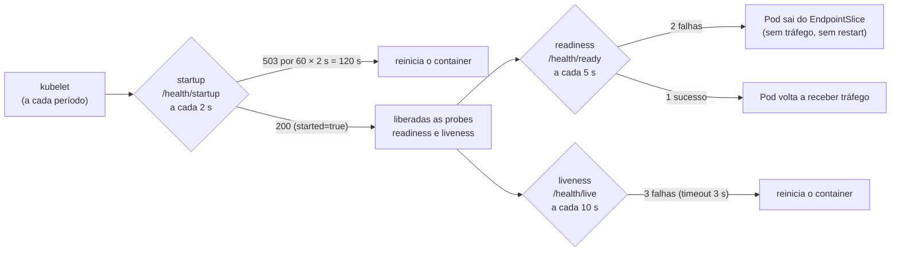
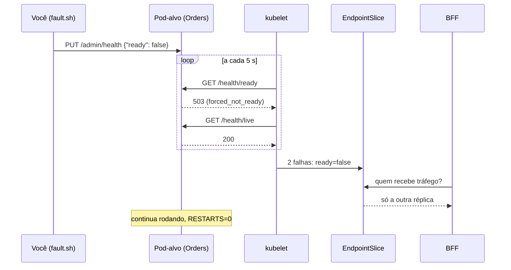
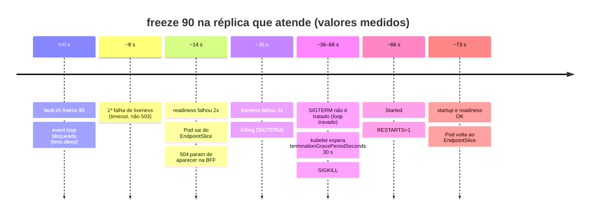
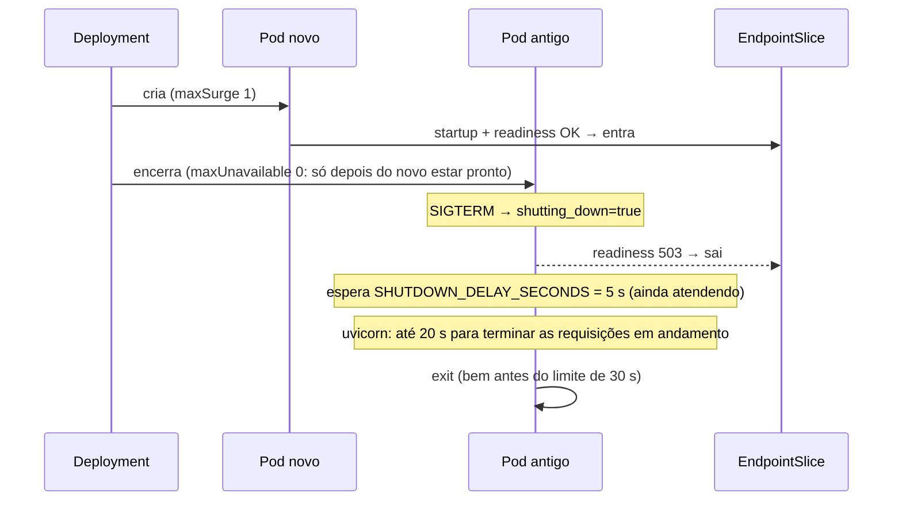
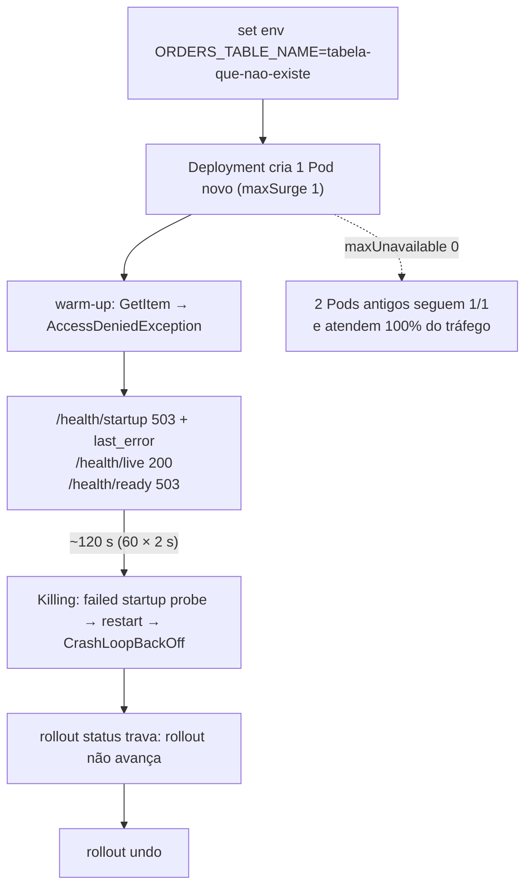
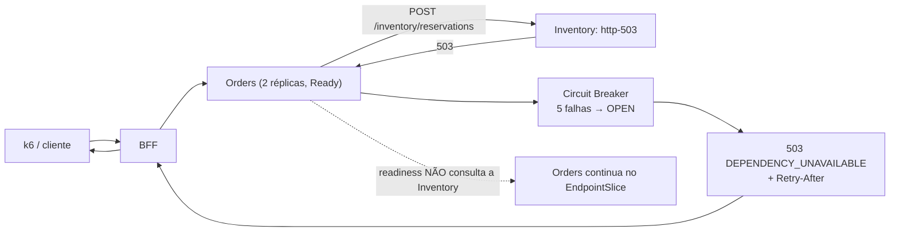
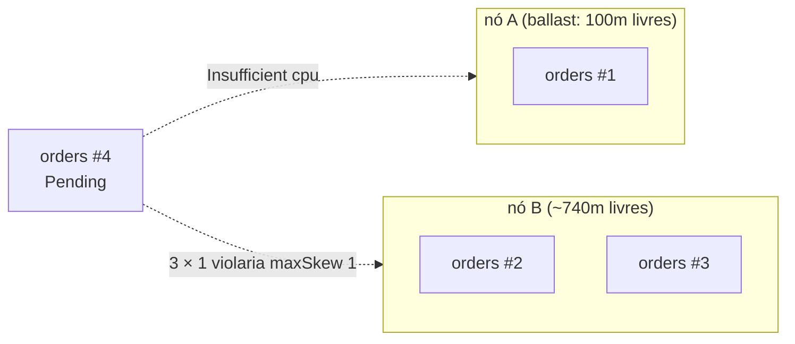
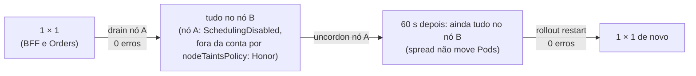

# LAB 05 — Probes, Graceful Shutdown & Topology Spread

> **Break it → Observe it → Understand it → Fix it → Validate it**
>
> Duração estimada: 55 min · Partes A–D (probes) ≈ 40 min · Parte E (topology spread) ≈ 15 min

---

## 1. Cenário

As três APIs expõem **três** health checks com papéis diferentes:

| Probe | Rota | Pergunta | O que o kubelet faz quando falha |
|---|---|---|---|
| **startup** | `/health/startup` | a inicialização terminou? | segura as outras probes; depois de 60 × 2 s = **120 s**, reinicia |
| **readiness** | `/health/ready` | esta réplica pode receber tráfego agora? | **tira o Pod do Service** (2 falhas × 5 s), sem reiniciar |
| **liveness** | `/health/live` | o processo está respondendo? | **reinicia o container** (3 falhas × 10 s, timeout de 3 s) |



Neste lab você faz cada probe falhar **de propósito**, em uma réplica, e observa o que o Kubernetes faz com o
tráfego e com o container. Para isso, a API admin (só `127.0.0.1`, via `kubectl exec`) tem duas falhas:

| Comando | O que faz dentro do Pod | `/health/ready` | `/health/live` |
|---|---|---|---|
| `scripts/fault.sh orders not-ready <pod>` | liga a flag `forced_not_ready` | **503** | **200** |
| `scripts/fault.sh orders freeze <s> <pod>` | `time.sleep(<s>)` síncrono **dentro do event loop**: o processo para de atender tudo | sem resposta (timeout) | sem resposta (timeout) |

> Por que não `kill -STOP 1`? O Linux protege o PID 1 de um container: `SIGSTOP` enviado de dentro do próprio
> container é ignorado. O `freeze` reproduz o mesmo efeito (processo vivo, mas travado).

Probes protegem contra uma **réplica** com problema. Contra a perda de um **nó**, as APIs usam
`topologySpreadConstraints` (`kubernetes/apps/*/deployment.yaml`): no máximo **1 réplica de diferença** entre os
nós `apps` (`maxSkew: 1`, `topologyKey: kubernetes.io/hostname`, `whenUnsatisfiable: DoNotSchedule`). A parte E
mostra a regra em ação: quando ela bloqueia, quando ela não ajuda e por que ela não rebalanceia sozinha.

## 2. Hipótese

1. Com **readiness** falhando e liveness OK, o Pod sai do tráfego em ~10 s e **nunca** é reiniciado.
2. Com o processo **travado**, o Pod primeiro sai do tráfego (readiness) e, ~30 s depois, é **reiniciado** (liveness).
3. Um **rollout** sob carga não gera erros: no `SIGTERM` a réplica deixa de ficar pronta e espera 5 s antes de parar.
4. Um deploy com configuração errada **não derruba o serviço**: o Pod novo nunca fica pronto, o rollout não avança e
   as réplicas antigas continuam atendendo.
5. Com a **Inventory fora do ar**, a Orders **continua pronta** (a readiness não verifica dependências): o erro
   aparece como `503 DEPENDENCY_UNAVAILABLE`, não como Pods `NotReady`.
6. Com `maxSkew: 1` rígido, uma réplica fica `Pending` em vez de ir para um nó que já tem uma a mais — **mesmo que
   esse nó tenha CPU livre**. E o spread só vale **no agendamento**: depois de um drain, as réplicas não voltam
   sozinhas para o nó recuperado.

## 3. Pré-requisitos

- LAB 01 concluído; `scripts/reset.sh` executado.
- `export CLUSTER_ID=<seu id>` (ex.: `aluno07`) e kubectl apontando para o seu cluster.
- **4 terminais** abertos na raiz do repositório (todos com o mesmo `CLUSTER_ID`).

## 4. Estado inicial

```bash
kubectl -n ecommerce get pods -l app.kubernetes.io/name=orders-api
scripts/fault.sh orders health
```

Esperado: 2 réplicas `1/1`, `RESTARTS 0`, e em cada Pod
`{"started":true,"shutting_down":false,"forced_not_ready":false}`.

Escolha **uma** réplica como alvo e guarde o nome nos terminais 1, 2 e 4:

```bash
export POD=$(kubectl -n ecommerce get pod -l app.kubernetes.io/name=orders-api -o jsonpath='{.items[0].metadata.name}')
echo $POD
```

## 5. Comandos executáveis

Deixe rodando durante todo o lab:

```bash
# Terminal 1 — painel do Pod-alvo: READY, RESTARTS e se ele recebe tráfego (só imprime quando muda)
labs/lab-05/watch-pod.sh $POD

# Terminal 2 — eventos do Pod-alvo (probes falhando, restarts)
kubectl -n ecommerce get events -w --field-selector involvedObject.name=$POD

# Terminal 3 — carga contínua: 10 pedidos/s por 30 min (com retry do cliente usando a MESMA Idempotency-Key)
scripts/k6.sh create-orders.js RATE=10 DURATION=30m
```

O terminal 4 é onde você provoca as falhas. Antes de **cada** parte, marque o início da janela para contar as
respostas da BFF só daquele trecho:

```bash
export T0=$(date -u +%FT%TZ)
# ... falha ...
labs/lab-05/count-responses.sh "$T0"
```

## 6. Falha provocada

Execute as partes **na ordem** (A1 → A2 → B → C → D), no terminal 4.

### Parte A1 — readiness falha, liveness OK



```bash
export T0=$(date -u +%FT%TZ)
scripts/fault.sh orders not-ready $POD
```

Observe os terminais 1 e 2 por **2 minutos**. Depois:

```bash
labs/lab-05/count-responses.sh "$T0"
scripts/fault.sh orders ready $POD     # desfaz; observe o terminal 1 por mais 10 s
```

### Parte A2 — processo travado



Agora mire a réplica que **está atendendo** (a outra). Na A1 o cliente HTTP da BFF moveu suas conexões
keep-alive para ela, então travá-la mostra o impacto real em quem chama:

```bash
export POD=$(kubectl -n ecommerce get pod -l app.kubernetes.io/name=orders-api -o jsonpath='{.items[*].metadata.name}' | tr ' ' '\n' | grep -v "$POD")
# reinicie os terminais 1 e 2 com o novo $POD

export T0=$(date -u +%FT%TZ)
scripts/fault.sh orders freeze 90 $POD
```

Observe por **~90 s** (até o Pod voltar a `READY=true`). Depois: `labs/lab-05/count-responses.sh "$T0"`.

### Parte B — rollout sob carga (graceful shutdown)



```bash
export T0=$(date -u +%FT%TZ)
OLD=$(kubectl -n ecommerce get pod -l app.kubernetes.io/name=orders-api -o jsonpath='{.items[0].metadata.name}')
kubectl -n ecommerce logs -f $OLD | grep --line-buffered SIGTERM &     # o log do Pod que vai encerrar
kubectl -n ecommerce rollout restart deploy/orders-api
kubectl -n ecommerce rollout status deploy/orders-api
sleep 15; kill %1
labs/lab-05/count-responses.sh "$T0"
```

### Parte C — deploy quebrado (startup)



Uma configuração errada: a Orders aponta para uma tabela que não existe (e que o Pod Identity dela não pode ler).

```bash
export T0=$(date -u +%FT%TZ)
kubectl -n ecommerce set env deploy/orders-api ORDERS_TABLE_NAME=tabela-que-nao-existe
sleep 20
NEW=$(kubectl -n ecommerce get pod -l app.kubernetes.io/name=orders-api --sort-by=.metadata.creationTimestamp -o jsonpath='{.items[-1:].metadata.name}')
kubectl -n ecommerce get pods -l app.kubernetes.io/name=orders-api
kubectl -n ecommerce exec $NEW -- python -c "
import urllib.request as u
for p in ('startup', 'live', 'ready'):
    try: r = u.urlopen('http://127.0.0.1:8080/health/' + p); print(p, r.status, r.read().decode()[:200])
    except Exception as e: print(p, e.code, e.read().decode()[:250])"
```

Espere **~2 min** e confira de novo:

```bash
kubectl -n ecommerce get pods -l app.kubernetes.io/name=orders-api
kubectl -n ecommerce get events --field-selector involvedObject.name=$NEW | grep -E 'Unhealthy|Killing'
kubectl -n ecommerce rollout status deploy/orders-api --timeout=10s      # trava: o rollout não avança
labs/lab-05/count-responses.sh "$T0"
```

### Parte D — dependência fora do ar (anti-cascata)



```bash
export T0=$(date -u +%FT%TZ)
scripts/fault.sh inventory http-503
sleep 45
kubectl -n ecommerce get pods -l app.kubernetes.io/name=orders-api
scripts/fault.sh orders cb
labs/lab-05/count-responses.sh "$T0"
scripts/fault.sh all reset
```

### Parte E — topology spread (falha de nó)

Mantenha o k6 rodando (terminal 3). No terminal 1, troque o painel por um que mostra **onde** cada réplica está:

```bash
# Terminal 1
kubectl -n ecommerce get pods -w -o 'custom-columns=POD:.metadata.name,STATUS:.status.phase,NODE:.spec.nodeName'
```

Escolha como **nó A** um nó `apps` **sem** a Inventory (réplica única: drená-la derrubaria a dependência — veja o
challenge 4):

```bash
INV_NODE=$(kubectl -n ecommerce get pod -l app.kubernetes.io/name=inventory-api -o jsonpath='{.items[0].spec.nodeName}')
export NODE_A=$(kubectl get nodes -l workload=apps -o name | sed 's#node/##' | grep -v "$INV_NODE" | head -1)
export NODE_B=$(kubectl get nodes -l workload=apps -o name | sed 's#node/##' | grep -v "$NODE_A" | head -1)
echo "A=$NODE_A  B=$NODE_B"
```

**E1 — distribuição inicial.** Cada API com 2 réplicas tem **uma em cada nó**:

```bash
kubectl -n ecommerce get pods -l 'app.kubernetes.io/name in (bff-api,orders-api)' -o wide --sort-by=.spec.nodeName
```

**E2 — a regra é rígida.** Primeiro desligue o **Cluster Autoscaler (CA)**: o componente que adiciona nós ao node
group `apps` (2 a 5 nós) quando há Pods `Pending` por falta de espaço, e remove nós ociosos. Ligado, ele veria a
réplica pendente deste passo e criaria um 3º nó em 2–4 min — um nó com 0 réplicas, onde ela cabe sem violar o
`maxSkew` — e o bloqueio que você quer observar sumiria. "Desligar" é escalar o Deployment dele para 0:

```bash
kubectl -n kube-system scale deploy -l app.kubernetes.io/name=aws-cluster-autoscaler --replicas=0
kubectl -n kube-system get deploy -l app.kubernetes.io/name=aws-cluster-autoscaler   # READY 0/0 = desligado
```

Agora ocupe a CPU livre **só do nó A** e peça 4 réplicas da Orders:

```bash
python3 labs/lab-03/fill-capacity.py --node $NODE_A --slack 100
kubectl -n ecommerce patch hpa orders-api -p '{"spec":{"minReplicas":4}}'
sleep 40
kubectl -n ecommerce get pods -l app.kubernetes.io/name=orders-api -o wide
P=$(kubectl -n ecommerce get pods -l app.kubernetes.io/name=orders-api --field-selector=status.phase=Pending -o name | head -1)
kubectl -n ecommerce describe $P | sed -n '/Events/,$p'
kubectl describe node $NODE_B | grep -A6 'Allocated resources'     # o nó B tem CPU livre
```

Libere o nó A e veja a réplica pendente subir **nele**:

```bash
kubectl -n loadtest delete pod -l app.kubernetes.io/name=capacity-ballast
sleep 20; kubectl -n ecommerce get pods -l app.kubernetes.io/name=orders-api -o wide
kubectl -n ecommerce patch hpa orders-api -p '{"spec":{"minReplicas":2}}'      # volta a 2 (aguarde ~1 min)
```



Sem o ballast, o nó A volta a ter CPU e a réplica #4 sobe nele: **2 × 2**.

**E3 — drain de um nó e o que acontece depois.**



```bash
export T0=$(date -u +%FT%TZ)
kubectl drain $NODE_A --ignore-daemonsets --delete-emptydir-data
sleep 30
kubectl -n ecommerce get pods -o wide --sort-by=.spec.nodeName
labs/lab-05/count-responses.sh "$T0"

kubectl uncordon $NODE_A
sleep 60
kubectl -n ecommerce get pods -o wide --sort-by=.spec.nodeName           # ainda tudo no nó B?

export T0=$(date -u +%FT%TZ)
kubectl -n ecommerce rollout restart deploy/orders-api deploy/bff-api
kubectl -n ecommerce rollout status deploy/orders-api && kubectl -n ecommerce rollout status deploy/bff-api
kubectl -n ecommerce get pods -o wide --sort-by=.spec.nodeName
labs/lab-05/count-responses.sh "$T0"

# Religue o Cluster Autoscaler (desligado na E2). READY 1/1 = ligado.
kubectl -n kube-system scale deploy -l app.kubernetes.io/name=aws-cluster-autoscaler --replicas=1
kubectl -n kube-system get deploy -l app.kubernetes.io/name=aws-cluster-autoscaler
```

## 7. Observações

Valores medidos no cluster `rw-0001` (10 pedidos/s) durante a validação deste lab. Os seus tempos podem variar
alguns segundos: o kubelet roda cada probe no próprio relógio, sem sincronia com o seu comando.

### A1 — `not-ready`

| Quando (após o comando) | Terminal 1 | Terminal 2 |
|---|---|---|
| ~10 s | `READY=false  RESTARTS=0  recebe-tráfego=não` | `Readiness probe failed: HTTP probe failed with statuscode: 503` |
| 2 min depois | **igual**: continua fora, `RESTARTS=0` | nenhum `Killing` |
| ~5 s após `ready` | `READY=true  recebe-tráfego=true` | — |

Respostas da BFF na janela: **815 × `201`, 0 erros** — a outra réplica atendeu tudo.

### A2 — `freeze 90`

| Quando (após o comando) | Terminal 1 | Terminal 2 |
|---|---|---|
| ~8 s | — | `Liveness probe failed: ... context deadline exceeded (Client.Timeout exceeded while awaiting headers)` (timeout, **não** 503) |
| ~14 s | `READY=false  recebe-tráfego=não` | `Readiness probe failed: ... context deadline exceeded` |
| ~36 s | — | `Killing: Container app failed liveness probe, will be restarted` |
| ~66 s | `RESTARTS=1` | `Started` (30 s depois do `Killing`, veja a seção 8) |
| ~73 s | `READY=true  recebe-tráfego=true` | — |

O restart acontece **antes** dos 90 s do `freeze` acabarem: foi a liveness que destravou a réplica.

Respostas da BFF na janela: **1160 × `201`, 6 × `504`, 2 × `409`** (de 1168).
- `504 UPSTREAM_TIMEOUT`: pedidos que já estavam na réplica quando ela travou esperaram os 3 s de timeout da BFF.
  Pararam quando o Pod saiu do EndpointSlice.
- `409 ORDER_IN_PROGRESS`: o k6 repetiu esses pedidos com a **mesma** `Idempotency-Key`, mas o lease ainda estava
  com a réplica travada. A repetição seguinte (depois do lease) foi confirmada.
- Se você congelar a réplica para a qual a BFF **não** tem conexões abertas (a da A1), os erros podem ser **zero**:
  o impacto depende de quantas conexões keep-alive apontavam para ela.

### B — rollout

- Log do Pod antigo: `SIGTERM recebido: readiness=false, aguardando 5.0s antes de encerrar`.
- `maxSurge: 1, maxUnavailable: 0`: o Pod novo fica `1/1` **antes** de um antigo ser encerrado.
- Respostas da BFF: **0 erros** (2 rodadas: 288 e 277 × `201`).

### C — deploy quebrado

- Pod novo `0/1`; os 2 antigos continuam `1/1`.
- `/health/startup` → `503` com
  `"last_error": "DynamoUnavailable: AccessDeniedException: ... is not authorized to perform: dynamodb:GetItem ..."`.
- `/health/live` → `200` (o processo está vivo; reiniciar não conserta configuração errada).
- `/health/ready` → `503`.
- ~2 min depois: `Killing: Container app failed startup probe, will be restarted` e `RESTARTS 1`. A cada ciclo de
  120 s ele reinicia de novo, com back-off crescente entre as tentativas (`CrashLoopBackOff` aparece entre elas).
- `rollout status` → `timed out waiting for the condition`: o rollout não avança.
- Respostas da BFF: **2121 × `201`, 0 erros** — o Pod quebrado nunca recebeu tráfego.

### D — Inventory em 503

- Orders: 2 réplicas `1/1`, `RESTARTS 0`, **nenhum** evento de probe.
- Circuit Breaker: `OPEN` / `HALF_OPEN` nas réplicas (`consecutive_failures: 5`).
- Respostas da BFF em 45 s: **919 × `503`, 37 × `201`** — `503 DEPENDENCY_UNAVAILABLE` com `Retry-After`, um erro
  de **negócio** que o cliente sabe tratar.

### E — topology spread

| Passo | O que aparece |
|---|---|
| E1 | BFF e Orders: **1 réplica em cada nó `apps`** |
| E2, 40 s depois | 3ª réplica no nó B; 4ª **`Pending`** com *"0/3 nodes are available: 1 Insufficient cpu, 1 node(s) didn't match pod topology spread constraints, 1 node(s) had untolerated taint(s) … preemption: … Preemption is not helpful for scheduling"* |
| E2, nó B | `cpu 1190m (61%)` de 1930m: **~740m livres**, e mesmo assim a réplica não foi para lá (ficaria 3 × 1) |
| E2, sem o ballast | a réplica pendente sobe **no nó A** em segundos → 2 × 2 |
| E2, `minReplicas: 2` | o ReplicaSet remove réplicas mantendo o equilíbrio → 1 × 1 |
| E3, drain | `evicting pod ecommerce/bff-api…`, `…orders-api…`; o drain respeita o PDB do CoreDNS (`Cannot evict pod as it would violate the pod's disruption budget`, nova tentativa em 5 s); tudo vai para o nó B |
| E3, BFF durante o drain | **513 × `201`, 0 erros** (readiness + graceful shutdown da parte B) |
| E3, 60 s após `uncordon` | **tudo continua no nó B**: o nó A voltou, mas nada se move |
| E3, `rollout restart` | 1 réplica em cada nó de novo; BFF: **282 × `201`, 0 erros** |

## 8. Explicação técnica

- **Readiness controla tráfego; liveness controla o processo.** Na A1 só a readiness falha: o EndpointSlice marca o
  Pod como não pronto e kube-proxy/NLB param de enviar requisições, mas o container segue rodando. Na A2 as duas
  falham — primeiro a réplica é isolada (readiness: 2 × 5 s), depois reiniciada (liveness: 3 × 10 s).
- **Os 30 s entre `Killing` e `Started` na A2:** o kubelet envia `SIGTERM`, mas o processo está travado e não
  consegue tratá-lo (o handler roda no próprio event loop). O kubelet espera `terminationGracePeriodSeconds: 30` e
  então envia `SIGKILL`. Um processo saudável encerraria em ~5 s (parte B).
- **Graceful shutdown (parte B):** três tempos atuam no encerramento:

  | Tempo | Onde | Papel |
  |---|---|---|
  | `SHUTDOWN_DELAY_SECONDS` = 5 s | aplicação (`workshop_common/server.py`) | após o `SIGTERM`, a readiness responde 503 e o processo **espera, ainda atendendo**, até sair dos endpoints |
  | `timeout_graceful_shutdown` = 20 s | uvicorn | termina as requisições em andamento sem aceitar novas |
  | `terminationGracePeriodSeconds` = 30 s | Deployment | limite total; depois disso, `SIGKILL` |

  Em produção é comum fazer a espera com um `preStop` hook (`lifecycle.preStop.sleep`), no manifesto, em vez de
  na aplicação — o efeito é o mesmo.
- **Startup separa "lento para subir" de "travado".** O warm-up da Orders faz um `GetItem` no DynamoDB (valida Pod
  Identity, policy e tabela) e repete com backoff. Enquanto ele não passa, a startup responde 503 com `last_error`
  e as outras probes nem rodam. A liveness responde 200 o tempo todo: sem a startup probe, um warm-up lento seria
  morto pela liveness antes de terminar.
- **`maxUnavailable: 0` + readiness = deploy seguro.** O Deployment só encerra um Pod antigo quando um novo fica
  pronto. Se o novo nunca fica pronto (parte C), o rollout para e o serviço continua no ar.
- **Readiness não verifica dependências (parte D).** Se verificasse a Inventory, as **duas** réplicas da Orders
  sairiam do Service ao mesmo tempo, e a BFF passaria a receber erro de conexão (cascata). A falha da dependência
  é tratada no lugar certo: timeout, retry e Circuit Breaker na chamada (LAB 04).
- **Nesta implementação, readiness e liveness só divergem em dois casos:** o shutdown (os 5 s do `SIGTERM`) e o
  `not-ready` do lab. "Ainda não iniciou" já é coberto pela startup probe. Manter as duas rotas separadas custa
  zero e deixa a readiness pronta para motivos próprios **da réplica** (warm-up, manutenção, saturação local).
- **Topology spread é uma regra de agendamento.** O scheduler a avalia só quando um Pod é criado:
  - `maxSkew: 1` + `DoNotSchedule`: um Pod só vai para um nó se, depois disso, a diferença entre o nó com mais e o
    com menos réplicas for ≤ 1. Por isso a 4ª réplica (E2) esperou o nó A, ignorando a CPU livre do nó B. Com
    `ScheduleAnyway` seria só uma preferência: ela iria para o B (3 × 1).
  - `nodeAffinityPolicy` (padrão `Honor`) + o `nodeSelector workload=apps`: o nó `observability` não conta.
    `nodeTaintsPolicy: Honor`: nós com taint — inclusive o `node.kubernetes.io/unschedulable` do cordon/drain — saem
    da conta. Sem isso, o nó drenado seria um domínio com 0 réplicas e **todo** Pod novo ficaria `Pending` (E3).
  - `matchLabelKeys: [pod-template-hash]`: só o ReplicaSet atual conta; num rollout as réplicas antigas não
    desequilibram a distribuição das novas.
  - Nada rebalanceia depois (E3): o spread não move Pods que já rodam. Para redistribuir, um `rollout restart` (ou o
    [descheduler](https://github.com/kubernetes-sigs/descheduler) com `RemovePodsViolatingTopologySpreadConstraint`).
    Entre o `uncordon` e o restart, perder o nó B derrubaria **todas** as réplicas.
- **Spread + Cluster Autoscaler:** com o CA ligado, a réplica pendente da E2 faria o CA criar um nó novo (um domínio
  com 0 réplicas, onde ela cabe). Por isso o CA fica desligado nesse passo.
- **Spread não protege réplica única.** A Inventory tem 1 réplica (estado em memória, `Recreate`): qualquer drain
  do nó dela derruba a dependência até o Pod subir em outro nó.

## 9. Correção

Não há bug a corrigir: as falhas foram provocadas. A "correção" de cada parte é desfazer a causa:

```bash
scripts/fault.sh orders ready            # A1 (todas as réplicas)
# A2: nada — a liveness já reiniciou a réplica
kubectl -n ecommerce rollout undo deploy/orders-api    # C: volta para a revisão anterior (sem ORDERS_TABLE_NAME)
scripts/fault.sh all reset               # D: remove a falha da Inventory e reseta os Circuit Breakers
kubectl uncordon $NODE_A                 # E: nó de volta ao agendamento
kubectl -n ecommerce rollout restart deploy/orders-api deploy/bff-api   # E: redistribui as réplicas
kubectl -n kube-system scale deploy -l app.kubernetes.io/name=aws-cluster-autoscaler --replicas=1   # E: CA ligado
```

## 10. Validação

```bash
kubectl -n ecommerce get pods -l app.kubernetes.io/name=orders-api        # 2 réplicas 1/1
kubectl -n ecommerce get deploy orders-api -o jsonpath='{.spec.template.spec.containers[0].env[*].name}'; echo
# não deve conter ORDERS_TABLE_NAME
scripts/fault.sh orders health           # forced_not_ready=false em todos os Pods
scripts/fault.sh orders cb               # CLOSED (após ~15 s sem falhas)
kubectl get nodes -l workload=apps       # nenhum SchedulingDisabled
kubectl -n ecommerce get pods -l 'app.kubernetes.io/name in (bff-api,orders-api)' -o wide   # 1 réplica por nó
```

Resumo dos cenários (valores medidos no `rw-0001`, 10 pedidos/s):

| Cenário | Ação | Comportamento esperado | Como verificar |
|---|---|---|---|
| A1 — readiness falha | `fault.sh orders not-ready $POD` | ~10 s: fora do tráfego; 2 min sem restart; volta ~5 s após `ready` | `watch-pod.sh`: `READY=false RESTARTS=0 recebe-tráfego=não`; BFF 0 erros |
| A2 — processo travado | `fault.sh orders freeze 90 $POD` | ~14 s fora do tráfego; ~36 s `Killing` (liveness); ~66 s `Started`; ~73 s pronto | eventos `Liveness probe failed ... context deadline exceeded`, `RESTARTS=1`; BFF poucos `504`/`409` (6 e 2 de 1168) |
| B — rollout | `rollout restart deploy/orders-api` | Pod antigo sai do Service antes de parar; novo pronto antes do antigo sair | log `SIGTERM recebido: readiness=false, aguardando 5.0s`; BFF 0 erros |
| C — deploy quebrado | `set env ORDERS_TABLE_NAME=tabela-que-nao-existe` | Pod novo nunca `1/1`; restart ~120 s; rollout travado; antigos atendem | `/health/startup` 503 com `AccessDeniedException`; `rollout status` timeout; BFF 0 erros |
| D — Inventory fora | `fault.sh inventory http-503` | Orders segue `1/1`, CB `OPEN`/`HALF_OPEN`, erro de negócio | `fault.sh orders cb`; BFF `503` (919 de 956) |
| E2 — skew rígido | ballast no nó A + `minReplicas: 4` | réplica #4 `Pending` com ~740m livres no nó B; sobe no nó A sem ballast | evento `didn't match pod topology spread constraints` |
| E3 — drain e volta | `drain` → `uncordon` → `rollout restart` | tudo no nó B; nada rebalanceia após `uncordon`; restart redistribui | `get pods -o wide`; BFF 0 erros (513 e 282) |

## 11. Challenge

1. Rode `scripts/fault.sh orders not-ready` em **todas** as réplicas (um Pod por vez). O que a BFF responde? Por
   que isso é exatamente o que a decisão "readiness não verifica dependências" evita?
2. Na parte C, quanto tempo um deploy quebrado leva para ser detectado? Que parâmetro da startup probe você
   mudaria para detectar mais cedo, e qual o risco de um warm-up legítimo (ex.: DynamoDB lento) ser cortado?
3. Troque o `SHUTDOWN_DELAY_SECONDS` da aplicação por um `preStop` hook no Deployment da Orders
   (`lifecycle.preStop.sleep.seconds: 5`) e repita a parte B. O resultado muda? Onde a configuração fica mais
   visível para quem opera o cluster? (Ao terminar: `kubectl -n ecommerce rollout undo deploy/orders-api`.)
4. Repita a E3 drenando o nó **da Inventory**. Quantos `503` a BFF devolve e por quanto tempo? O que mudaria com 2
   réplicas da Inventory — e por que hoje ela não pode ter 2 (estoque em memória)?
5. Repita a E2 com o Cluster Autoscaler **ligado**. Quanto tempo até a réplica pendente rodar, e em qual nó?

## 12. Critérios de sucesso

- [ ] A1: o Pod ficou fora do tráfego por 2 min com `RESTARTS=0` e 0 erros na BFF.
- [ ] A2: o Pod saiu do tráfego **antes** de ser reiniciado, e o restart veio antes do fim do `freeze`.
- [ ] B: rollout com 0 erros e o log `SIGTERM recebido` no Pod antigo.
- [ ] C: o Pod novo nunca ficou pronto, o `last_error` explicou a causa e a BFF teve 0 erros.
- [ ] D: a Orders continuou `1/1` com a Inventory fora, e o erro chegou como `503 DEPENDENCY_UNAVAILABLE`.
- [ ] E: a 4ª réplica ficou `Pending` com CPU livre no outro nó, e após o `uncordon` nada se moveu até o restart.
- [ ] Você sabe explicar por que a liveness **não** deve verificar o DynamoDB nem a Inventory.

## 13. Reset

```bash
kubectl -n loadtest delete jobs -l app.kubernetes.io/name=k6     # se o k6 ainda estiver rodando
scripts/reset.sh       # remove overrides (ORDERS_TABLE_NAME etc.), falhas e ballasts; uncordon dos nós apps; CA ligado
```
