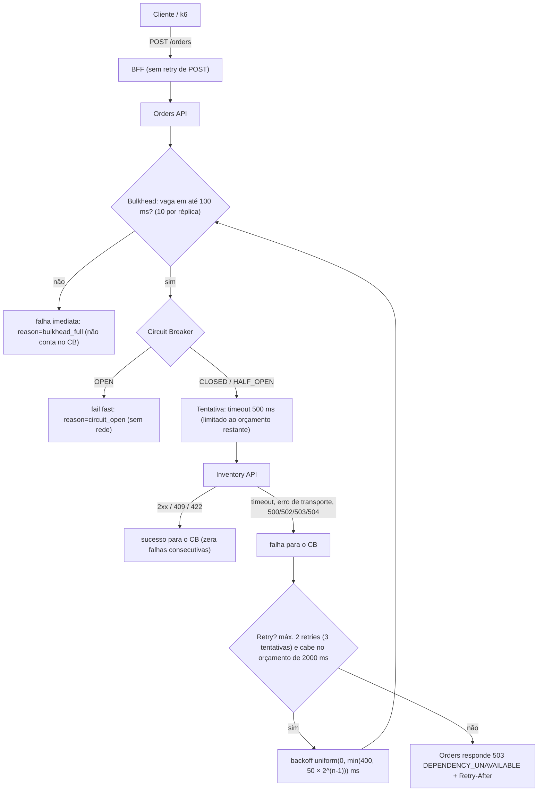
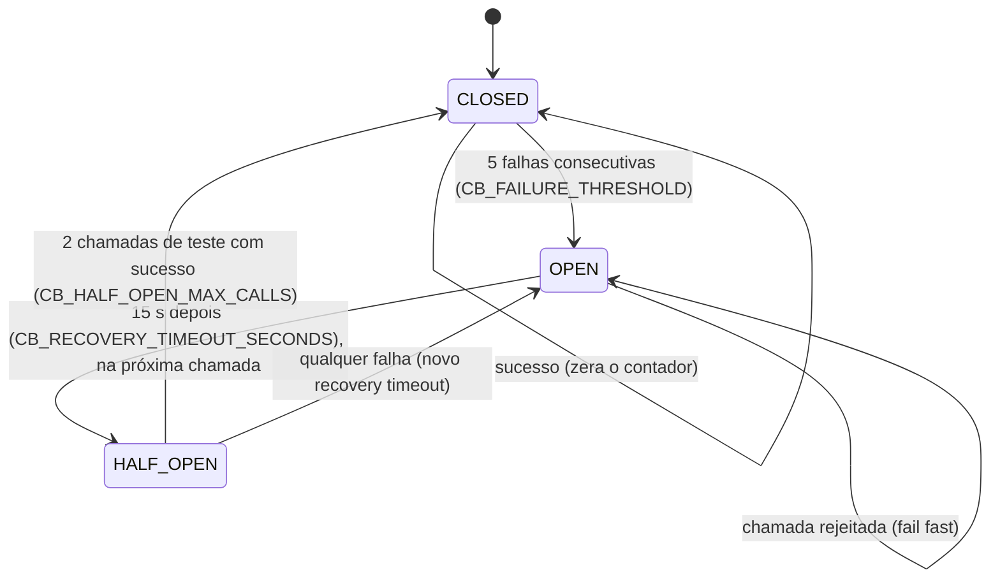
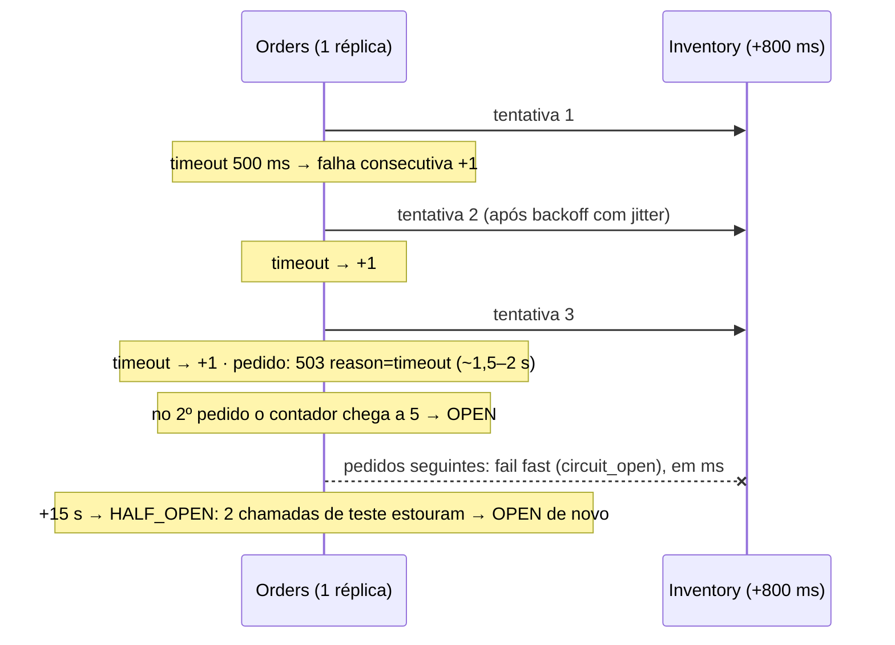
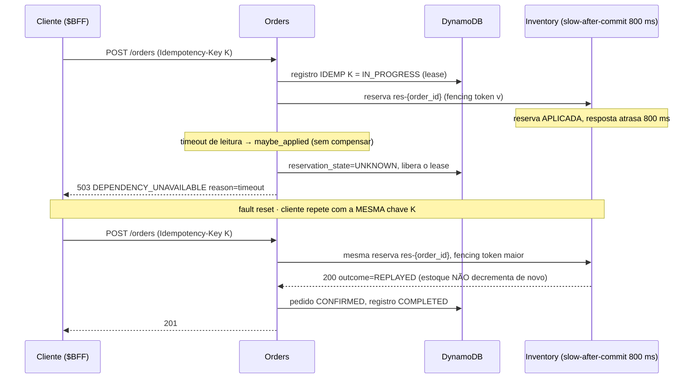

# LAB 07 — Circuit Breaker

> **Break it → Observe it → Understand it → Fix it → Validate it**
>
> Duração estimada: 40 min

---

## 1. Cenário

A Inventory API começa a responder **lentamente** e depois a devolver **HTTP 503**. Sem proteção, cada pedido
ficaria preso esperando a dependência, consumindo conexões, threads e o orçamento de latência do cliente — e os
retries multiplicariam a carga sobre um serviço que já está doente (**retry amplification**).

A Orders API protege a chamada à Inventory com: **timeout** (500 ms), **retry** com backoff exponencial + full jitter
(máx. 2), **orçamento total** por chamada (2000 ms), **bulkhead** (10 chamadas simultâneas por réplica) e um
**Circuit Breaker** local por réplica (`CLOSED` → `OPEN` → `HALF_OPEN` → `CLOSED`).

Caminho de cada chamada da Orders à Inventory (`apps/orders-api/app/inventory_client.py`):



Estados do Circuit Breaker (por réplica; `apps/orders-api/app/circuit_breaker.py`, ConfigMap `orders-config`):



## 2. Hipótese

1. Com latência > timeout, cada réplica da Orders acumula falhas consecutivas e abre o circuito após **5** falhas.
2. Com o circuito `OPEN`, os pedidos falham **rápido** (`503`, `reason=circuit_open`) em vez de esperar timeouts.
3. Após **15 s**, o circuito vai a `HALF_OPEN` e permite no máximo **2** chamadas de teste; se a dependência ainda
   falha, volta a `OPEN`; se as 2 têm sucesso, volta a `CLOSED`.
4. Nenhum pedido é duplicado e nenhuma reserva é compensada "às cegas" durante a falha.

## 3. Pré-requisitos

- LAB 01 concluído; `scripts/reset.sh` executado.
- HyperDX acessível: `kubectl -n observability port-forward svc/clickstack-app 3000:3000`.
- Três terminais: **T1** injeção de falhas, **T2** `watch-cb.sh`, **T3** carga k6.

Parâmetros efetivos (ConfigMap `orders-config`):

```text
CB_FAILURE_THRESHOLD=5            CB_RECOVERY_TIMEOUT_SECONDS=15     CB_HALF_OPEN_MAX_CALLS=2
INVENTORY_TIMEOUT_MS=500          INVENTORY_MAX_RETRIES=2            INVENTORY_CALL_BUDGET_MS=2000
INVENTORY_RETRY_BASE_MS=50        INVENTORY_RETRY_MAX_BACKOFF_MS=400 INVENTORY_MAX_CONCURRENT_REQUESTS=10
```

```bash
kubectl -n ecommerce get configmap orders-config -o yaml | grep -E "CB_|INVENTORY_"
```

## 4. Estado inicial

```bash
scripts/fault.sh inventory status     # "fault_mode": "NONE"
scripts/fault.sh orders cb            # todas as réplicas: "state": "CLOSED"
kubectl -n ecommerce get pods -l app.kubernetes.io/name=orders-api
```

## 5. Comandos executáveis

```bash
# T2 — painel do Circuit Breaker (estado de CADA réplica a cada 3s)
labs/lab-07/watch-cb.sh

# T3 — carga constante; sem retry do cliente para enxergar o comportamento "cru"
scripts/k6.sh create-orders.js RATE=5 DURATION=5m RETRY_ON_ERROR=false
```

### 5.1 Latência acima do timeout

```bash
# T1 — 800 ms ANTES de processar, em TODAS as rotas (consulta de estoque e reservas)
scripts/fault.sh inventory latency 800
```

Aguarde o circuito abrir em todas as réplicas (T2). Depois de ~15 s observe a transição para `HALF_OPEN` e o
retorno a `OPEN` (as chamadas de teste ainda estouram o timeout). Sequência registrada na validação real (EKS):

```text
16:45:30 dz4zt HALF_OPEN -> OPEN      # chamada de teste estourou o timeout
16:45:45 dz4zt OPEN -> HALF_OPEN      # +15 s (CB_RECOVERY_TIMEOUT_SECONDS)
16:46:33 dz4zt HALF_OPEN -> CLOSED    # após `scripts/fault.sh inventory reset`: 2 chamadas de teste OK
```

> **Variação didática (granularidade do breaker):** com `scripts/fault.sh inventory latency 800 RESERVATIONS`
> o circuito **oscila**: em `HALF_OPEN` as chamadas de teste costumam ser o `GET /inventory/{sku}` do precheck
> (rápido, não afetado), que fecha o circuito; logo depois a reserva volta a estourar o timeout e o circuito
> reabre. Um único breaker por dependência mistura operações com perfis de falha diferentes — discuta
> breakers por operação no Challenge.

Fluxo esperado com `latency 800` (cada tentativa estoura os 500 ms):



### 5.2 Recuperação

```bash
scripts/fault.sh inventory reset
```

Em até ~15 s cada réplica vai a `HALF_OPEN`, as 2 chamadas de teste têm sucesso e o estado volta a `CLOSED`.

### 5.3 HTTP 503

```bash
scripts/fault.sh inventory http-503          # alvo ALL: precheck e reservas
# ... observe OPEN / fail fast ...
scripts/fault.sh inventory reset
```

Com 503 o fluxo é o mesmo da 5.1, mas **sem esperar timeout**: cada tentativa falha na hora, então o circuito abre
mais rápido e o pedido falha em poucos ms já antes do `OPEN`.

### 5.4 Bulkhead (limite de concorrência)

```bash
scripts/fault.sh inventory latency 400 RESERVATIONS     # abaixo do timeout: chamadas lentas, mas bem-sucedidas
scripts/k6.sh stress-orders.js RATE=60 DURATION=2m RAMP=30s
scripts/fault.sh inventory reset
```

Com 10 chamadas simultâneas por réplica e ~0,4 s por chamada, cada réplica comporta ~25 reservas/s. Acima disso as
chamadas excedentes falham em 100 ms com `reason=bulkhead_full` — sem fila ilimitada, e **sem** contar como falha
do Circuit Breaker. A própria Inventory também limita concorrência (`INVENTORY_MAX_CONCURRENT_REQUESTS=10` →
`503 TOO_MANY_CONCURRENT_REQUESTS`), e isso conta como falha.

### 5.5 Resposta lenta APÓS aplicar o efeito (resultado desconhecido)

```bash
scripts/fault.sh inventory slow-after-commit 800
```

Crie um pedido manualmente com uma chave conhecida, pela BFF pública (NLB):

```bash
export BFF=http://$(kubectl -n ecommerce get svc bff-api-public -o jsonpath='{.status.loadBalancer.ingress[0].hostname}')
KEY=$(python3 -c 'import uuid; print(uuid.uuid4())')
BODY='{"customer_id":"customer-lab07","items":[{"sku":"product-002","quantity":1,"unit_price":"51.90"}]}'
curl -s -i -X POST $BFF/orders -H "Content-Type: application/json" -H "Idempotency-Key: $KEY" -d "$BODY"
# HTTP/1.1 503  {"error":"DEPENDENCY_UNAVAILABLE", ... "reason":"timeout"}

# Estado do registro de idempotência (API admin da Orders, via exec)
for p in $(kubectl -n ecommerce get pod -l app.kubernetes.io/name=orders-api -o name); do
  kubectl -n ecommerce exec ${p#pod/} -c app -- python -c "import urllib.request;print(urllib.request.urlopen('http://127.0.0.1:8081/admin/idempotency/customer-lab07/$KEY').read().decode())" 2>/dev/null && break
done
# "status": "IN_PROGRESS", "reservation_state": "UNKNOWN"

scripts/fault.sh inventory state      # a reserva FOI aplicada (reservations_total +1) apesar do timeout

scripts/fault.sh inventory reset
curl -s -i -X POST $BFF/orders -H "Content-Type: application/json" -H "Idempotency-Key: $KEY" -d "$BODY"
# HTTP/1.1 201 — pedido CONFIRMED reutilizando a MESMA reserva (o estoque não é decrementado de novo)
scripts/fault.sh inventory state
```

> O registro de idempotência pode ser lido por qualquer réplica (está no DynamoDB); o laço acima só pega a primeira
> que responder.

Fluxo do caso 5.5 (o efeito acontece, a resposta não chega a tempo):



| Cenário | Ação | Comportamento esperado | Como verificar |
|---|---|---|---|
| 5.1 Latência > timeout | `fault.sh inventory latency 800` | cada réplica abre o CB após 5 falhas consecutivas; pedidos passam de ~1,5–2 s a falha rápida | T2 `OPEN`; k6 `http_req_duration` cai; logs `Circuit breaker transition` |
| 5.1 Recovery com falha ativa | aguardar ~15 s | `OPEN → HALF_OPEN → OPEN` (testes estouram o timeout) | T2; logs `HALF_OPEN -> OPEN` |
| 5.1 variação | `latency 800 RESERVATIONS` | CB **oscila**: testes do precheck fecham, reserva reabre | T2 alternando `CLOSED`/`OPEN` |
| 5.2 Recuperação | `fault.sh inventory reset` | em até ~15 s: `HALF_OPEN`, 2 testes OK, `CLOSED` | T2 `CLOSED`, `consecutive_failures: 0` |
| 5.3 HTTP 503 | `fault.sh inventory http-503` | falhas imediatas, CB abre mais rápido que na 5.1; `503 reason=circuit_open` | T2 `OPEN`; `orders.failed` por `reason` |
| 5.4 Bulkhead | `latency 400 RESERVATIONS` + `stress-orders.js RATE=60` | acima de ~25 reservas/s por réplica: falha em 100 ms com `bulkhead_full`, **sem** abrir o CB | `inventory.bulkhead.rejected`; `orders.failed{reason=inventory_bulkhead_full}`; CB segue `CLOSED` |
| 5.4 limite da Inventory | mesma carga | `503 TOO_MANY_CONCURRENT_REQUESTS` da Inventory **conta** como falha | logs da Inventory; CB pode abrir |
| 5.5 Resultado desconhecido | `slow-after-commit 800` + `curl` | `503 reason=timeout`; registro `IN_PROGRESS` / `reservation_state=UNKNOWN`; reserva aplicada | admin `/admin/idempotency/…`; `fault.sh inventory state` (`reservations_total +1`) |
| 5.5 Retry com a mesma chave | `fault.sh inventory reset` + mesmo `curl` | `201`, pedido `CONFIRMED`, reserva `REPLAYED`; estoque decrementado **uma vez** | `fault.sh inventory state` sem novo decremento |

## 6. Falha provocada

| Falha | Comando | Efeito |
|---|---|---|
| Latência 800 ms antes de processar | `fault.sh inventory latency 800` | timeouts de leitura (500 ms) → retries → falhas consecutivas |
| HTTP 503 | `fault.sh inventory http-503` | falha imediata, transitória |
| Latência + concorrência | `latency 400` + `stress-orders.js` | bulkhead cheio / limite da Inventory |
| Efeito aplicado, resposta lenta | `fault.sh inventory slow-after-commit 800` | resultado desconhecido (`reservation_state=UNKNOWN`) |

## 7. Observações

**Terminal (`watch-cb.sh`)**

```text
10:12:03
  orders-api-6c9…-abcde   CLOSED    falhas_consecutivas=3 open_restante=0.0s
  orders-api-6c9…-fghij   OPEN      falhas_consecutivas=0 open_restante=11.2s
10:12:18
  orders-api-6c9…-fghij   HALF_OPEN falhas_consecutivas=0 open_restante=0.0s
```

Cada réplica muda de estado em momentos diferentes: **o estado é local ao Pod** (limitação do MVP).

**k6:** `http_req_duration` cai de ~1,5–2 s (timeouts + retries) para alguns ms quando o circuito abre;
`http_req_failed` fica alto (503) enquanto a dependência está doente.

**HyperDX — Traces** (source Traces):

```text
ServiceName:"orders-api" SpanName:"Inventory reserve"
```

No detalhe do span veja os **eventos** `attempt.failed` (`attempt`, `reason=timeout`), `retry`
(`attempt`, `backoff_ms`, `reason`), `retry.budget_exhausted` e, com o circuito aberto, `circuit_breaker.open`
(`retry_after`) e o atributo `circuit_breaker.rejected=true`. O atributo `inventory.attempts` mostra quantas
tentativas foram feitas; `inventory.outcome_unknown=true` aparece no caso 5.5.

**HyperDX — Logs** (source Logs):

```text
ServiceName:"orders-api" Body:"Circuit breaker transition"
ServiceName:"orders-api" Body:"Retry para Inventory API"
ServiceName:"orders-api" Body:"Inventory API indisponível"
```

Atributos: `circuit_breaker.name`, `circuit_breaker.from`, `circuit_breaker.to`; `retry.attempt`, `retry.backoff_ms`,
`retry.reason`; `dependency.reason`, `reservation.state`, `idempotency.key`, `order.id`.

**HyperDX — Metrics:**

| Métrica | Atributos | Leitura |
|---|---|---|
| `circuit_breaker.state` (gauge) | `circuit_breaker.name` | 0=CLOSED, 1=HALF_OPEN, 2=OPEN (por Pod via `ResourceAttributes.k8s.pod.name`) |
| `circuit_breaker.transitions` | `from_state`, `to_state` | contagem de transições |
| `circuit_breaker.rejected_requests` | `state` | chamadas rejeitadas em fail fast |
| `inventory.retry.attempts` | `operation` (`get_stock`, `reserve`, `release`) | volume de retries |
| `inventory.bulkhead.rejected` | `operation` | rejeições do bulkhead |
| `orders.failed` | `reason` (ex.: `inventory_circuit_open`, `inventory_timeout`, `inventory_bulkhead_full`) | falhas de negócio |

### Achados da validação real (EKS, 2026-10-14)

1. **Balanceamento por conexão, não por requisição.** A BFF reutiliza conexões HTTP keep-alive para o
   ClusterIP da Orders; o kube-proxy balanceia **conexões** (L4). Em taxas baixas (5 req/s) uma única
   conexão carregou todo o tráfego: uma réplica recebeu 448 requisições em 90 s e a outra **zero**. Consequências:
   os circuitos de cada réplica evoluem de forma muito diferente, e réplicas novas do HPA podem ficar ociosas.
   Verifique:

   ```bash
   for p in $(kubectl -n ecommerce get pods -l app.kubernetes.io/name=orders-api -o name); do
     echo "$p $(kubectl -n ecommerce logs $p --since=90s | grep -c 'HTTP request completed') req/90s"; done
   ```

2. **O breaker é avaliado sob demanda.** `OPEN → HALF_OPEN` só acontece quando chega uma chamada (ou quando o
   estado é consultado pela API admin). Uma réplica sem tráfego permanece `OPEN`/`HALF_OPEN` indefinidamente —
   o que é correto, mas confunde quem observa só o painel.

## 8. Explicação técnica

- **Timeout** (500 ms por tentativa, limitado pelo orçamento restante de 2000 ms): sem ele, uma dependência lenta
  prende recursos indefinidamente.
- **Retry com backoff exponencial + full jitter**: espera `uniform(0, min(400, 50 × 2^(n-1)))` ms. O jitter evita
  que todas as réplicas repitam ao mesmo tempo (thundering herd). Retry só para falhas **transitórias**
  (timeout, erro de transporte, 500/502/503/504) — nunca para 409/422.
- **Anti-amplificação**: apenas a Orders faz retry (a BFF **não** repete POST); no máximo 2 retries; um retry que
  estouraria o orçamento não é iniciado; `circuit_open` e `bulkhead_full` interrompem imediatamente.
- **Circuit Breaker**: conta falhas **consecutivas** (um sucesso zera). `OPEN` rejeita sem chamar a rede.
  `HALF_OPEN` admite até 2 chamadas simultâneas; 2 sucessos → `CLOSED`; qualquer falha → `OPEN` com novo
  `recovery_timeout`. Bulkhead cheio **não** conta como falha da dependência.
- **Estado local por réplica**: com N réplicas a Inventory pode receber até N × 2 chamadas de teste no `HALF_OPEN`,
  e réplicas novas (HPA) começam `CLOSED`. Um CB distribuído/compartilhado fica para a fase 2.
- **Resultado desconhecido** (5.5): um timeout de **leitura** não diz se a reserva foi aplicada. A Orders marca
  `reservation_state=UNKNOWN`, libera o lease e responde 503 — **sem compensar**. No retry com a mesma
  `Idempotency-Key`, a reserva é repetida com o mesmo `reservation_id` (`res-<order_id>`) e um fencing token maior;
  a Inventory reconhece a reserva existente (`outcome=REPLAYED`, HTTP 200) e não decrementa o estoque de novo.
- **Readiness não verifica a Inventory** de propósito: se verificasse, todas as réplicas da Orders sairiam do Service
  e a falha se propagaria para a BFF (cascata).

## 9. Correção

A "correção" neste laboratório é a **remoção da causa** — o Circuit Breaker não conserta a dependência, ele contém o
dano e acelera a recuperação:

```bash
scripts/fault.sh inventory reset
```

Discussão de ajuste fino (não precisa aplicar): timeout coerente com o p99 real da Inventory, threshold por
**taxa** de falhas numa janela (mais robusto que consecutivas com tráfego alto), recovery timeout com jitter,
e mensagens de degradação para o cliente (DEGRADED mode é fase 2).

## 10. Validação

```bash
scripts/fault.sh orders cb                     # todas as réplicas "state": "CLOSED", "consecutive_failures": 0
scripts/k6.sh create-orders.js RATE=5 DURATION=1m   # thresholds OK
```

| Verificação | Comando / onde | Esperado |
|---|---|---|
| CB fechado em todas as réplicas | `scripts/fault.sh orders cb` | `"state": "CLOSED"`, `"consecutive_failures": 0` |
| Tráfego normal | `scripts/k6.sh create-orders.js RATE=5 DURATION=1m` | thresholds OK (`http_req_failed < 5%`) |
| Ciclo completo do CB | HyperDX Logs `Body:"Circuit breaker transition"` | `CLOSED→OPEN`, `OPEN→HALF_OPEN`, (`HALF_OPEN→OPEN`…), `HALF_OPEN→CLOSED` |
| Fail fast | spans `Inventory reserve` | `circuit_breaker.rejected=true`, evento `circuit_breaker.open` |
| Sem falhas injetadas | `scripts/fault.sh inventory status` | `"fault_mode": "NONE"` |

No HyperDX, a sequência de logs `Circuit breaker transition` de uma réplica deve mostrar
`CLOSED→OPEN`, `OPEN→HALF_OPEN`, (`HALF_OPEN→OPEN`, `OPEN→HALF_OPEN` enquanto a falha persistiu) e `HALF_OPEN→CLOSED`.

## 11. Challenge

1. Use `scripts/fault.sh inventory error-rate 0.3` (30% de 503). O circuito abre? Por que a política de falhas
   **consecutivas** reage pouco a erros intermitentes? Proponha uma política por taxa em janela deslizante.
2. Reduza o timeout de uma réplica em tempo de execução: `scripts/fault.sh orders inventory-timeout 200` com
   `scripts/fault.sh inventory latency 300 RESERVATIONS`. Calcule quantas tentativas cabem no orçamento de 2000 ms.
3. Com 6 réplicas da Orders, quantas chamadas de teste a Inventory recebe no pior caso durante o `HALF_OPEN`?
4. Por que o cliente k6 com `RETRY_ON_ERROR=true` **não** causa duplicidade de pedidos? (Dica: `Idempotency-Key`.)
5. Granularidade: compare `latency 800` com `latency 800 RESERVATIONS`. Proponha breakers separados para
   consulta e reserva — que trade-offs isso traz?
6. Balanceamento: proponha formas de evitar a concentração de tráfego por keep-alive (reciclagem de conexões,
   balanceamento L7/service mesh, client-side load balancing) — tema da fase 2.

## 12. Critérios de sucesso

- [ ] Circuit Breaker observado em `CLOSED`, `OPEN` e `HALF_OPEN` (terminal e logs) e de volta a `CLOSED`.
- [ ] Fail fast visível: respostas `503` com `reason=circuit_open` em poucos ms.
- [ ] Spans com eventos `retry`/`attempt.failed` e `circuit_breaker.open` encontrados no HyperDX.
- [ ] Métricas `circuit_breaker.state` e `inventory.retry.attempts` consultadas.
- [ ] Caso `slow-after-commit`: `reservation_state=UNKNOWN`, retry com a mesma chave → `201`, estoque decrementado uma única vez.
- [ ] O aluno explica por que o estado do CB é local e quais as implicações.

## 13. Reset

```bash
scripts/fault.sh all reset      # limpa falhas das 3 APIs e reseta o CB de todas as réplicas
scripts/reset.sh
```
